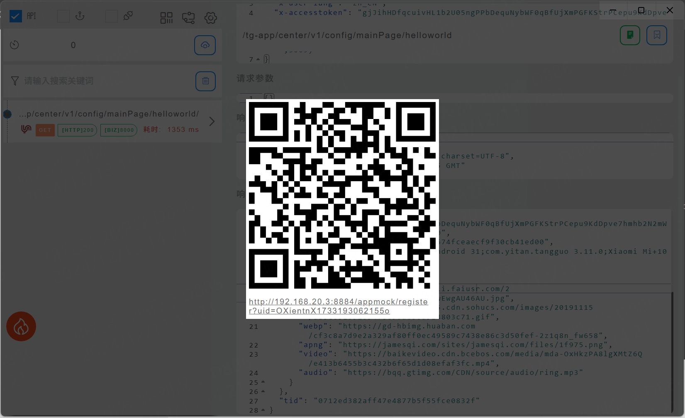
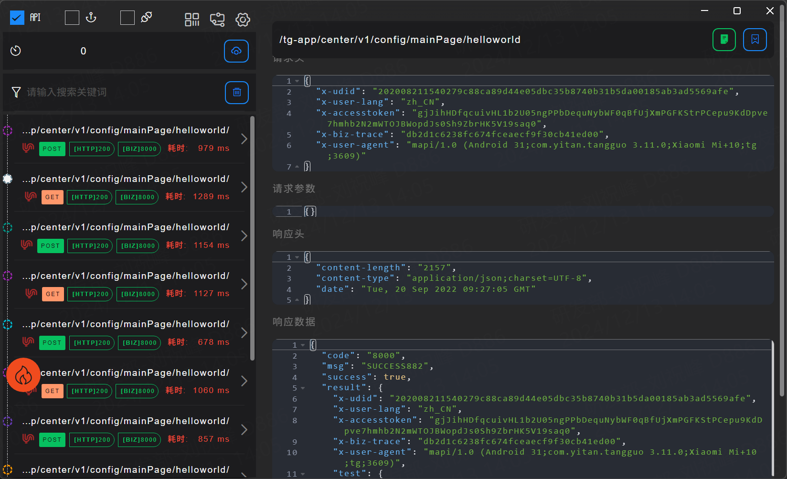
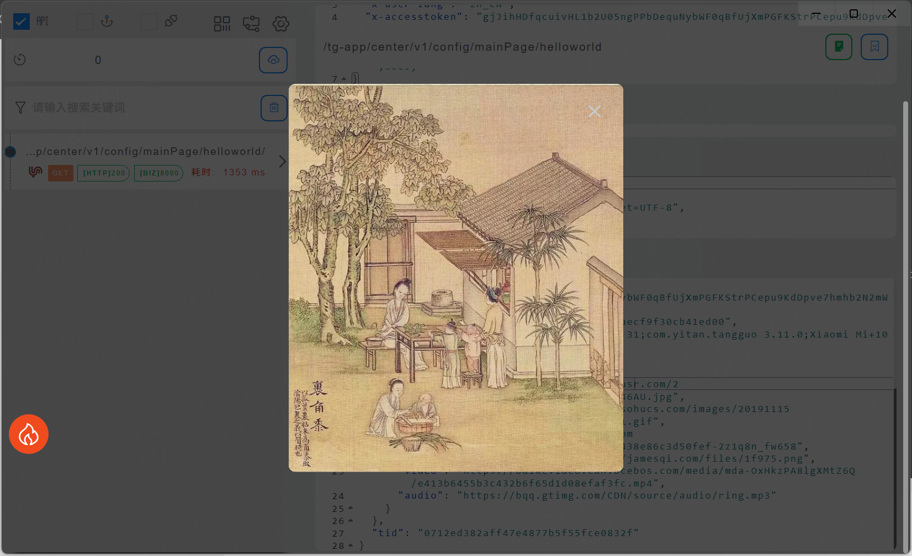
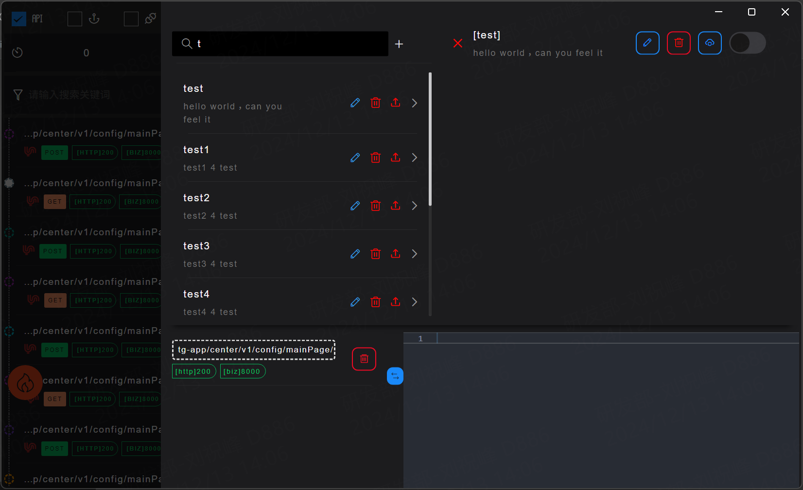
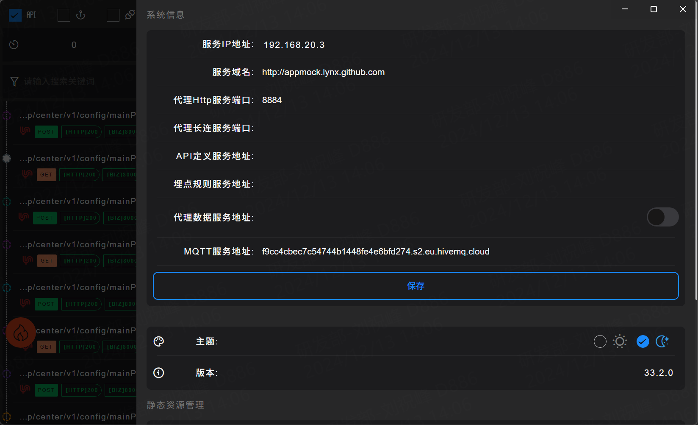

### AppApiProxy


> 详细使用说明：[docs/使用说明.md](./docs/使用说明.md) ｜ [PDF 版](./docs/使用说明.pdf)

> 旨在推动前后端研发分离的效率小工具，方便前端（移动/PC/FE）同学在研发过程透过代理方便地查看请求数据/伪造数据/覆盖边界，结合接口设计可在前后端并行开发中通过数据Mock功能实现对API接口实现依赖的解耦，加速研发流程。
> 原工程[app-mock-desktop](https://github.com/maskerliu/app-mock-desktop) 现在废弃了。
> 欢迎大家试用


> 这是一个集成了vue3+vant+pinia+webpack5的electron项目，应用构建使用electron-builder。
> 使用了[electron-vue-boilerplates](https://github.com/maskerliu/electron-vue-boilerplates)，这是一个支持使用vue3来构建electron应用的脚手架，使用webpack5，参考了[electron-vue](https://github.com/SimulatedGREG/electron-vue)，升级了其老旧的脚本，并使用typescript来实现。











#### Build Setup

``` bash
# install dependencies
yarn 

# serve with hot reload at localhost:9080
yarn dev

# build electron application for production
yarn build

```

#### 接入指南

将请求地址改为 `{代理协议}://{代理IP}:{端口}/_proxy{原始Path}{原始Query}`，并添加请求头：

```http
x-mock-host: https://api.example.com
x-mock-uid: <在线客户端 UID>
```

其中 `x-mock-host` 为原始请求的协议和域名，`x-mock-uid` 为在线客户端的 ID。完整的接入步骤、代码示例和常见问题见 [docs/使用说明.md](./docs/使用说明.md)。