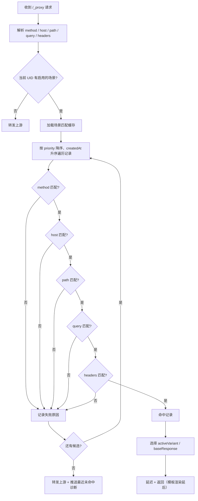

# AppApiProxy PRD — v1.1（0–6 周需求）

> 文档版本：v1.0（评审稿）
> 编写日期：2026-11-05
> 目标版本：v1.1.0
> 关联文档：[产品功能分析与需求规划](./产品功能分析与需求规划.md)
> 需求范围：匹配引擎 v2、结构化响应编辑器、接入向导与诊断、规则导入/导出

---

## 目录

- [1. 背景与目标](#1-背景与目标)
- [2. 用户与场景](#2-用户与场景)
- [3. 总体方案](#3-总体方案)
- [4. 需求详情](#4-需求详情)
  - [4.1 R1 匹配引擎 v2](#41-r1-匹配引擎-v2)
  - [4.2 R2 结构化响应编辑器](#42-r2-结构化响应编辑器)
  - [4.3 R3 接入向导与诊断](#43-r3-接入向导与诊断)
  - [4.4 R4 规则导入/导出](#44-r4-规则导入导出)
- [5. 接口设计](#5-接口设计)
- [6. 数据迁移](#6-数据迁移)
- [7. 非功能需求](#7-非功能需求)
- [8. 指标与埋点](#8-指标与埋点)
- [9. 测试与验收](#9-测试与验收)
- [10. 排期与里程碑](#10-排期与里程碑)
- [11. 风险与依赖](#11-风险与依赖)
- [12. 本期决策与待确认问题](#12-本期决策与待确认问题)
- [附录 A：匹配规则示例](#附录-a匹配规则示例)
- [附录 B：导入/导出格式](#附录-b导入导出格式)
- [附录 C：诊断错误码映射](#附录-c诊断错误码映射)

---

## 1. 背景与目标

### 1.1 背景

当前版本（1.0.4）已经跑通「接入 → 抓包 → 录制 → Mock → 切回真实」的闭环，但 Mock 的实际可用性受限于四个问题：

1. **匹配太刚性**：只按 URL 精确匹配，不区分 Method/Host，Query 顺序和动态参数导致真实 App 的录制规则大面积不命中。
2. **编辑太原始**：整段 JSON 手改，没有状态码/响应头/响应体的结构化编辑，没有变体和模板。
3. **接入门槛高**：新用户需要自己读文档、拼 Header、处理证书，缺少向导和链路自检。
4. **无法沉淀和分享**：规则只能留在本机 PouchDB，不能导出、导入、进 Git。

本期（v1.1，0–6 周）只解决这四件事，目标是让 Mock 从「能演示」变成「日常可用」。

### 1.2 本期目标

| 目标 | 说明 | 对应需求 |
|---|---|---|
| O1：让 Mock 可命中 | 真实项目录制规则无需手改 URL 即可命中 | R1 |
| O2：让 Mock 可编辑 | 结构化编辑响应，支持变体；模板与预览延后 | R2 |
| O3：让接入可自助 | 新用户 10 分钟内完成首个请求和首个 Mock | R3 |
| O4：让规则可流转 | 规则可导出、导入、进 Git、给同事 | R4 |

### 1.3 成功指标（v1.1 发布后 4 周）

| 指标 | 目标 |
|---|---|
| 真实项目规则命中率（无需手改 URL） | ≥ 80% |
| 新用户首次代理请求耗时 | ≤ 10 分钟 |
| 新用户首次 Mock 命中耗时 | ≤ 20 分钟 |
| 规则创建成功率（表单校验通过并保存） | ≥ 95% |
| 导入/导出成功率（合法文件） | ≥ 99% |
| 现有规则迁移丢失率 | 0 |
| 代理额外开销（匹配 + 响应组装，p95） | ≤ 5ms |

### 1.4 范围

**本期包含：**

- 匹配引擎 v2：Method、Host、Path（精确/前缀/通配/正则）、Query 条件与忽略键、Header 条件、优先级、命中诊断。
- 结构化响应编辑器：状态码、响应头、响应体、变体；模板变量与预览延后（见 [4.2.0](#420-落地说明需求调整摘要)）。
- 接入向导：服务检查、代码片段、扫码注册、设备验证、首个 Mock 引导。
- 诊断：服务/设备/链路/上游/Mock 五段自检，错误码映射。
- 规则导入/导出：JSON 规则包、HAR 导入、敏感头脱敏。
- 所需的数据迁移（schema v3）和接口变更。

**本期不包含：**

- 断点、请求/响应改写、Map Local/Map Remote、环境切换（Next）。
- 请求会话持久化、HAR 导出、重放/Composer/对比（Next）。
- 场景/状态机、条件序列、概率失败、弱网模板（Next）。
- OpenAPI 导入与 Schema 校验、WebSocket/gRPC/SSE（Later）。
- MCP/AI、CLI/CI、团队云空间（Later）。
- 请求体匹配（Body 条件）暂不做，避免范围膨胀。

---

## 2. 用户与场景

### 2.1 目标用户

| 用户 | 特征 | 本期最关心 |
|---|---|---|
| 移动端开发 | 有代码权限，能改拦截器；经常真机联调 | 录制一次就能稳定命中；不用手写 JSON |
| PC/H5 开发 | 后端未就绪，需要并行开发 | 快速造响应、切边界数据 |
| 测试工程师 | 不一定能改代码，需要构造异常态 | 结构化编辑、变体、导入同事的规则 |
| 小团队 Tech Lead | 需要把 Mock 样本沉淀和分享 | 导出/导入、规则包进 Git |

### 2.2 核心用户故事

| 编号 | 用户故事 | 优先级 |
|---|---|---|
| US-01 | 作为移动端开发，我录了一条带 `timestamp`/`sign` 的请求，希望不改 URL 也能稳定命中 | P0 |
| US-02 | 作为开发，我希望同一个 Path 的 GET 和 POST 能分别配置 Mock，不互相覆盖 | P0 |
| US-03 | 作为开发，我希望按 Host 区分不同环境的同名接口 | P0 |
| US-04 | 作为测试，我希望不改 JSON 就能把状态码改成 500、把响应体换成空数组 | P0 |
| US-05 | 作为测试，我希望同一个接口保存「正常/空态/错误/超时」多个变体，一键切换 | P0 |
| US-06 | 作为开发，我希望响应里的时间和随机数每次请求都变化，而不是固定值 | P1 |
| US-07 | 作为新用户，我希望跟着向导 10 分钟完成接入和第一个 Mock | P0 |
| US-08 | 作为用户，当 Mock 没生效时，我希望知道为什么没命中 | P0 |
| US-09 | 作为 Tech Lead，我希望把规则导出成文件，提交到 Git 给同事使用 | P1 |
| US-10 | 作为测试，我希望导入 Charles/浏览器导出的 HAR，快速生成 Mock 记录 | P1 |

### 2.3 体验目标（Before / After）

| 环节 | Before（1.0.4） | After（v1.1） |
|---|---|---|
| 录制后命中 | 改 URL、删动态参数、固定签名 | 自动识别动态参数，勾选忽略即可命中 |
| 同路径多方法 | GET/POST 互相覆盖 | Method 独立匹配 |
| 编辑响应 | 手改整段 JSON | 状态码/响应头/响应体分栏 + 变体 |
| 边界数据 | 复制多条记录、手改 | 一个记录多个变体，一键切换 |
| 新用户接入 | 读文档、拼 Header、猜证书 | 向导 + 代码片段 + 链路自检 |
| 未命中 | 不知道为什么 | 显示最接近的规则和差异原因 |
| 分享 | 只能本机使用 | 导出规则包/HAR，导入即用 |

---

## 3. 总体方案

### 3.1 功能结构

```
Mock 规则管理
├── 场景（规则）
│   ├── 记录列表（按 URL/名称检索）
│   └── 记录编辑
│       ├── 响应（状态码 / 响应头 / 响应体）
│       ├── 变体（正常 / 空态 / 错误 / 自定义）
│       ├── 匹配（Method / Host / Path / Query / Header / 优先级）
│       └── 原始 JSON（高级用户逃生口）
├── 导入 / 导出
└── 启用开关（场景级 + 全局）

接入向导
├── 服务检查
├── 代码片段
├── 设备注册
├── 链路验证
└── 第一个 Mock

诊断中心
├── 服务
├── 设备
├── 链路
├── 上游
└── Mock 匹配
```

### 3.2 核心流程

#### 3.2.1 请求匹配流程



#### 3.2.2 编辑与保存流程

```
选择记录 → 加载 MockRecord → 编辑响应/变体/匹配
        → 前端校验 → 保存 → 服务端校验 → 写入 PouchDB
        → 失效匹配缓存 → 下次请求立即生效
```

### 3.3 数据模型（目标态）

```ts
export type MockMethod = 'ANY' | 'GET' | 'POST' | 'PUT' | 'PATCH' | 'DELETE' | 'HEAD' | 'OPTIONS'

export type PathMatchType = 'exact' | 'prefix' | 'glob' | 'regex'

export type ValueOp = 'equals' | 'regex' | 'exists' | 'notExists'

export interface MockQueryCondition {
  key: string
  op: ValueOp
  value?: string
  ignoreCase?: boolean
}

export interface MockQueryMatch {
  mode: 'ignore' | 'match'       // ignore: 不校验 query
  ignoreKeys: string[]           // 比较前剔除的动态参数
  conditions: MockQueryCondition[]
  allowExtra: boolean            // 是否允许请求携带未声明的参数
}

export interface MockHeaderCondition {
  key: string
  op: ValueOp
  value?: string
  ignoreCase?: boolean
}

export interface MockMatchRule {
  method: MockMethod
  host: string                   // '' 或 '*' = 任意；支持 *.example.com
  pathType: PathMatchType
  path: string
  pathIgnoreCase: boolean
  ignoreTrailingSlash: boolean
  query: MockQueryMatch
  headers: MockHeaderCondition[]
  priority: number               // 越大越优先
  enabled: boolean
}

export type MockBodyType = 'json' | 'xml' | 'text' | 'binary'

export interface MockResponseDef {
  statusCode: number
  headers: Record<string, string | string[]>  // 同名多值头，如 set-cookie
  body: string
  bodyType: MockBodyType
  bodyEncoding?: 'utf8' | 'base64'            // binary 固定为 base64
  delayMs: number                // 0 表示使用设备级延迟
}

export interface MockVariant extends MockResponseDef {
  id: string
  name: string
  updatedAt?: number
}

export interface MockRecordSource {
  url: string
  method: string
  headers?: Record<string, any>
  requestBody?: string
  capturedAt?: number
}

export interface MockRecord {
  id: string                     // 对应 PouchDB _id
  ruleId: string
  name: string
  // 目标态：R1 接入后使用 match；当前实现暂用 url: string，按 ruleId + url 精确命中
  match: MockMatchRule
  response: MockResponseDef
  variants: MockVariant[]
  activeVariantId: string | null // null = 使用 base response
  source?: MockRecordSource
  createdAt: number
  updatedAt: number
}
```

**存储文档（PouchDB）：**

```ts
interface MockRecordDoc {
  _id: string                    // 新记录 rec_<uuid>；历史记录保持 rec_<sha1> 不变
  type: 'record'
  ruleId: string
  name: string
  // 目标态：R1 接入后使用 match；当前实现暂用 url: string，按 ruleId + url 精确命中
  match: MockMatchRule
  response: MockResponseDef
  variants: MockVariant[]
  activeVariantId: string | null
  source?: MockRecordSource
  createdAt: number
  updatedAt: number
  // 兼容字段：保留旧结构，便于回滚与旧版本读取
  record?: ProxyMock.ProxyRequestRecord
}

interface MockRuleDoc {
  _id: string                    // rule_<uuid>
  type: 'rule'
  name: string
  desc: string
  createdAt: number
  updatedAt: number
}
```

### 3.4 兼容与迁移原则

1. **旧数据不丢**：迁移只新增字段，不删除旧字段；旧版本仍可读取。
2. **旧行为尽量保留**：历史记录默认 `host=任意`、`method=录制方法`、`path=精确`、`query=全部参数必须匹配且顺序无关`、`allowExtra=false`。
3. **记录 ID 不再随 URL 变化**：历史记录保留原 `_id`；新记录使用 UUID。修改 URL/匹配条件不再重建文档。
4. **迁移幂等**：重复执行不产生重复数据；迁移前自动备份 PouchDB。
5. **可回滚**：保留旧字段与旧规则文档；回滚旧版本可继续工作。

---

## 4. 需求详情

### 4.1 R1 匹配引擎 v2

#### 4.1.1 目标

让真实 App 的录制规则在动态参数、多方法、多 Host 场景下稳定命中，并在未命中时给出可解释的原因。

#### 4.1.2 用户故事

- US-01：录制带 `timestamp`/`sign` 的请求，勾选忽略后稳定命中。
- US-02：GET 与 POST 同 Path 分别配置。
- US-03：按 Host 区分不同环境的同名接口。
- US-08：未命中时看到最接近的规则和差异原因。

#### 4.1.3 功能规则

##### 1）匹配维度

| 维度 | 匹配方式 | 默认值 | 说明 |
|---|---|---|---|
| Method | `ANY` / 具体方法 | 录制时的 Method；缺失则 `ANY` | 大小写不敏感 |
| Host | 任意 / 精确 / `*.example.com` | 任意 | 来源为 `x-mock-host`，只取 hostname + port |
| Path | 精确 / 前缀 / 通配 / 正则 | 精确 | 匹配 `/_proxy` 之后的 pathname |
| Query | 忽略 / 条件匹配 | 条件匹配 | 支持忽略键、顺序无关、允许额外参数 |
| Header | 条件匹配 | 无 | 键名大小写不敏感 |
| Priority | 数值排序 | 0 | 越大越优先；相同按创建时间升序 |

##### 2）Path 匹配规则

| 类型 | 规则 | 示例 |
|---|---|---|
| exact | 字符串完全相等（可选忽略大小写/尾斜杠） | `/v1/users/10086` |
| prefix | 以 pattern 开头 | `/v1/users/` |
| glob | `*` 匹配任意字符（含 `/`），`?` 匹配单个字符 | `/v1/users/*` |
| regex | JavaScript 正则，长度 ≤ 200，保存时校验 | `^/v1/users/\d+$` |

- 默认大小写敏感；`pathIgnoreCase` 可选。
- 默认忽略尾斜杠：`/a` 与 `/a/` 视为相同。
- 正则仅作为高级选项，UI 需提示性能风险；拒绝明显灾难性回溯的模式（如嵌套量词）。

##### 3）Query 匹配规则

- 解析使用 `URLSearchParams`，多值参数保留数组。
- `mode=ignore`：完全不校验 Query。
- `mode=match`：
  1. 先剔除 `ignoreKeys` 中的键；
  2. 所有 `conditions` 按 AND 关系匹配；
  3. `allowExtra=true` 时允许请求携带未声明参数；`false` 时存在未声明参数即失败；
  4. 参数顺序不影响匹配。
- 条件操作符：

| 操作符 | 规则 |
|---|---|
| equals | 任一值完全相等（可忽略大小写） |
| regex | 任一值匹配正则 |
| exists | 键存在即可，值不限 |
| notExists | 键不存在 |

- **动态参数识别（辅助，不自动修改规则）：**
  - 键名命中：`ts`、`timestamp`、`_t`、`time`、`nonce`、`sign`、`signature`、`token`、`access_token`、`deviceId`、`device_id`、`udid`、`imei`、`oaid`、`idfa`、`requestId`、`traceId`、`sessionId`、`version`、`v` 等。
  - 值形态命中：13/10 位时间戳、UUID、长十六进制、长 Base64。
  - 同一场景下相同 Path 的多次录制中，值发生变化的键。
  - UI 展示「发现 N 个可能变化的参数」，用户点击「加入忽略列表」后才生效。

##### 4）匹配算法（伪代码）

```ts
function matchRequest(req: NormalizedRequest, ruleId: string): MatchResult {
  const candidates = matcherCache.get(ruleId) // 按 priority desc, createdAt asc 预排序
  let closest: MissDiagnostic | null = null

  for (const record of candidates) {
    if (!record.match.enabled) continue
    const result = evaluate(record.match, req)
    if (result.ok) return { record, miss: null }
    if (closest == null || result.failures.length < closest.failures.length) {
      closest = { recordId: record.id, name: record.name, failures: result.failures }
    }
  }

  return { record: null, miss: closest }
}
```

`evaluate` 依次校验 method → host → path → query → headers，全部通过才命中；失败时记录维度、期望值、实际值。

##### 5）优先级与冲突

- 同一场景内按 `priority` 降序匹配；`priority` 相同按 `createdAt` 升序（先录制的优先）。
- 命中第一条即返回，不再继续匹配。
- UI 记录列表显示优先级，支持上移/下移或直接输入数值。
- 同一场景内允许存在多条相同 Path 的记录（不同 Method/Query/变体），不再互相覆盖。

##### 6）场景启用与状态持久化

- 保持「一个 viewer 同时只启用一个场景」的模型。
- 新增**全局 Mock 开关**：主界面顶部显示「Mock 已启用：场景名」/「Mock 已关闭」，点击可快速开关当前场景，不必打开规则管理。
- **持久化最近启用场景**：
  - 在 PouchDB meta 文档保存 `lastActiveRuleId`。
  - 应用启动或 viewer 重新注册后，自动恢复该场景的启用状态。
  - 场景被删除时清空 `lastActiveRuleId`。
- 设备（device）继续继承其 owner viewer 的启用状态。

##### 7）未命中诊断

- 代理在未命中时计算「最接近的记录」：
  - 优先选择失败维度最少、Path 相似度最高的记录；
  - 仅当该记录与请求的 Path 有较高相似度（同前缀或同首段）时，才在列表显示「Mock 未命中」标记，避免每条请求都提示。
- 诊断内容：

```ts
interface MockMissDiagnostic {
  ruleId: string
  closestRecordId?: string
  closestRecordName?: string
  failures: Array<{
    dimension: 'method' | 'host' | 'path' | 'query' | 'header'
    expected: string
    actual: string
    detail?: string
  }>
}
```

- 展示位置：
  - 请求详情新增「Mock 匹配」区块；
  - 列表行显示灰色「未命中」标签（仅高相似度时）；
  - 点击标签打开诊断面板，展示失败维度与一键「编辑该规则」。
- 若当前没有启用场景，不显示未命中诊断，改为提示「当前未启用 Mock 场景」。

##### 8）性能与缓存

- 每个场景维护一份内存匹配缓存：`Map<ruleId, { version, compiledRecords }>`。
- 场景记录变更（保存/删除/导入/启用/迁移）时失效缓存。
- 单场景最多加载 5,000 条记录参与匹配；超过时提示用户拆分场景，并只匹配前 5,000 条（按 priority/createdAt）。
- 目标：1,000 条记录下单次匹配 ≤ 1ms；正则编译只做一次。
- 正则安全：长度 ≤ 200；保存时拒绝明显灾难性回溯模式；执行不引入额外依赖。

#### 4.1.4 数据模型变更

- `MockRecordDoc` 新增：`name`、`match`、`response`、`variants`、`activeVariantId`、`source`。
- 历史记录保留 `record` 字段，作为来源快照与回滚依据。
- `MockRuleDoc` 不变；meta 文档新增 `lastActiveRuleId`。
- `MockRecord.id` 对应 `_id`：
  - 历史记录：保持 `rec_<sha1(ruleId + url)>`；
  - 新记录：`rec_<uuid>`。
- 不再使用 `record.url` 作为记录唯一键；修改 URL 只更新内容，不重建文档。

#### 4.1.5 UI 交互

**记录列表：**

- 显示：名称（默认取 Path）、Method、Host、优先级、启用状态、变体数。
- 支持搜索：名称、Path、Host。
- 支持排序：优先级 / 创建时间 / 更新时间。
- 同 Path 多方法不再合并。

**匹配 Tab：**

- Method：下拉（ANY + 常见方法）。
- Host：输入框，空 = 任意；支持 `*.example.com`。
- Path：类型下拉 + 输入框；正则模式显示「高级」提示。
- Query：
  - 模式切换：忽略 / 匹配；
  - 条件表格：键、操作符、值、忽略大小写；
  - 忽略键：标签输入，展示自动识别建议；
  - 允许额外参数：开关（新记录默认开，历史记录默认关）。
- Header：
  - 条件表格：键、操作符、值；
  - 常用 Header 建议：`x-tenant-id`、`x-user-role`、`x-exp`。
- 优先级：数字输入 + 上移/下移。
- 启用：开关。
- 底部：实时「用当前请求测试匹配」按钮（如果有选中的实时请求）。

**未命中面板：**

- 标题：`未命中：最接近「{记录名}」`
- 表格：维度 / 期望 / 实际 / 说明
- 操作：`编辑该记录`、`忽略此参数`、`复制诊断信息`

#### 4.1.6 接口变更

| 接口 | 变更 |
|---|---|
| `GET /_appmock/getMockRecords` | 返回新的 `MockRecord` 结构（含 match/response/variants） |
| `POST /_appmock/saveMockRecord` | 入参改为 `{ ruleId, recordId?, record }`；`recordId` 为空表示新建 |
| `POST /_appmock/deleteMockRecord` | 入参改为 `{ ruleId, recordId }` |
| `GET /_appmock/getActiveMockRule` | 返回当前启用场景；若内存无状态则从 `lastActiveRuleId` 恢复 |
| `POST /_appmock/saveMockRule` | 保持 `isMock` 语义；同步写入/清除 `lastActiveRuleId` |
| `POST /_appmock/matchMockRecord` | 新增：用指定请求上下文测试匹配，返回命中记录或诊断 |
| `GET /_appmock/getMockMiss` | 可选：按 requestId 查询未命中诊断（若未随推送返回） |

#### 4.1.7 边界与异常

| 场景 | 行为 |
|---|---|
| 历史记录没有 `method` | `method=ANY` |
| 历史记录 URL 无法解析 | 迁移时跳过并记录错误，不阻塞启动；该记录标记 `matchInvalid` |
| 正则非法 | 保存失败，提示具体错误；不影响其他记录 |
| 场景记录超过 5,000 条 | 启动匹配时告警；只加载前 5,000 条，并在 UI 提示 |
| 未启用场景 | 不匹配，直接转发；不显示未命中诊断 |
| 设备 UID 离线 | 沿用现有逻辑：无记录、无 Mock；诊断提示 UID 不匹配 |
| 同一优先级多条命中 | 按 createdAt 升序，先录制者优先 |
| Query 键重复 | 多值比较，任一值满足条件即通过 |
| Header 值包含换行 | 校验拒绝，避免响应头注入 |

#### 4.1.8 验收标准

| 编号 | Given / When / Then |
|---|---|
| AC-R1-01 | Given 录制了 `GET /v1/users?ts=123&sign=abc&id=1`，When 把 `ts`、`sign` 加入忽略列表，Then 请求 `?ts=456&sign=xyz&id=1` 命中 |
| AC-R1-02 | Given 同一 Path 有 GET 和 POST 两条记录，When 分别发送 GET/POST，Then 各自命中，不互相覆盖 |
| AC-R1-03 | Given 两条记录 Host 分别为 `api.dev.com` 和 `api.test.com`，When 请求带对应 `x-mock-host`，Then 命中正确记录 |
| AC-R1-04 | Given Path 配置 `/v1/users/*`，When 请求 `/v1/users/10086`，Then 命中 |
| AC-R1-05 | Given 场景内两条记录 priority 分别为 10 和 0 且都匹配，When 请求，Then 命中 priority=10 的记录 |
| AC-R1-06 | Given 请求未命中但存在相似 Path 记录，When 查看详情，Then 显示失败维度和期望/实际值 |
| AC-R1-07 | Given 应用重启，When 打开主界面，Then 上次启用的场景自动恢复 |
| AC-R1-08 | Given 1,000 条记录，When 连续发送 1,000 次请求，Then 匹配 p95 ≤ 5ms，无内存持续增长 |
| AC-R1-09 | Given 历史规则，When 升级到 v1.1，Then 原有命中行为保持（除 Query 顺序变为不敏感外），无数据丢失 |

---

### 4.2 R2 结构化响应编辑器

#### 4.2.0 落地说明：需求调整摘要

截至 2026-11-06，R2 已交付「结构化响应编辑 + 变体 + 原始 JSON」链路，模板变量与预览整体延后到后续版本。实现过程中对原需求的调整如下：

| 原需求 | 最终实现 | 调整原因 |
|---|---|---|
| 状态码 / 响应头 / 响应体 / 延迟 / 变体结构化编辑 | 已交付 | — |
| 模板变量、测试渲染、`previewMockRecord` | **本期未实现**；`{{...}}` 按原文返回 | W4 R2-b（模板与预览）未进入本期交付，先保证编辑、存储、命中链路 |
| 编辑器 4 个 Tab（响应 / 变体 / 匹配 / 原始） | 本期 3 个 Tab（响应 / 变体 / 原始），无「匹配」 | R1 匹配引擎未接入，记录仍按 `ruleId + url` 精确命中 |
| 切换当前变体后立即保存 | 改动进入草稿，保存按钮 / Ctrl+S 显式保存 | 与统一未保存保护一致，避免每次点击都写库 |
| 记录列表行显示当前变体名 | 列表显示有效状态码、变体数量、「当前」标记；变体名在变体条中展示 | 列表行宽有限，避免名称被截断 |
| 响应头保存时过滤逐跳头 | 保存时只校验；实际发送与录制回填时统一过滤 | 保留用户配置，同时保证不透传非法/长度/压缩头 |
| 响应体上限 1MB（模板输出） | 编辑与存储上限 2MB | 评审结论：模板输出上限不覆盖编辑与存储 |
| 原始 JSON 默认折叠 | 独立「原始」Tab，点「应用」后仍需保存 | 与 Tab 布局一致；服务端保存前统一校验 |
| 新增 `getMockRecord` 单条接口 | 未新增；使用分页列表 + 保存返回 `{ id, updatedAt }` | 当前页面模型足够，减少一个接口 |
| 并发保存 409 自动重试 | PouchDB 版本冲突内部重试 2 次；用户级乐观锁冲突直接提示刷新 | 区分内部版本冲突与用户并发编辑 |

实现位置：`src/shared/mock.validation.ts`（校验与归一化）、`src/shared/proxy.models.ts`（模型与有效响应）、`src/main/service/mock.service.ts`（命中与发送）、`src/main/repository/mock.repo.ts`（存储与迁移）、`src/renderer/pages/proxy/mock/`（编辑器组件）、`src/renderer/pages/proxy/MockRuleMgr.vue`（列表、保存与未保存保护）。

#### 4.2.1 目标

本期把「手改整段 JSON」升级为「状态码 + 响应头 + 响应体 + 变体」的结构化编辑，让开发和测试都能快速构造响应；模板变量与预览作为后续版本能力。

#### 4.2.2 用户故事

- US-04：不改 JSON，改状态码、响应头、响应体。
- US-05：同一接口保存多个变体，一键切换。
- US-06（后续版本）：响应中的时间/随机数每次变化。

#### 4.2.3 功能规则

##### 1）响应基础字段

| 字段 | 规则 | 默认 |
|---|---|---|
| statusCode | 100–599 整数 | 200 |
| headers | 键值对列表；键名合法 token；值不允许 CRLF；保存时校验，发送时再统一过滤 | 继承录制响应头，过滤逐跳头 |
| body | 文本；JSON / XML / Text 按类型选择 Ace 语言；上限 2MB | 录制响应体 |
| bodyType | json / xml / text / binary；binary 以 base64 存储 | 由 Content-Type 推断 |
| bodyEncoding | utf8 / base64；与 bodyType 配套 | binary 时为 base64，其余不写 |
| delayMs | 0–60,000 整数；0 表示使用设备级延迟 | 0 |

- 二进制响应：切换为 binary 时，当前文本按 UTF-8 转为 base64；编辑器只展示体积与提示，不提供正文编辑；发送时按 base64 解码为 Buffer。需要直接修改二进制内容时走「原始」Tab。
- 响应头在保存时只校验名称合法性与 CRLF；在实际命中发送、以及从录制记录回填时，统一过滤逐跳头、`content-length`、`content-encoding`，多值头（如 `set-cookie`）以数组逐条保留。
- JSON 响应体允许保存非法 JSON（用于测试异常解析），但编辑器显示警告，不阻塞保存；发送时按原文返回。
- 响应体超过 2MB 时编辑器显示提示并阻止保存（编辑与存储共用同一上限）。

##### 2）变体

- 每条记录包含：
  - 1 个基础响应（`response`）；
  - 0–20 个变体（`variants`）；
  - `activeVariantId` 指定当前生效的变体；`null` 表示基础响应。
- 变体操作：新增、复制当前、重命名、删除、设为当前。
- 变体字段：名称、状态码、响应头、响应体、延迟。
- 列表展示：变体名、状态码、是否当前；不展示更新时间。
- 新增变体默认复制基础响应；复制变体默认复制当前选中变体，命名为「<原名> - 副本」；新增命名「变体 N」。
- 变体 id 由前端生成（`var_<时间 base36>_<随机>`）；本期不对「原始」Tab 手工粘贴产生的重复 id 做重新生成。
- 切换当前变体只修改草稿，需显式保存（保存按钮 / Ctrl+S）；不自动写库。
- 删除当前变体时，`activeVariantId` 置空，立即回退到基础响应。
- 达到 20 个变体时，新增/复制按钮置灰；服务端保存校验同样拒绝。
- 变体编辑行：名称、状态码、延迟、生效开关、复制/删除（图标按钮）同排；响应头与响应体复用响应表单。

##### 3）模板变量（本期未实现）

> **本期未交付（W4 R2-b）。** 当前响应体与响应头中的 `{{...}}` 原样保存、原样返回，不做解析，也不会产生 warning。以下为后续版本的设计范围。

- 语法：`{{ expression }}`，仅支持白名单函数与请求上下文，**不使用 eval，不执行任意 JS**。
- 作用范围：响应体的字符串内容、响应头的值。
- 内置变量/函数：

| 表达式 | 说明 | 示例输出 |
|---|---|---|
| `{{timestamp}}` | 当前毫秒时间戳 | `1762310400000` |
| `{{timestampSec}}` | 当前秒级时间戳 | `1762310400` |
| `{{uuid}}` | UUID v4 | `3f2c...` |
| `{{randomInt(1,100)}}` | 随机整数（含边界） | `42` |
| `{{randomFloat(0,1,2)}}` | 随机小数 | `0.73` |
| `{{pick("a","b","c")}}` | 随机取一个 | `b` |
| `{{seq}}` | 当前记录命中序号（从 1 开始） | `3` |
| `{{now("YYYY-MM-DD HH:mm:ss")}}` | 格式化当前时间 | `2026-11-05 14:00:00` |
| `{{request.method}}` | 请求方法 | `GET` |
| `{{request.path}}` | 请求 Path | `/v1/users` |
| `{{request.query.id}}` | Query 参数 | `10086` |
| `{{request.header.x-user-id}}` | 请求头 | `u_123` |
| `{{request.body.data.id}}` | 请求 JSON Body 的点路径 | `10086` |

- 未知表达式：渲染为空字符串，并在响应记录中产生 warning。
- 渲染异常：不得导致代理崩溃；返回原始文本或空字符串，并产生 warning。
- 输出上限：单次渲染结果 ≤ 1MB；超限截断并 warning。
- `seq` 按记录维护，存内存；应用重启或手动「重置序号」后归零。

> 以上均为后续版本行为；本期 R2 不包含模板引擎、warning 采集与序号管理。

##### 4）预览（本期未实现）

> **本期未交付（W4 R2-b）。** 编辑器未提供「测试渲染」，服务端也未新增 `previewMockRecord` 接口。以下为后续版本范围。

- 编辑器提供「测试渲染」：
  - 可填写样例请求：Method、Path、Query、Headers、Body；
  - 默认用当前选中的实时请求作为样例；
  - 展示渲染后的完整响应（状态码、响应头、响应体）；
  - 展示 warning 列表（未知变量、渲染失败、超大输出）。
- 预览必须调用服务端渲染接口，保证与真实 Mock 行为一致。

##### 5）编辑器布局

- 顶部：记录名称、路径两行输入，右侧为未保存标记与保存按钮；启用开关在规则级工具栏，不在记录编辑器内。
- Tab（本期 3 个）：
  1. **响应**（默认）：状态码、延迟、响应头折叠卡片、响应体编辑器。
  2. **变体**：顶部横向变体条 + 当前变体编辑（名称、状态码、延迟、生效开关、复制/删除）。
  3. **原始**：完整 `MockRecord` JSON，「应用」到草稿后再保存。
- 响应头：折叠卡片内逐行编辑键值，右上角图标按钮新增，行尾删除；本期无常用 Header 自动补全。
- 响应体编辑器：Ace，支持 JSON / XML / Text；JSON 提供格式化、压缩与非法 JSON 警告；binary 不展示正文编辑器，只显示体积提示。
- 体积显示在响应体工具栏（`体积：xx KB`）；本期无独立底部状态栏与行列数。
- 快捷键：Ctrl/Cmd + S 保存。
- 切换记录、切换规则、新建记录时若有未保存修改，弹出确认；关闭 Mock 弹层不做拦截，草稿随组件卸载丢弃。
- 布局稳定性：
  - 变体条固定高度，超出横向滚动；新增按钮放在滚动区外，始终可见。
  - Tab 导航条不参与 flex 收缩，避免响应头展开导致内容溢出时整个 Tab 区上移。
  - Tab 面板预留滚动条槽位（`scrollbar-gutter: stable`），展开响应头触发滚动时不产生左右位移。
  - 响应体按剩余高度贴合面板底部，正文在 Ace 内部滚动，格式化工具栏不随内容滚出可视区。

##### 6）保存校验

客户端保存前用共享校验器 `validateMockRecord` 提示；服务端 `saveMockRecord` 再次校验并拒绝。错误码与文案一一对应。

| 校验 | 行为 |
|---|---|
| statusCode 非 100–599 | 阻止保存 |
| delayMs 非 0–60,000 整数 | 阻止保存 |
| Header 名非法 | 阻止保存 |
| Header 值含 CRLF | 阻止保存 |
| Path 为空 | 阻止保存 |
| bodyType / bodyEncoding 非法 | 阻止保存 |
| 响应体超过 2MB | 阻止保存 |
| 变体数 > 20 | 阻止新增与保存 |
| `activeVariantId` 不存在 | 阻止保存（提示「当前变体不存在」） |
| 同一规则内 URL 重复 | 阻止保存（提示 `url [x] 已存在`） |
| `expectedUpdatedAt` 与库中不一致 | 阻止覆盖，提示「记录已被其他人修改，请刷新后重试」 |
| JSON 非法 | 警告，不阻止保存 |
| 正则非法 / 模板表达式未知 | 本期不适用（匹配与模板未交付） |

#### 4.2.4 数据模型与存储

见 [3.3](#33-数据模型目标态) 中的 `MockResponseDef`、`MockVariant`、`MockRecord`。本期落地时补充：

- `MockResponseHeaders` 为 `Record<string, string | string[]>`，支持同名多值头。
- `MockResponseDef` 增加 `bodyEncoding?: 'utf8' | 'base64'`；`binary` 时固定为 `base64`。
- `MockRecord.url` 本期仍作为匹配键：命中时按 `ruleId + url` 精确查单条记录，不做 Method / Query / Header 匹配（R1 未接入）。
- 同一规则内 `url` 唯一；重复 URL 保存直接报错，不自动合并。
- 保存返回 `MockRecordSaveResult { id, updatedAt }`，用于后续保存的乐观锁。
- PouchDB 存储拆分为：
  - `rule` 文档：只存规则名称/描述等元信息；
  - `record` 文档：一条记录一个文档，新记录 `_id = rec_<uuid>`，历史迁移记录保留 `rec_<sha1>`；
  - 元信息文档 `mock_schema_meta` 记录 schema 版本；
  - schema v3 迁移旧记录为结构化响应，迁移前生成 `.v3.bak` 备份，失败不阻塞启动；
  - 从 v2 迁移来的记录额外保留旧 `record` 字段以支持版本回滚，新记录不写。
- 记录列表按 `createdAt` 升序分页，单页默认 100、上限 500。

**有效响应解析顺序：**

1. `activeVariantId` 命中某个变体 → 使用该变体；
2. 否则使用基础 `response`；
3. 状态码非法（非 100–599）→ 回退 200，避免 Express 抛 `RangeError`；
4. 延迟：变体 `delayMs > 0` 时覆盖设备级延迟，否则使用设备级延迟；两者不叠加；
5. 响应头过滤逐跳头、`content-length`、`content-encoding`；
6. `binary` / `base64` 响应体按 base64 解码为 `Buffer`；`json` 尝试解析，非法时按原文返回；其余按文本返回；
7. 本期无模板渲染步骤。

#### 4.2.5 UI 交互补充

**变体切换：**

- 记录列表行显示有效状态码、变体数量与「当前」标记，不显示变体名。
- 变体 Tab 顶部横向胶囊条显示每个变体的名称与状态码，点击切换编辑对象；生效开关控制 `activeVariantId`。
- 切换与编辑都只修改草稿，点击保存或 Ctrl+S 后生效并提示「记录已保存」。
- 「复制」按钮复制当前选中变体，默认命名「<原名> - 副本」。
- 变体条固定高度并横向滚动，新增按钮固定在滚动区外；变体按钮宽度随名称增长，本期未做名称省略。

**原始 JSON：**

- 独立「原始」Tab，展示完整 `MockRecord`。
- 点「应用」时先做 JSON 解析与顶层对象校验，非法时用提示条展示，不覆盖草稿。
- 应用后仅更新草稿（名称、路径、响应、变体、`activeVariantId`、来源信息），仍需保存才落库。
- 服务端保存时再执行统一校验与 `normalizeMockRecord`，补齐缺失字段。

**模板插入（本期未实现）：**

- 响应体工具栏不提供「插入变量」菜单；`{{...}}` 需手工输入并按原文保存。
- 「测试渲染」不提供，后续版本随模板引擎一起交付。

**未保存保护与并发：**

- 切换记录、切换规则、新建记录前，若有未保存修改会弹出确认；取消后保留当前编辑内容。
- 保存时携带 `updatedAt` 作为乐观锁；冲突提示「记录已被其他人修改，请刷新后重试」。
- 未保存时关闭 Mock 弹层不做确认，草稿丢失（已知限制）。

#### 4.2.6 接口变更

| 接口 | 最终实现 |
|---|---|
| `POST /_appmock/saveMockRecord` | 已实现。Body 为完整 `MockRecord`，Query `expectedUpdatedAt` 可选；返回 `{ id, updatedAt }`；校验失败返回错误码与 `issues` |
| `POST /_appmock/saveMockRule` | 已实现。只保存规则名称/描述元信息，记录由 `saveMockRecord` 单独维护 |
| `GET /_appmock/getMockRecords` | 已实现。由整包返回改为分页 `{ items, hasMore }`，参数 `ruleId`、`offset`、`limit`（默认 100，上限 500） |
| `POST /_appmock/deleteMockRecord` | 已实现。按 `recordId` 删除单条记录 |
| `POST /_appmock/previewMockRecord` | **未实现**，随模板与预览在后续版本交付 |
| `GET /_appmock/getMockRecord` | **未实现**。单条记录通过分页列表获取，保存返回 `id/updatedAt` |

#### 4.2.7 边界与异常

| 场景 | 行为 |
|---|---|
| 变体 id 冲突 | UI 生成唯一 id；「原始」Tab 手工粘贴重复 id 本期不重新生成（已知限制，首条匹配生效） |
| `activeVariantId` 不存在 | 保存时校验拒绝（提示「当前变体不存在」）；运行期若读到旧数据则回退基础响应 |
| 模板输出超大 | 本期无模板；响应体编辑/存储超过 2MB 阻止保存 |
| 响应头含 `set-cookie` 数组 | 支持数组，发送时逐条写回 |
| bodyType=binary 但 body 非空 | 按 base64 存储、解码发送；编辑器只显示体积，不编辑正文 |
| 设备级延迟与变体延迟同时存在 | 变体 `delayMs > 0` 时覆盖设备延迟，不叠加 |
| 并发保存同一条记录 | `expectedUpdatedAt` 乐观锁；PouchDB 版本冲突内部重试 2 次，仍冲突则提示「记录已被其他人修改，请刷新后重试」 |
| 同一规则内 URL 重复 | 阻止保存并提示 `url [x] 已存在` |
| 状态码非法（历史数据） | 发送前回退 200，避免 Express `RangeError` |
| JSON 响应体非法 | 允许保存；发送时按原文返回 |
| 旧数据升级 | v2 规则/记录自动拆分为独立文档并补齐结构化响应；迁移前备份 `.v3.bak`；迁移记录保留旧 `record` 字段以支持回滚 |
| 关闭 Mock 弹层时存在未保存修改 | 不做拦截，草稿丢弃（已知限制） |
| body 切换为 text/xml 时不是合法 base64 | 保留原文本，不强制转换（`bodyEncoding` 清除） |

#### 4.2.8 验收标准

| 编号 | Given / When / Then | 状态 |
|---|---|---|
| AC-R2-01 | Given 一条录制记录，When 把状态码改为 500、响应体改为 `{"code":5000}`，Then 保存后请求返回 500 和该 Body | 已实现 |
| AC-R2-02 | Given 一条记录，When 新增「空态」「错误」两个变体并切换为「空态」，Then 保存后请求返回空态响应 | 已实现 |
| AC-R2-03 | Given 响应体包含 `{{timestamp}}` 和 `{{uuid}}`，When 连续请求两次，Then 两次值不同且格式正确 | 未实现（后续版本） |
| AC-R2-04 | Given 响应体包含 `{{request.query.id}}`，When 请求 `?id=10086`，Then 返回中包含 `10086` | 未实现（后续版本） |
| AC-R2-05 | Given 未知变量 `{{foo}}`，When 请求，Then 返回空字符串，详情显示 warning，代理不崩溃 | 未实现（后续版本） |
| AC-R2-06 | Given 响应体是非法 JSON，When 保存，Then 允许保存并显示警告，请求按原文返回 | 已实现 |
| AC-R2-07 | Given 变体延迟 2000ms，When 请求，Then 约 2 秒后返回；设备级延迟不叠加 | 已实现 |
| AC-R2-08 | Given 未保存修改，When 切换记录，Then 弹出确认，取消后保留编辑内容 | 已实现 |
| AC-R2-09 | Given 响应头值包含换行，When 保存，Then 阻止并提示 | 已实现 |
| AC-R2-10 | Given 20 个变体，When 再新增，Then 新增按钮置灰且保存校验拒绝 | 已实现 |
| AC-R2-11 | Given 响应体超过 2MB，When 保存，Then 阻止并提示「响应体超过 2MB」 | 已实现 |
| AC-R2-12 | Given 同一规则已存在 URL A，When 新建另一条 URL A 的记录并保存，Then 阻止并提示 URL 已存在 | 已实现 |
| AC-R2-13 | Given 两个窗口编辑同一记录，When 后保存者使用过期 `updatedAt`，Then 提示「记录已被其他人修改，请刷新后重试」 | 已实现 |
| AC-R2-14 | Given 响应体切换为 binary，When 保存并请求，Then 返回的字节与切换前文本的 UTF-8 编码一致 | 已实现 |
| AC-R2-15 | Given 「原始」Tab 输入非法 JSON，When 点「应用」，Then 显示提示条且草稿不变 | 已实现 |
| AC-R2-16 | Given v2 历史规则与记录，When 启动应用，Then 自动迁移为独立记录文档且请求命中行为不变，迁移前生成 `.v3.bak` | 已实现 |
| AC-R2-17 | Given 展开响应头导致面板出现滚动条，When 对比展开前后，Then Tab 导航条高度与面板内容纵坐标不变，无左右位移 | 已实现 |

---

### 4.3 R3 接入向导与诊断

#### 4.3.1 目标

让新用户不读文档也能完成接入；让「请求没到 / Mock 没生效」可被快速定位。

#### 4.3.2 用户故事

- US-07：跟着向导 10 分钟完成接入和第一个 Mock。
- US-08：Mock 没生效时，知道是链路问题还是匹配问题。

#### 4.3.3 接入向导

**入口：**

- 首次启动（本地配置 `onboarded !== true`）。
- 请求列表空状态：「还没有请求？打开接入向导」。
- 设置 → 帮助 → 接入向导。
- 托盘菜单 → 接入向导。

**步骤 1：服务检查**

展示：

- 协议、IP、端口、代理基地址；
- 服务状态：运行中 / 端口被占用 / 未启动；
- 二维码（设备注册）；
- 复制基地址按钮；
- Windows 防火墙提示（如检测到 Windows）。

操作：

- 端口异常 → 跳转设置；
- 协议切换提示（HTTPS 自签名证书需客户端信任）。

**步骤 2：接入代码**

- 选择客户端类型：Android（OkHttp/Retrofit）、iOS（URLSession）、Flutter（dio）、Web（axios/fetch）、Python（requests）、cURL。
- 自动填充：代理基地址、Path 前缀、当前 UID（或「扫码后获取」）。
- 生成可复制的代码片段，包含：
  - URL 替换；
  - `x-mock-host`；
  - `x-mock-uid`；
  - HTTPS 证书处理提示（仅 HTTPS）。
- 「为什么不用系统代理」折叠说明：代码级接入、无需 root、可精确归属设备。

**步骤 3：设备验证**

- 显示当前 UID 与在线状态。
- 点击「开始监听」后进入 120 秒等待态，显示「等待设备请求…」。
- 检测到请求后：
  - 若 UID 匹配：显示「代理链路成功」并展示该请求摘要；
  - 若 UID 不匹配：提示「请求已到达，但 UID 不一致」，展示期望/实际 UID；
  - 若无请求：展示排查清单（同网段、防火墙、证书、URL 前缀）。
- 提供「验证上游」按钮：调用诊断接口，检查 `x-mock-host` 的 DNS/TCP/TLS/HTTP。

**步骤 4：第一个 Mock**

- 提供两种方式：
  1. **一键创建示例场景**：创建「示例场景」，包含 `GET /demo/hello` → `{"code":8000,"data":{"message":"hello from AppApiProxy"}}`，自动启用；展示调用命令。
  2. **用刚才的请求创建**：选择最近一条请求，打开结构化编辑器并预填响应。
- 命中后显示「Mock 成功」与请求详情入口。
- 完成：写入 `onboarded=true`，关闭向导；支持「跳过」和「再次查看」。

**Web 版本差异：**

- 隐藏端口/协议修改、二维码中的本机 IP 等桌面专属能力；
- 保留代码片段、诊断、规则管理；
- 文案提示「当前为 Web 版本，部分能力由宿主提供」。

#### 4.3.4 诊断中心

**入口：**

- 设置 → 诊断；
- 请求详情「Mock 匹配」区块的「诊断」按钮；
- 错误 Toast 的「查看诊断」；
- 主界面顶部状态点（有异常时显示）。

**检查项：**

| 分组 | 检查项 | 通过条件 | 失败提示 |
|---|---|---|---|
| 服务 | 端口绑定 | 端口可监听 | 端口被占用，建议更换 |
| 服务 | 协议/证书 | HTTP 或 HTTPS 正常 | HTTPS 需客户端信任证书 |
| 设备 | UID 在线 | UID 在 pushClients/devices 中 | 重新扫码或检查桌面端连接 |
| 设备 | 归属关系 | device 有 ownerUid | 重新注册 |
| 链路 | URL 前缀 | 包含 `/_proxy` | 检查接入代码 |
| 链路 | `x-mock-host` | 存在且可解析 | 检查请求头 |
| 上游 | DNS | 域名可解析 | 检查网络/DNS |
| 上游 | TCP/TLS | 可建立连接 | 检查端口/证书 |
| 上游 | HTTP | 5 秒内返回 | 检查服务状态/超时 |
| Mock | 场景启用 | 有 activeRuleId | 打开场景开关 |
| Mock | 记录匹配 | 有命中记录 | 展示未命中诊断 |

**诊断接口：**

- `GET /_appmock/health`：服务状态、版本、端口、协议、在线客户端数、最近错误数。
- `POST /_appmock/diagnose`：输入目标 host（来自 `x-mock-host` 或用户填写），依次执行 DNS → TCP → TLS → HTTP HEAD/GET，返回每步耗时与结果。
- 诊断只允许 `http:`/`https:`；超时 5 秒；不跟随重定向；不输出 Authorization/Cookie。

**错误码映射：** 见 [附录 C](#附录-c诊断错误码映射)。

**诊断报告：**

- 「复制诊断报告」输出：
  - 应用版本、OS、协议/IP/端口；
  - 在线客户端列表（UID 脱敏）；
  - 最近 10 条代理错误；
  - 当前选中请求摘要（URL、Method、状态码、失败原因）；
  - 已脱敏，不含 Authorization/Cookie/Token。
- 报告格式：Markdown，便于粘贴到 Issue/群聊。

#### 4.3.5 数据与接口

- `local.config.json` 新增 `onboarded?: boolean`。
- 新增 `health`、`diagnose` 接口（见 5.1）。
- 代理错误环形缓冲：内存保留最近 20 条 `{ timestamp, uid, url, error }`，供诊断使用；不落盘。
- 前端新增「接入向导」页面或弹层；建议独立路由 `/onboarding`，便于托盘/设置跳转。

#### 4.3.6 边界与异常

| 场景 | 行为 |
|---|---|
| 端口被占用 | 向导第 1 步直接提示，并提供「打开设置」 |
| 设备一直无请求 | 展示排查清单，不阻塞完成 |
| 用户跳过向导 | 记录 `onboarded=true`，可在设置再次打开 |
| Web 模式 | 隐藏桌面专属步骤，保留代码/诊断 |
| 诊断目标不可达 | 每步独立超时，返回已完成的步骤 |
| 诊断输出敏感信息 | 统一脱敏后再展示/复制 |

#### 4.3.7 验收标准

| 编号 | Given / When / Then |
|---|---|
| AC-R3-01 | Given 新安装用户，When 打开应用，Then 自动进入向导第 1 步 |
| AC-R3-02 | Given 向导第 2 步选择 OkHttp，Then 生成的代码包含基地址、`/_proxy`、`x-mock-host`、`x-mock-uid` |
| AC-R3-03 | Given 用户发送一条 UID 匹配的请求，When 向导处于监听态，Then 2 秒内显示「代理链路成功」 |
| AC-R3-04 | Given UID 不匹配，When 请求到达，Then 显示期望/实际 UID 提示 |
| AC-R3-05 | Given 一键创建示例场景，When 请求 `/demo/hello`，Then 返回示例 JSON 并显示 Mock 成功 |
| AC-R3-06 | Given 服务端口被占用，When 打开向导，Then 第 1 步显示失败与「去设置」 |
| AC-R3-07 | Given 上游域名不可解析，When 点击「验证上游」，Then 显示 DNS 失败及排查建议 |
| AC-R3-08 | Given 诊断报告复制，Then 不含 Authorization/Cookie/Token 原值 |
| AC-R3-09 | Given 用户点击「跳过」，Then 下次启动不再自动弹出，可从设置再次打开 |
| AC-R3-10 | Given Web 模式，Then 不显示端口修改/二维码本机 IP 等桌面专属项 |

---

### 4.4 R4 规则导入/导出

#### 4.4.1 目标

让规则成为可流转的资产：导出 JSON 规则包、导入规则包、导入 HAR，支持进 Git、给同事、跨机器迁移。

#### 4.4.2 用户故事

- US-09：导出规则包，提交到 Git，同事导入即用。
- US-10：导入 HAR，快速生成 Mock 记录。

#### 4.4.3 导出

**入口：**

- Mock 规则管理顶部「导出」；
- 场景右键/更多菜单「导出当前场景」；
- 设置 → 数据 → 导出全部场景。

**选项：**

| 选项 | 默认 | 说明 |
|---|---|---|
| 导出范围 | 当前场景 | 当前场景 / 全部场景 |
| 包含来源快照 | 开 | 请求 URL/Method/Headers/Body |
| 脱敏敏感请求头 | 开 | Authorization、Cookie、Set-Cookie、x-token、x-access-token、proxy-authorization |
| 包含变体 | 开 | 含所有变体与当前选中项 |
| 文件名 | `appapi-mock-<场景名>-<日期>.json` | 可编辑 |

**实现：**

- 服务端生成规则包 JSON；
- 桌面端通过 `window.mainApi.saveFile()` 保存；
- Web 端使用 Blob 下载；
- 导出进度提示；超过 5,000 条记录时提示耗时。

#### 4.4.4 导入规则包

**入口：**

- Mock 规则管理顶部「导入」；
- 设置 → 数据 → 导入。

**流程：**

1. 选择文件（`.json` / `.har`）；
2. 解析并预览：
   - 格式与版本；
   - 场景数、记录数、变体数；
   - 无效条目与原因；
   - 冲突数量（合并模式下）。
3. 选择导入模式：

| 模式 | 行为 |
|---|---|
| 新建场景（默认） | 为每个导入场景创建新规则；名称冲突时追加 `(1)` |
| 合并到当前场景 | 按记录 id 合并；冲突策略：跳过（默认）/ 覆盖 / 复制为新记录 |

4. 执行导入，展示结果：成功 / 跳过 / 失败数量与明细。
5. 导入完成后刷新规则列表；若导入了启用状态，不自动启用，需用户手动打开。

**校验：**

- 格式标识与版本必须匹配；
- 必填字段缺失 → 该条失败并记录原因；
- 记录数 ≤ 5,000/包；文件 ≤ 50MB；
- 变体数 ≤ 20/记录；
- 正则/路径/状态码按保存规则校验；
- 全部校验通过后再写入；新建场景失败时删除已创建的场景（尽力回滚）。

#### 4.4.5 HAR 导入

**解析规则：**

- 读取 `log.entries[]`；
- 每个 entry 生成一条记录：
  - `match.method` = request.method；
  - `match.host` = request.url 的 hostname；
  - `match.pathType` = exact；
  - `match.path` = request.url 的 pathname；
  - `match.query`：按 URL 参数生成 equals 条件，`allowExtra=false`；
  - `response`：status、headers、body（`content.encoding=base64` 时解码）；
  - `bodyType`：按 `content.mimeType` 推断；
  - `source`：请求 URL/Method/Headers/Body。
- 跳过无 response 的 entry，并计入「跳过」；
- 不自动忽略动态参数，但在 UI 提示「检测到可能变化的参数」；
- 限制 1,000 条 entry；超出提示分批导入。

#### 4.4.6 数据与接口

- 规则包格式见 [附录 B](#附录-b导入导出格式)。
- 新增接口：
  - `GET /_appmock/exportMockPack?ruleId=<id|all>`
  - `POST /_appmock/importMockPack`
  - `POST /_appmock/importHar`
- 导入写入使用 PouchDB `bulkDocs`；失败条目返回明细，不阻塞其他条目。
- 导出/导入不改变现有规则 ID（新建场景除外）。

#### 4.4.7 边界与异常

| 场景 | 行为 |
|---|---|
| 文件格式错误 | 拒绝导入，提示「不是有效的规则包/HAR」 |
| 版本过高 | 拒绝并提示升级 App |
| 记录超过上限 | 拒绝并提示拆分 |
| 单条记录校验失败 | 跳过该条，汇总展示原因 |
| 合并冲突 | 按用户选择的策略处理 |
| 导入过程中断 | 新建模式尽量回滚；合并模式保留已写入条目并提示 |
| 文件名含非法字符 | 保存时由系统对话框处理 |
| 导出包含敏感头 | 默认脱敏；用户可显式关闭 |

#### 4.4.8 验收标准

| 编号 | Given / When / Then |
|---|---|
| AC-R4-01 | Given 一个含 2 条记录、3 个变体的场景，When 导出再导入到新机器，Then 记录、变体、匹配规则、当前变体完全一致 |
| AC-R4-02 | Given 导出时开启脱敏，Then `authorization`/`cookie` 值为 `***` |
| AC-R4-03 | Given 导入名称冲突的场景，Then 新场景名称追加 `(1)`，不覆盖原场景 |
| AC-R4-04 | Given 合并模式选择「跳过」，Then 已存在的 recordId 不被修改 |
| AC-R4-05 | Given 非法 JSON 文件，Then 拒绝导入并提示格式错误 |
| AC-R4-06 | Given HAR 含 3 条 entry，其中 1 条无 response，Then 导入 2 条、跳过 1 条并展示原因 |
| AC-R4-07 | Given HAR 响应体为 base64，Then 解码后保存，Binary 类型正确展示 |
| AC-R4-08 | Given 导入 1,001 条 HAR entry，Then 提示超过上限并拒绝 |
| AC-R4-09 | Given 导入失败部分条目，Then 已成功条目保留，失败条目有明细 |
| AC-R4-10 | Given 导出全部场景，Then 包含所有场景且不遗漏空场景 |

---

## 5. 接口设计

### 5.1 接口清单

| 方法 | 路径 | 类型 | 说明 |
|---|---|---|---|
| GET | `/_appmock/getMockRecords` | 变更 | 返回 `MockRecord[]` + 分页 |
| POST | `/_appmock/saveMockRecord` | 变更 | 保存完整记录；`recordId` 为空表示新建 |
| POST | `/_appmock/deleteMockRecord` | 变更 | 按 `recordId` 删除 |
| POST | `/_appmock/matchMockRecord` | 新增 | 用样例请求测试匹配 |
| POST | `/_appmock/previewMockRecord` | 新增 | 服务端渲染预览 |
| GET | `/_appmock/exportMockPack` | 新增 | 导出规则包 |
| POST | `/_appmock/importMockPack` | 新增 | 导入规则包 |
| POST | `/_appmock/importHar` | 新增 | 导入 HAR |
| GET | `/_appmock/health` | 新增 | 服务健康检查 |
| POST | `/_appmock/diagnose` | 新增 | 上游链路诊断 |
| GET | `/_appmock/getMockMiss` | 可选 | 查询未命中诊断 |
| POST | `/_appmock/saveMockRule` | 变更 | 同步 `lastActiveRuleId` |
| GET | `/_appmock/getActiveMockRule` | 变更 | 支持恢复最近启用场景 |

### 5.2 关键请求/响应示例

#### 5.2.1 `GET /_appmock/getMockRecords`

响应：

```json
{
  "code": 8000,
  "data": {
    "items": [
      {
        "id": "rec_3f2c9a7e",
        "ruleId": "rule_1",
        "name": "用户详情",
        "match": {
          "method": "GET",
          "host": "api.example.com",
          "pathType": "exact",
          "path": "/v1/users/10086",
          "pathIgnoreCase": false,
          "ignoreTrailingSlash": true,
          "query": {
            "mode": "match",
            "ignoreKeys": ["timestamp", "sign"],
            "conditions": [{ "key": "detail", "op": "equals", "value": "1" }],
            "allowExtra": true
          },
          "headers": [],
          "priority": 0,
          "enabled": true
        },
        "response": {
          "statusCode": 200,
          "headers": { "content-type": "application/json" },
          "body": "{\"code\":8000,\"data\":{\"id\":10086}}",
          "bodyType": "json",
          "delayMs": 0
        },
        "variants": [
          {
            "id": "v_empty",
            "name": "空态",
            "statusCode": 200,
            "headers": { "content-type": "application/json" },
            "body": "{\"code\":8000,\"data\":null}",
            "bodyType": "json",
            "delayMs": 0
          }
        ],
        "activeVariantId": null,
        "source": {
          "url": "/v1/users/10086?detail=1&timestamp=1762310400&sign=abc",
          "method": "GET",
          "capturedAt": 1762310400000
        },
        "createdAt": 1762310400000,
        "updatedAt": 1762310400000
      }
    ],
    "hasMore": false
  }
}
```

#### 5.2.2 `POST /_appmock/previewMockRecord`

请求：

```json
{
  "record": { "...": "MockRecord" },
  "sample": {
    "method": "GET",
    "path": "/v1/users/10086",
    "query": { "detail": "1", "timestamp": "1762310500" },
    "headers": { "x-user-id": "u_123" }
  }
}
```

响应：

```json
{
  "code": 8000,
  "data": {
    "response": {
      "statusCode": 200,
      "headers": { "content-type": "application/json" },
      "body": "{\"id\":10086,\"ts\":1762310500000}"
    },
    "warnings": []
  }
}
```

#### 5.2.3 `POST /_appmock/matchMockRecord`

请求：

```json
{
  "ruleId": "rule_1",
  "sample": {
    "method": "GET",
    "path": "/v1/users/10086",
    "query": { "detail": "1", "timestamp": "1762310500" },
    "headers": {}
  }
}
```

响应（命中）：

```json
{
  "code": 8000,
  "data": {
    "hit": true,
    "recordId": "rec_3f2c9a7e",
    "recordName": "用户详情",
    "failures": []
  }
}
```

响应（未命中）：

```json
{
  "code": 8000,
  "data": {
    "hit": false,
    "closestRecordId": "rec_3f2c9a7e",
    "closestRecordName": "用户详情",
    "failures": [
      { "dimension": "query", "expected": "detail=1", "actual": "detail=2" }
    ]
  }
}
```

#### 5.2.4 `GET /_appmock/health`

```json
{
  "code": 8000,
  "data": {
    "ok": true,
    "version": "1.1.0",
    "protocol": "https",
    "ip": "192.168.1.10",
    "port": 8884,
    "uptimeSec": 3600,
    "clients": { "viewers": 1, "devices": 2 },
    "recentErrors": 0
  }
}
```

#### 5.2.5 `POST /_appmock/diagnose`

请求：

```json
{ "target": "https://api.example.com" }
```

响应：

```json
{
  "code": 8000,
  "data": {
    "target": "https://api.example.com",
    "steps": [
      { "step": "dns", "ok": true, "ms": 12 },
      { "step": "tcp", "ok": true, "ms": 45 },
      { "step": "tls", "ok": true, "ms": 120 },
      { "step": "http", "ok": true, "ms": 210, "statusCode": 200 }
    ]
  }
}
```

### 5.3 错误约定

- 继续使用 `BizResponse`：`code=8000` 成功，`9000` 业务失败，`4000` 异常。
- 新增错误消息统一以可读中文/英文返回，前端直接展示。
- 导入接口返回逐条结果：

```json
{
  "code": 8000,
  "data": {
    "created": 10,
    "skipped": 2,
    "failed": 1,
    "details": [
      { "index": 13, "reason": "path 不能为空" }
    ]
  }
}
```

---

## 6. 数据迁移

### 6.1 迁移版本

- 当前 schema：v2（规则/记录分文档）。
- 目标 schema：v3（新增匹配、响应、变体、来源快照）。
- 迁移在 `MockService.init()` → `MockRepo.init()` 中执行。

### 6.2 迁移步骤

1. **备份**：将 `Mock.Rules` 复制到 `Mock.Rules.v2.bak`（PouchDB replicate，只执行一次）。
2. **遍历记录文档**（`type=record`）：
   - 缺少 `match` 时生成默认匹配规则；
   - 缺少 `response` 时从旧字段生成；
   - 缺少 `variants` 时设为 `[]`；
   - 缺少 `source` 时从 `record` 生成；
   - 保留旧字段 `record`。
3. **写入 meta**：`{ version: 3, migratedAt, lastActiveRuleId? }`。
4. **建索引**：保留现有索引；新增 `type, ruleId, createdAt` 已有，无需变更。
5. **校验**：统计迁移前后记录数；不一致时记录错误日志，不阻塞启动。

### 6.3 历史记录默认匹配规则

| 字段 | 默认值 | 说明 |
|---|---|---|
| method | `record.method` 或 `ANY` | 修复 GET/POST 覆盖 |
| host | `''`（任意） | 保持旧行为 |
| pathType | `exact` | 与旧逻辑一致 |
| path | URL pathname | 解析失败则标记 invalid |
| pathIgnoreCase | `false` | 路径大小写敏感 |
| ignoreTrailingSlash | `true` | 用户体验优化 |
| query.mode | `match` | 旧逻辑校验 Query |
| query.conditions | 每个 Query 参数 equals | 保持旧语义 |
| query.ignoreKeys | `[]` | 不自动忽略 |
| query.allowExtra | `false` | 保持旧语义（不允许额外参数） |
| headers | `[]` | 不校验 |
| priority | `0` | 按创建时间排序 |
| enabled | `true` | 默认启用 |

### 6.4 历史响应默认值

| 字段 | 默认值 |
|---|---|
| statusCode | `record.statusCode ?? 200` |
| headers | `record.responseHeaders ?? {}` |
| body | `record.responseData`（对象转 JSON 字符串） |
| bodyType | 按 Content-Type 推断；无法推断为 `text` |
| delayMs | `0` |
| variants | `[]` |
| activeVariantId | `null` |

### 6.5 回滚

- 旧字段保留，旧版本可继续读取。
- 新版本写入的新记录，旧版本无法识别，但不会破坏旧数据。
- 如需完整回滚，使用 `Mock.Rules.v2.bak` 恢复。

---

## 7. 非功能需求

### 7.1 性能

| 项 | 要求 |
|---|---|
| 匹配耗时 | 1,000 条记录 p95 ≤ 5ms |
| 模板渲染 | 单次 ≤ 2ms（1KB Body） |
| 编辑器加载 | 1,000 条记录列表首屏 ≤ 1s |
| 导入 1,000 条 | ≤ 10s，带进度 |
| 导出 1,000 条 | ≤ 5s |
| 内存 | 匹配缓存不超过记录总量的 2 倍；单场景上限 5,000 条 |

### 7.2 安全

- 模板引擎不使用 `eval`/`Function`，只支持白名单表达式。
- 正则长度限制 + 灾难性回溯校验。
- 响应头值禁止 CRLF，防止头注入。
- 导入文件只接受 JSON/HAR，限制大小与记录数。
- 导出默认脱敏敏感请求头。
- 诊断报告默认脱敏。
- 不引入远程上传；所有数据留在本机。

### 7.3 兼容性

- Windows / macOS / Linux 桌面端。
- Web 版本：隐藏桌面专属能力，保留规则管理/导入导出/诊断。
- 深浅色主题、中英文文案完整。
- 窄窗口（≤ 640px）下编辑器可上下堆叠，不出现不可用宽度。

### 7.4 可观测性

- 代理错误环形缓冲（最近 20 条）。
- 匹配命中/未命中计数（本地内存）。
- 导入/导出结果日志。
- 迁移日志：记录数、耗时、失败项。

### 7.5 文档

- 更新 `docs/使用说明.md`：
  - 新的匹配维度与示例；
  - 结构化编辑器与变体；
  - 模板变量表；
  - 导入/导出；
  - 接入向导与诊断。
- 发布说明中标注行为变化：
  - Query 顺序不再影响匹配；
  - 历史记录按录制 Method 匹配（GET/POST 不再互相覆盖）；
  - 记录 ID 不再随 URL 变化。

---

## 8. 指标与埋点

本期不引入远程埋点，使用**本地统计**（可在设置中查看/重置），避免隐私问题。

### 8.1 本地计数

| 指标 | 说明 |
|---|---|
| `onboardingStarted` | 打开向导次数 |
| `onboardingCompleted` | 完成向导次数 |
| `onboardingSkipped` | 跳过次数 |
| `firstProxyRequestAt` | 首次成功代理请求时间 |
| `firstMockHitAt` | 首次 Mock 命中时间 |
| `mockHitTotal` | Mock 命中次数 |
| `mockMissTotal` | 启用场景下未命中次数 |
| `ruleCount` / `recordCount` / `variantCount` | 当前数据量 |
| `importCount` / `exportCount` | 导入导出次数 |
| `templateWarningTotal` | 模板渲染警告次数 |

### 8.2 使用方式

- 设置 → 关于 → 「本地使用统计」展示；
- 支持一键重置；
- 不自动上传；后续如需远程统计，必须显式 opt-in。

---

## 9. 测试与验收

### 9.1 单元测试

| 模块 | 用例 |
|---|---|
| Matcher | Method/Host/Path 四种类型/Query 条件/忽略键/allowExtra/优先级/并列排序 |
| Matcher | 多值 Query、重复 Header、大小写、尾斜杠 |
| Template | 内置变量、请求变量、未知变量、异常、超大输出、注入字符 |
| Migration | v2 → v3 字段完整性、幂等、无效 URL、记录数一致 |
| Import/Export | 规则包往返、HAR 解析、非法文件、超限、脱敏 |
| Diagnostics | 错误码映射、超时、不可达目标 |

### 9.2 集成测试

| 场景 | 预期 |
|---|---|
| 带动态 Query 的请求命中 | 忽略键生效，返回 Mock |
| 未命中 | 转发上游 + 推送未命中诊断 |
| 变体切换 | 立即返回新变体 |
| 保存记录 | 匹配缓存失效，新规则立即生效 |
| 应用重启 | 最近启用场景恢复 |
| 导入规则包 | 规则/记录/变体一致 |
| 导入 HAR | 记录生成正确，二进制解码正确 |

### 9.3 手工测试矩阵

| 维度 | 覆盖 |
|---|---|
| 平台 | Windows 10/11、macOS、Linux |
| 主题 | 浅色/深色 |
| 语言 | 简体中文/English |
| 窗口 | 宽屏、窄屏（≤640px） |
| 客户端 | curl、OkHttp、axios、Python requests |
| 协议 | HTTP、HTTPS、HTTP/2 |
| 数据 | JSON、XML、Text、Binary、大响应、空响应 |
| 异常 | 端口占用、证书错误、DNS 失败、超时、UID 不匹配 |

### 9.4 发布前检查清单

- [ ] schema v3 迁移在旧数据副本上验证通过
- [ ] 备份文件生成成功
- [ ] 旧版本数据可被新版本读取
- [ ] 新增接口在 HTTP/HTTPS 下均可用
- [ ] 桌面端与 Web 端行为差异符合预期
- [ ] 中英文文案完整
- [ ] `docs/使用说明.md` 更新
- [ ] `version.json` 与各平台版本文件同步（按现有发布约定）
- [ ] 增量/全量更新包验证

---

## 10. 排期与里程碑

> 假设 1 名 Electron/前端 + 1 名 Node/后端 + PM/QA 兼职。若单人开发，建议拉长到 8–10 周，并拆成 v1.1 / v1.2 两次发布。

| 周 | 工作内容 | 产出 |
|---|---|---|
| W1 | 数据模型、schema v3 迁移、Matcher 核心与单测 | 迁移脚本、Matcher 单测 |
| W2 | Matcher 接入代理、缓存、未命中诊断、场景状态持久化 | 命中率可测，诊断可展示 |
| W3 | 结构化编辑器：响应 Tab、Header 表格、保存接口 | 可结构化编辑并保存 |
| W4 | 变体、模板引擎、预览接口、编辑器校验 | 变体/模板可用 |
| W5 | 接入向导、健康检查、诊断接口与诊断中心 | 新用户可自助接入 |
| W6 | 导入/导出、HAR、回归测试、文档、发布 | v1.1.0 |

### 里程碑

| 里程碑 | 时间 | 退出标准 |
|---|---|---|
| M1：Matcher 可用 | W2 末 | 真实 App 录制规则命中率 ≥ 80%（3 个 App 验证） |
| M2：编辑器可用 | W4 末 | 3 分钟内创建 3 个变体；模板渲染正确 |
| M3：接入自助 | W5 末 | 新用户 10 分钟内完成首个请求和首个 Mock |
| M4：可发布 | W6 末 | 全部 AC 通过；迁移零丢失；文档更新 |

---

## 11. 风险与依赖

| 风险 | 概率 | 影响 | 应对 |
|---|---|---|---|
| 历史规则迁移后行为变化引发投诉 | 中 | 高 | 发布说明明确；保留旧字段与备份；提供「恢复旧匹配」选项（后续） |
| 正则导致性能问题 | 中 | 中 | 长度限制、灾难性回溯校验、正则仅高级模式 |
| 模板引擎安全漏洞 | 低 | 高 | 白名单、无 eval、输出限制、单测覆盖注入 |
| 编辑器复杂度导致开发延期 | 中 | 中 | 先做响应 Tab + 变体；原始 JSON 保留；匹配 Tab 复用现有表单组件 |
| 导入大文件卡顿 | 中 | 中 | 限制 50MB/5,000 条；分批写入；进度提示 |
| 诊断误报/漏报 | 中 | 中 | 每步独立超时；报告附原始错误；允许复制报告反馈 |
| 与 Next 阶段功能耦合 | 中 | 低 | 本期只做匹配/编辑/导入导出；断点/改写另行设计 |
| Web 版本能力差异 | 低 | 中 | 明确隐藏桌面专属项；文案提示 |

**依赖：**

- PouchDB 迁移与索引能力（现有依赖）。
- Electron IPC `selectFile` / `saveFile`（现有）。
- 现有 `MockRuleMgr`、`ProxyService`、`PushService` 改造。
- 现有发布脚本与版本文件约定。

---

## 12. 本期决策与待确认问题

### 12.1 已决策

| 问题 | 决策 |
|---|---|
| 新记录 ID | 使用 `rec_<uuid>`；历史记录保持原 `_id` |
| 历史记录 Method | 使用录制 Method；缺失则 `ANY` |
| 历史记录 Query | 保持「全部参数必须匹配」，但顺序不敏感；`allowExtra=false` |
| 新记录 Query 默认 | `allowExtra=true`；动态参数只建议、不自动忽略 |
| 变体延迟 | 变体 `delayMs>0` 时覆盖设备级延迟，不叠加 |
| 模板语法 | `{{ expression }}`，白名单，不使用 eval |
| 启用场景持久化 | 保存 `lastActiveRuleId`，启动时恢复 |
| 全局 Mock 开关 | 本期提供，位于主界面顶部 |
| 导入默认模式 | 新建场景；合并默认「跳过」 |
| 导出脱敏 | 默认脱敏敏感请求头，可关闭 |
| 示例场景 | 向导提供一键创建，可选 |

### 12.2 待确认

| 问题 | 需要谁确认 | 建议 |
|---|---|---|
| 是否需要支持请求体（JSON 字段）匹配 | 产品/研发 | 本期不做，放入 Next |
| 正则是否默认对普通用户隐藏 | 产品 | 默认折叠在「高级」中 |
| 变体数量上限 20 是否合理 | 研发 | 先 20，后续按需调整 |
| 导入合并是否需要「覆盖」之外的「按匹配指纹合并」 | 产品 | 本期只按 recordId；指纹合并放 Next |
| 诊断是否需要主动 ping 设备 | 研发 | 本期不做，依赖请求到达 |
| 本地统计是否需要在 UI 中展示 | 产品 | 放在设置「关于」中，默认折叠 |

---

## 附录 A：匹配规则示例

### A.1 动态 Query 忽略

```json
{
  "method": "GET",
  "host": "api.example.com",
  "pathType": "exact",
  "path": "/v1/users/10086",
  "query": {
    "mode": "match",
    "ignoreKeys": ["timestamp", "sign", "deviceId"],
    "conditions": [
      { "key": "detail", "op": "equals", "value": "1" }
    ],
    "allowExtra": true
  }
}
```

匹配：

- `GET /v1/users/10086?detail=1&timestamp=1&sign=a&deviceId=x` → 命中
- `GET /v1/users/10086?detail=2&timestamp=1` → 不命中（detail 不符）

### A.2 通配 Path + Header 条件

```json
{
  "method": "POST",
  "host": "*.example.com",
  "pathType": "glob",
  "path": "/v1/orders/*",
  "query": { "mode": "ignore", "ignoreKeys": [], "conditions": [], "allowExtra": true },
  "headers": [
    { "key": "x-tenant-id", "op": "exists" }
  ],
  "priority": 10
}
```

### A.3 正则 Path

```json
{
  "method": "ANY",
  "host": "",
  "pathType": "regex",
  "path": "^/v1/users/\\d+$",
  "query": { "mode": "ignore", "ignoreKeys": [], "conditions": [], "allowExtra": true }
}
```

---

## 附录 B：导入/导出格式

### B.1 规则包

```json
{
  "format": "appapi-mock-pack",
  "version": 1,
  "exportedAt": "2026-11-05T14:00:00.000Z",
  "appVersion": "1.1.0",
  "rules": [
    {
      "id": "rule_1",
      "name": "用户模块",
      "desc": "用户详情/列表",
      "createdAt": 1762310400000,
      "updatedAt": 1762310400000,
      "records": [
        {
          "id": "rec_3f2c9a7e",
          "name": "用户详情",
          "match": {
            "method": "GET",
            "host": "api.example.com",
            "pathType": "exact",
            "path": "/v1/users/10086",
            "pathIgnoreCase": false,
            "ignoreTrailingSlash": true,
            "query": {
              "mode": "match",
              "ignoreKeys": ["timestamp", "sign"],
              "conditions": [{ "key": "detail", "op": "equals", "value": "1" }],
              "allowExtra": true
            },
            "headers": [],
            "priority": 0,
            "enabled": true
          },
          "response": {
            "statusCode": 200,
            "headers": { "content-type": "application/json" },
            "body": "{\"code\":8000,\"data\":{\"id\":10086}}",
            "bodyType": "json",
            "delayMs": 0
          },
          "variants": [
            {
              "id": "v_empty",
              "name": "空态",
              "statusCode": 200,
              "headers": { "content-type": "application/json" },
              "body": "{\"code\":8000,\"data\":null}",
              "bodyType": "json",
              "delayMs": 0
            }
          ],
          "activeVariantId": null,
          "source": {
            "url": "/v1/users/10086?detail=1&timestamp=1762310400&sign=abc",
            "method": "GET",
            "headers": { "authorization": "***", "x-user-id": "u_123" },
            "capturedAt": 1762310400000
          },
          "createdAt": 1762310400000,
          "updatedAt": 1762310400000
        }
      ]
    }
  ]
}
```

### B.2 脱敏字段

默认脱敏以下请求头（值替换为 `***`）：

- `authorization`
- `cookie`
- `set-cookie`
- `proxy-authorization`
- `x-token`
- `x-access-token`
- `x-auth-token`

### B.3 HAR 映射

| HAR 字段 | MockRecord 字段 |
|---|---|
| `request.method` | `match.method` |
| `request.url` hostname | `match.host` |
| `request.url` pathname | `match.path` |
| `request.url` query | `match.query.conditions`（equals，allowExtra=false） |
| `response.status` | `response.statusCode` |
| `response.headers` | `response.headers` |
| `response.content.text` | `response.body`（base64 解码） |
| `response.content.mimeType` | `response.bodyType` |
| `request.headers` | `source.headers` |
| `request.postData.text` | `source.requestBody` |

---

## 附录 C：诊断错误码映射

| 错误信息/场景 | 诊断分组 | 用户提示 | 建议操作 |
|---|---|---|---|
| `missing x-mock-host header` | 链路 | 缺少 `x-mock-host` 请求头 | 检查接入代码，补上原始服务地址 |
| `proxy timeout` | 上游 | 上游 15 秒无响应 | 检查后端服务/网络/域名 |
| `getaddrinfo ENOTFOUND` | 上游 | 域名无法解析 | 检查 DNS、拼写、代理机网络 |
| `UNABLE_TO_VERIFY_LEAF_SIGNATURE` | 上游 | 上游证书无法校验 | 检查上游证书是否有效 |
| `self signed certificate` | 上游 | 上游使用自签名证书 | 更换证书或使用可信环境 |
| `client [...] is not online` | 设备 | 桌面端未注册或已断开 | 等待注册成功后再扫码 |
| `EADDRINUSE` | 服务 | 端口被占用 | 更换端口或结束占用进程 |
| UID 不匹配 | 设备 | 请求 UID 与当前桌面端不一致 | 使用正确的 `x-mock-uid` |
| 无 `/_proxy` 前缀 | 链路 | 请求未经过代理 | 检查 URL 拼接 |
| 当前无启用场景 | Mock | 未启用 Mock 场景 | 打开场景开关 |
| 未命中（Query 不同） | Mock | Query 参数不匹配 | 忽略动态参数或修改条件 |
| 未命中（Method 不同） | Mock | 请求方法不匹配 | 修改 Method 或设为 ANY |
| 未命中（Host 不同） | Mock | Host 不匹配 | 修改 Host 或设为任意 |
| 未命中（Path 不同） | Mock | Path 不匹配 | 修改 Path/匹配类型 |
| 模板渲染失败 | Mock | 模板变量无法解析 | 检查变量名与请求上下文 |
| 导入格式错误 | 数据 | 文件不是有效的规则包/HAR | 检查文件格式与版本 |
