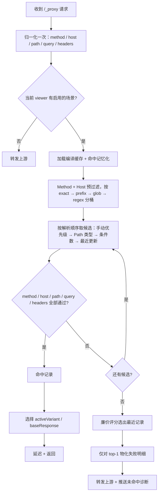

# AppApiProxy PRD — v1.1（0–6 周需求）

> 文档版本：v1.0（评审稿）
> 编写日期：2026-11-05
> 目标版本：v1.1.0
> 关联文档：[产品功能分析与需求规划](./产品功能分析与需求规划.md)
> 需求范围：匹配引擎 v2、结构化响应编辑器、接入向导与诊断、规则导入/导出、录制与规则管理流程精简

---

## 目录

- [1. 背景与目标](#1-背景与目标)
- [2. 用户与场景](#2-用户与场景)
- [3. 总体方案](#3-总体方案)
- [4. 需求详情](#4-需求详情)
  - [4.1 R1 匹配引擎 v2](#41-r1-匹配引擎-v2)
  - [4.2 R2 结构化响应编辑器](#42-r2-结构化响应编辑器)
  - [4.3 R3 接入向导与诊断](#43-r3-接入向导与诊断)
  - [4.4 R4 规则导入/导出](#44-r4-规则导入导出)
  - [4.5 R5 录制与规则管理流程精简](#45-r5-录制与规则管理流程精简增量需求)
- [5. 接口设计](#5-接口设计)
- [6. 数据迁移](#6-数据迁移)
- [7. 非功能需求](#7-非功能需求)
- [8. 指标与埋点](#8-指标与埋点)
- [9. 测试与验收](#9-测试与验收)
- [10. 排期与里程碑](#10-排期与里程碑)
- [11. 风险与依赖](#11-风险与依赖)
- [12. 本期决策与待确认问题](#12-本期决策与待确认问题)
- [13. 需求演进复盘与初版盲区](#13-需求演进复盘与初版盲区)
- [附录 A：匹配规则示例](#附录-a匹配规则示例)
- [附录 B：导入/导出格式](#附录-b导入导出格式)
- [附录 C：诊断错误码映射](#附录-c诊断错误码映射)

---

## 1. 背景与目标

### 1.1 背景

当前版本（1.0.4）已经跑通「接入 → 抓包 → 录制 → Mock → 切回真实」的闭环，但 Mock 的实际可用性受限于四个问题：

1. **匹配太刚性**：只按 URL 精确匹配，不区分 Method/Host，Query 顺序和动态参数导致真实 App 的录制规则大面积不命中。
2. **编辑太原始**：整段 JSON 手改，没有状态码/响应头/响应体的结构化编辑，没有变体和模板。
3. **接入门槛高**：新用户需要自己读文档、拼 Header、处理证书，缺少向导和链路自检。
4. **无法沉淀和分享**：规则只能留在本机 PouchDB，不能导出、导入、进 Git。

本期（v1.1，0–6 周）只解决这四件事，目标是让 Mock 从「能演示」变成「日常可用」。

### 1.2 本期目标

| 目标 | 说明 | 对应需求 |
|---|---|---|
| O1：让 Mock 可命中 | 真实项目录制规则无需手改 URL 即可命中；命中与未命中均可解释 | R1 |
| O2：让 Mock 可编辑 | 结构化编辑响应，支持变体；模板与预览延后 | R2 |
| O3：让接入可自助 | 新用户 10 分钟内完成首个请求和首个 Mock | R3 |
| O4：让规则可流转 | 规则可导出、导入、进 Git、给同事 | R4 |

> **2026-11-10 校正**：O4/R4 本期未交付（代码中无导入导出与 HAR 实现），目标与对应指标顺延到下一版本；同期范围外新增了 WebSocket 观测与应用更新链路。详见 [13.1](#131-交付对账初版范围之外的实际变化)。

### 1.3 成功指标（v1.1 发布后 4 周）

| 指标 | 目标 |
|---|---|
| 真实项目规则命中率（无需手改 URL） | ≥ 80% |
| 新用户首次代理请求耗时 | ≤ 10 分钟 |
| 新用户首次 Mock 命中耗时 | ≤ 20 分钟 |
| 规则创建成功率（表单校验通过并保存） | ≥ 95% |
| 导入/导出成功率（合法文件） | ≥ 99% ——**本期不可测**（R4 未交付，见 13.1） |
| 现有规则迁移丢失率 | 0 |
| 自动放宽后被用户撤销的比例 | ≤ 10%（用于评估自动忽略是否过度） |
| 代理额外开销（匹配 + 响应组装，p95） | ≤ 5ms |

### 1.4 范围

**本期包含：**

- 匹配引擎 v2：录制派生的匹配松紧（宽松/标准/严格）、稳定性分析（动态键自动忽略、Path 参数化）、Method/Host/Path（精确/前缀/通配/正则）/Query/Header 条件、可预测的冲突解析、命中解释与未命中诊断。
- 结构化响应编辑器：状态码、响应头、响应体、变体；模板变量与预览延后（见 [4.2.0](#420-落地说明需求调整摘要)）。
- 接入向导：服务检查、代码片段、扫码注册、设备验证、首个 Mock 引导。
- 诊断：服务/设备/链路/上游/Mock 五段自检，错误码映射。
- 规则导入/导出：JSON 规则包、HAR 导入、敏感头脱敏。
- 所需的数据迁移（schema v4）和接口变更。

**本期不包含：**

- 断点、请求/响应改写、Map Local/Map Remote、环境切换（Next）。
- 请求会话持久化、HAR 导出、重放/Composer/对比（Next）。
- 场景/状态机、条件序列、概率失败、弱网模板（Next）。
- OpenAPI 导入与 Schema 校验、WebSocket/gRPC/SSE（Later）。
- MCP/AI、CLI/CI、团队云空间（Later）。
- 请求体匹配（Body 条件）：v1.1 只在 schema 中预留 `match.body`，引擎仅支持 `ignore`，UI 不提供编辑；导入含其他模式的规则包会被明确拒绝。

> **2026-11-10 状态校正**：本节写作时（1.0 评审稿）的范围已不完全等于实际交付——WebSocket 观测版提前交付、R4 导入/导出实际未交付、应用更新链路与主题/滚动条等在文档之外完成。逐条对账与成因见 [13. 需求演进复盘与初版盲区](#13-需求演进复盘与初版盲区)。

---

## 2. 用户与场景

### 2.1 目标用户

| 用户 | 特征 | 本期最关心 |
|---|---|---|
| 移动端开发 | 有代码权限，能改拦截器；经常真机联调 | 录制一次就能稳定命中；不用手写 JSON |
| PC/H5 开发 | 后端未就绪，需要并行开发 | 快速造响应、切边界数据 |
| 测试工程师 | 不一定能改代码，需要构造异常态 | 结构化编辑、变体、导入同事的规则 |
| 小团队 Tech Lead | 需要把 Mock 样本沉淀和分享 | 导出/导入、规则包进 Git |

### 2.2 核心用户故事

| 编号 | 用户故事 | 优先级 |
|---|---|---|
| US-01 | 作为移动端开发，我录了一条带 `timestamp`/`sign` 的请求，希望不改 URL 也能稳定命中 | P0 |
| US-02 | 作为开发，我希望同一个 Path 的 GET 和 POST 能分别配置 Mock，不互相覆盖 | P0 |
| US-03 | 作为开发，我希望按 Host 区分不同环境的同名接口 | P0 |
| US-04 | 作为测试，我希望不改 JSON 就能把状态码改成 500、把响应体换成空数组 | P0 |
| US-05 | 作为测试，我希望同一个接口保存「正常/空态/错误/超时」多个变体，一键切换 | P0 |
| US-06 | 作为开发，我希望响应里的时间和随机数每次请求都变化，而不是固定值 | P1 |
| US-07 | 作为新用户，我希望跟着向导 10 分钟完成接入和第一个 Mock | P0 |
| US-08 | 作为用户，当 Mock 没生效时，我希望知道为什么没命中 | P0 |
| US-09 | 作为 Tech Lead，我希望把规则导出成文件，提交到 Git 给同事使用 | P1 |
| US-10 | 作为测试，我希望导入 Charles/浏览器导出的 HAR，快速生成 Mock 记录 | P1 |
| US-11 | 作为联调开发，我希望用「宽松/标准/严格」调匹配强度，而不是逐个理解 Query/Header 条件 | P0 |
| US-12 | 作为调试者，我希望命中后也能看到“为什么命中、忽略了哪些参数” | P1 |
| US-13 | 作为已有规则维护者，我希望后录制的更具体规则自动优先，不需要手动改优先级 | P0 |

### 2.3 体验目标（Before / After）

| 环节 | Before（1.0.4） | After（v1.1） |
|---|---|---|
| 录制后命中 | 改 URL、删动态参数、固定签名 | 自动识别并忽略高置信动态参数，Path ID 自动参数化，无需手改 |
| 同路径多方法 | GET/POST 互相覆盖 | Method 独立匹配 |
| 同路径多分支 | 后录制覆盖或永远不命中 | 更具体/更新的规则优先，冲突可见 |
| 匹配强度 | 不理解 Query/Header 条件 | 宽松/标准/严格三档 + 稳定性建议 |
| 命中后 | 只看到 Mock 生效 | 显示命中原因、忽略键与排序依据 |
| 编辑响应 | 手改整段 JSON | 状态码/响应头/响应体分栏 + 变体 |
| 边界数据 | 复制多条记录、手改 | 一个记录多个变体，一键切换 |
| 新用户接入 | 读文档、拼 Header、猜证书 | 向导 + 代码片段 + 链路自检 |
| 未命中 | 不知道为什么 | 显示最接近的规则、相似度和差异原因 |
| 分享 | 只能本机使用 | 导出规则包/HAR，导入即用 |

---

## 3. 总体方案

### 3.1 功能结构

```
Mock 规则管理
├── 场景（规则）
│   ├── 记录列表（按 URL/名称检索）
│   └── 记录编辑
│       ├── 响应（状态码 / 响应头 / 响应体）
│       ├── 变体（正常 / 空态 / 错误 / 自定义）
│       ├── 匹配（松紧档位 / Method / Host / Path / Query / Header / 稳定性建议 / 优先级）
│       └── 原始 JSON（高级用户逃生口）
├── 导入 / 导出
└── 启用开关（场景级 + 全局）

接入向导
├── 服务检查
├── 代码片段
├── 设备注册
├── 链路验证
└── 第一个 Mock

诊断中心
├── 服务
├── 设备
├── 链路
├── 上游
└── Mock 匹配
```

### 3.2 核心流程

#### 3.2.1 请求匹配流程



#### 3.2.2 编辑与保存流程

```
选择记录 → 加载 MockRecord → 编辑响应/变体/匹配
        → 前端校验 → 保存 → 服务端校验 → 写入 PouchDB
        → 失效匹配缓存 → 下次请求立即生效
```

### 3.3 数据模型（目标态）

```ts
export type MockMethod = 'ANY' | 'GET' | 'POST' | 'PUT' | 'PATCH' | 'DELETE' | 'HEAD' | 'OPTIONS'

export type PathMatchType = 'exact' | 'prefix' | 'glob' | 'regex'

export type ValueOp = 'equals' | 'regex' | 'exists' | 'notExists'

export type MockMatchLevel = 'loose' | 'standard' | 'strict' | 'custom'

export type MatchValueSource = 'recording' | 'auto-ignored' | 'suggested' | 'manual' | 'migration'

export interface MockQueryCondition {
  key: string
  op: ValueOp
  value?: string
  ignoreCase?: boolean
  source?: MatchValueSource
}

export interface MockQueryMatch {
  mode: 'ignore' | 'match'       // ignore: 不校验 query
  ignoreKeys: string[]           // 比较前剔除的动态参数
  conditions: MockQueryCondition[]
  allowExtra: boolean            // 是否允许请求携带未声明的参数
  multiValue: 'any' | 'all'      // 重复键：任一值满足 / 全部值满足
}

export interface MockHeaderCondition {
  key: string
  op: ValueOp
  value?: string
  ignoreCase?: boolean
  source?: MatchValueSource
}

export interface MockHeaderMatch {
  ignoreKeys: string[]           // 匹配前剔除的易变头
  conditions: MockHeaderCondition[]
}

// v1.1 仅支持 ignore；其余模式为后续版本预留
export interface MockBodyMatch {
  mode: 'ignore' | 'jsonSubset' | 'jsonPath' | 'form' | 'text'
  conditions?: Array<{ path: string; op: ValueOp; value?: string }>
  maxBytes?: number
}

export interface MockMatchDerivation {
  source: 'recording' | 'migration' | 'import' | 'manual'
  autoIgnoredKeys: string[]
  suggestions: Array<{ kind: 'ignore-key' | 'path-parameter'; value: string; evidence: string }>
  pathParameterized: boolean
  analyzedAt?: number
}

export interface MockMatchRule {
  version: 1                     // 匹配 schema 版本
  level: MockMatchLevel          // 展示用预设，不参与执行
  method: MockMethod
  host: string                   // '' 或 '*' = 任意；支持 *.example.com；可带显式端口
  pathType: PathMatchType
  path: string
  pathIgnoreCase: boolean
  ignoreTrailingSlash: boolean
  query: MockQueryMatch
  headers: MockHeaderMatch
  body: MockBodyMatch            // v1.1 固定 { mode: 'ignore' }
  priority: number | null        // null = 自动排序；手动值优先
  enabled: boolean
  derivation?: MockMatchDerivation
}

export type MockBodyType = 'json' | 'xml' | 'text' | 'binary'

export interface MockResponseDef {
  statusCode: number
  headers: Record<string, string | string[]>  // 同名多值头，如 set-cookie
  body: string
  bodyType: MockBodyType
  bodyEncoding?: 'utf8' | 'base64'            // binary 固定为 base64
  delayMs: number                // 0 表示使用设备级延迟
}

export interface MockVariant extends MockResponseDef {
  id: string
  name: string
  updatedAt?: number
}

export interface MockRecordSource {
  url: string
  method: string
  headers?: Record<string, any>
  requestBody?: string
  capturedAt?: number
}

export interface MockRecord {
  id: string                     // 对应 PouchDB _id
  ruleId: string
  name: string
  // R1 目标态：命中按 match 条件；过渡期回滚时按 ruleId + url 精确命中
  match: MockMatchRule
  // 展示与旧版本兼容；不再作为唯一键
  url?: string
  response: MockResponseDef
  variants: MockVariant[]
  activeVariantId: string | null // null = 使用 base response
  source?: MockRecordSource
  matchInvalid?: string          // 非空表示无法生成有效条件，记录禁用但保留
  createdAt: number
  updatedAt: number
}
```

**存储文档（PouchDB）：**

```ts
interface MockRecordDoc {
  _id: string                    // 新记录 rec_<uuid>；历史记录保持 rec_<sha1> 不变
  type: 'record'
  ruleId: string
  name: string
  // R1 目标态：命中按 match 条件；过渡期回滚时按 ruleId + url 精确命中
  match: MockMatchRule
  // 展示与旧版本兼容；不再作为唯一键
  url?: string
  response: MockResponseDef
  variants: MockVariant[]
  activeVariantId: string | null
  source?: MockRecordSource
  matchInvalid?: string
  createdAt: number
  updatedAt: number
  // 兼容字段：保留旧结构，便于回滚与旧版本读取
  record?: ProxyMock.ProxyRequestRecord
}

interface MockRuleDoc {
  _id: string                    // rule_<uuid>
  type: 'rule'
  name: string
  desc: string
  createdAt: number
  updatedAt: number
}
```

### 3.4 兼容与迁移原则

1. **旧数据不丢**：迁移只新增字段，不删除旧字段；无法解析的记录保留并禁用，不跳过、不删除。
2. **保守放宽，不改变身份**：历史记录默认 `host=任意`、`method=录制方法`、`path=精确`；Query 保留原始条件，但自动忽略高置信动态键，`allowExtra=true`。这是为了满足 O1 的有意行为变化，必须出现在迁移复核与发布说明中。
3. **语义参数不自动忽略**：`version`、`type`、`tenant`、`role`、`page`、`token` 等业务键永不自动放宽，只给建议。
4. **记录 ID 不再随 URL 变化**：历史记录保留原 `_id`；新记录使用 UUID。修改 URL/匹配条件不再重建文档。
5. **唯一性改为匹配指纹**：URL 不再是唯一键；保存、录制去重、导入合并均按归一化后的匹配条件判断。
6. **迁移幂等**：重复执行不产生重复数据；迁移前自动备份 PouchDB。
7. **可回滚**：保留旧字段与旧规则文档；回滚旧版本可继续工作；新记录的 match 指纹与旧 url 字段同时保留，便于降级排查。

---

## 4. 需求详情

### 4.1 R1 匹配引擎 v2

#### 4.1.0 设计原则：录制派生规则（本期核心变化）

录制得到的请求不是一条“干净的规则”，而是**接口身份 + 分支条件 + 请求噪声**的混合体。匹配引擎的目标不是复刻整条 URL，而是识别并剥离噪声，只保留能区分接口和分支的信息。

| 信息类别 | 典型内容 | 默认处理 |
|---|---|---|
| 接口身份 | Method、Host、Path | 作为匹配条件 |
| 分支条件 | 稳定的 Query 键、业务 Header、稳定的 Path ID 位 | 有证据时作为条件 |
| 请求噪声 | `ts`/`sign`/`nonce`/`requestId`/`sessionId`/`deviceId`、每次变化的 Path ID、易变 Header | 忽略或参数化 |

由此确定 5 条产品原则：

1. **匹配 = 接口身份 + 分支条件 − 请求噪声**。不再默认“录制时 URL 里的每个参数都必须相等”。
2. **默认命中优先，误命中可控**。录制与迁移默认使用“标准”松紧；需要精确区分时才收紧，收紧必须由用户明确选择。
3. **每条条件可解释、可追溯**。条件来源分为「录制」「自动忽略」「手动添加」，UI 必须能显示来源。
4. **解析顺序可预测**。手动优先级 > 路径类型 > 条件具体度 > 最近更新，不依赖“谁先录制”。
5. **不静默放宽、不静默截断**。自动忽略、Path 参数化、超限都必须给出报告，且可撤销。

#### 4.1.1 目标

让真实 App 的录制规则在动态参数、多方法、多 Host 场景下稳定命中；让命中与未命中都可解释；在提升命中率的同时，把“误命中”控制在用户可理解和可收紧的范围内。

#### 4.1.2 用户故事

- US-01：录制带 `timestamp`/`sign` 的请求，不改 URL 即可稳定命中。
- US-02：GET 与 POST 同 Path 分别配置。
- US-03：按 Host 区分不同环境的同名接口。
- US-08：未命中时看到最接近的规则和差异原因。
- US-11：作为联调开发，我希望用「宽松/标准/严格」一个开关调匹配强度，而不是逐个理解 Query/Header 条件。
- US-12：作为调试者，我希望命中后也能看到“为什么命中、忽略了哪些参数”，避免误命中却不知道。
- US-13：作为已有规则维护者，我希望后录制的更具体规则能自动优先，而不是手动改优先级。

#### 4.1.3 功能规则

##### 1）匹配松紧（产品主模型）

用户不需要理解 Method/Query/Header 的组合，只需要选择一个松紧档位；档位是条件的**可视化预设**，不是独立执行路径。

| 档位 | 生效条件 | 适用场景 | 默认 |
|---|---|---|---|
| 宽松 | Method + Path | 该接口所有请求返回同一响应 | 手动选择 |
| 标准 | Method + Host（新录制）+ Path + 稳定 Query；动态键忽略；`allowExtra=true`；Header/Body 忽略 | 大多数录制规则 | **录制与迁移默认** |
| 严格 | Method + Host + Path + 全部 Query（`allowExtra=false`）+ 指定 Header；Body 暂不支持 | 同接口多分支，需要精确定位 | 手动选择 |
| 自定义 | 任意条件组合 | 高级用户 | 编辑任一条件后自动进入 |

- 档位只用于展示与批量操作，执行始终按实际条件；手动修改条件后档位变为「自定义」。
- 记录列表与编辑头部显示当前档位和一行可读摘要，例如：`POST api.example.com /v1/orders · 标准 · 忽略 ts,sign`。
- 未命中面板提供「一键放宽」（并入宽松/忽略该参数）；命中解释面板提供「一键收紧」（把被忽略的键变成条件）。
- 收紧后仍命中率不足的规则，用「恢复录制精确匹配」还原为严格档位（全 Query + `allowExtra=false`）。

##### 2）稳定性分析（自动派生条件）

录制与迁移时，服务端对同一场景内 **同一接口身份**（Method + 归一化 Path）的多次录制做差异分析，决定哪些字段进入条件、哪些忽略、哪些只提示。

| 证据 | 判定 | 是否自动忽略 | UI 表现 |
|---|---|---|---|
| E1：同一接口 ≥2 次录制，键存在且值不同 | 动态参数 | **是** | 「动态（多次录制值不同）」 |
| E2：键名命中高风险集合 | 请求级噪声 | **是** | 「动态（请求标识）」 |
| E3：值形态像时间戳/UUID/长十六进制/长 Base64 | 疑似动态 | 否，仅建议 | 「建议忽略」 |
| E4：键在部分录制中出现 | 可选参数 | 否，配合 `allowExtra=true` | 「偶发参数」 |
| E5：键名命中语义集合 | 业务分支 | 否，必须作为条件 | 「业务参数」 |

- **E2 高风险键名**：`ts`、`timestamp`、`_t`、`nonce`、`sign`、`signature`、`requestId`、`traceId`、`spanId`、`sessionId`、`token`、`access_token`、`deviceId`、`device_id`、`udid`、`imei`、`oaid`、`idfa`。
- **E5 语义集合（永不自动忽略）**：`version`、`v`、`tenant`、`tenantId`、`role`、`exp`、`user_id`、`uid`、`time`、`page`、`size`、`cursor`、`status`、`type`、`lang`、`locale`。这些键即使值在多次录制中变化，也只建议忽略，因为忽略后可能把不同业务分支混为一体。
- **值形态只用于建议，不作为自动忽略依据**：UUID、长 Base64 可能是有意义的资源 ID、分页游标，自动忽略会制造静默误命中。
- 证据范围：同一场景、同一 Method + 归一化 Path（含参数化后的模板）的全部记录；保存、导入、重新分析时更新。
- 分析结果写入 `match.derivation`：来源（recording/migration/import/manual）、自动忽略键及证据、待确认建议、分析时间。UI 可展开查看证据并一键撤销。
- **Path 参数化**：同一 Path 模板下，某一段多次出现不同的纯数字/UUID/长十六进制值时，自动将这一段替换为 `*`（如 `/v1/users/10086` → `/v1/users/*`）；单次录制只建议不自动。版本段（`/v1/`）、固定词、短数字（如 `v2`）不参数化。
- 自动忽略和 Path 参数化都属于“放宽”，必须在迁移报告或录制结果中明示，禁止静默执行。

##### 3）匹配维度与归一化

| 维度 | 匹配方式 | 默认值 | 归一化与说明 |
|---|---|---|---|
| Method | `ANY` / 具体方法 | 录制时的 Method；缺失则 `ANY` | 统一大写；不做 HEAD→GET 回退 |
| Host | 任意 / 精确 / `*.example.com` | 新录制：录制 Host；历史：任意 | 优先取 `x-mock-host`，缺失时回落真实 `Host` 头；去协议/路径；小写；不带端口 = 任意端口；显式端口 = 精确端口；`*.example.com` 不含 apex；支持 IPv6 方括号 |
| Path | 精确 / 前缀 / 通配 / 正则 | 精确 | 匹配 `/_proxy` 之后的 pathname；解析前先消除点段与重复斜杠；默认尾斜杠不敏感；大小写默认敏感 |
| Query | 忽略 / 条件匹配 | 标准：稳定键条件；无 Query：忽略 | `URLSearchParams` 解析；键名大小写敏感；值解码后再比较；`+` 与 `%20` 等价；重复键保留为数组；空值（`?a=`）与缺省（`?a`）区分 |
| Header | 条件匹配 | 无 | 键名大小写不敏感；值去除首尾空白；默认不生成任何 Header 条件 |
| Body | 预留 | 忽略 | v1.1 引擎只接受 `mode=ignore`；导入含 Body 条件的规则包时拒绝并提示「当前版本不支持请求体匹配」 |
| Priority | 手动覆盖 | `null`（自动） | 见 5）优先级与冲突解析 |

**Path 类型语义：**

| 类型 | 规则 | 示例 |
|---|---|---|
| exact | 归一化后字符串完全相等（可忽略大小写/尾斜杠） | `/v1/users/10086` |
| prefix | 以 pattern 开头 | `/v1/users/` |
| glob | `*` 匹配任意字符（含 `/`），`?` 匹配单个非 `/` 字符；`\` 转义 | `/v1/users/*` |
| regex | JavaScript 正则，按整段 Path 全匹配（引擎自动加锚点），长度 ≤ 200 | `^/v1/users/\d+$` |

- 正则仅作为高级选项，默认折叠；保存时校验并预编译，拒绝嵌套量词等明显高风险模式。
- Path 类型的具体度：`exact > prefix > glob > regex`，用于冲突解析。

**Query 条件语义：**

- `mode=ignore`：完全不校验 Query，等价于“任意 Query 都通过”。
- `mode=match`：
  1. 先剔除 `ignoreKeys` 中的键，再做条件比较；
  2. 所有 `conditions` 按 AND 关系匹配；
  3. `allowExtra=true` 时允许请求携带未声明参数；`false` 时存在未声明参数即失败；
  4. 参数顺序不影响匹配；
  5. `multiValue` 控制重复键：`any`（默认，任一值满足即可）或 `all`（所有值都必须满足）。

| 操作符 | 规则 |
|---|---|
| equals | 任一值完全相等（可忽略大小写） |
| regex | 任一值匹配正则 |
| exists | 键存在即可；`?a=` 视为存在 |
| notExists | 键不存在；`?a=` 视为存在，不通过 |

##### 4）优先级与冲突解析

`priority` 改为 `number | null`，默认 `null` 表示自动排序；只有用户显式设置时才参与第一层比较。

**解析顺序（逐层比较，命中第一条即返回）：**

| 层级 | 规则 | 理由 |
|---|---|---|
| 1 | 手动 `priority`：设置了优先级的规则优先于未设置；都设置时数值大者优先 | 只用于强制覆盖自动排序 |
| 2 | Path 类型具体度：`exact > prefix > glob > regex` | 精确路径比模式路径更可信 |
| 3 | 条件具体度计数：Method≠ANY（+1）、Host≠任意（+1）、每个 Query 条件（+1）、`allowExtra=false`（+1）、每个 Header 条件（+1）、Body≠ignore（+1） | 条件越多，规则越具体 |
| 4 | `updatedAt` 降序 | 后录制的规则优先，重新录制能覆盖旧行为 |

- **移除「同优先级按创建时间升序（先录制者优先）」**。该策略会让后录制的精确规则永远输给旧的宽规则，属于反直觉行为。
- 同一场景内允许存在多条相同 Path 的记录（不同 Method/Query/Header/变体），不再互相覆盖。
- UI 记录列表显示排序依据；手动优先级只作为高级项，默认可隐藏。
- **冲突检测**（记录列表与保存时）：
  - 重复：归一化后的匹配条件完全一致 → 保存前阻止并提示打开已有记录；
  - 遮蔽：同 Method 下，A 的 Host/Path 覆盖 B、A 的 Query/Header 条件是 B 的子集且 `allowExtra=true` → 提示「B 可能永远不会命中」；
  - 不可达：B 被更高手动优先级的重复规则完全覆盖 → 提示禁用或删除。
- 遮蔽检测先覆盖可判定的 `exact`/`prefix` 组合；glob/regex 只做重复条件检测，避免误报。

##### 5）未命中诊断

- 未命中时计算「最接近的记录」，分两阶段：
  1. **廉价评分阶段**：只比较 Path 结构与维度通过数，不构造期望/实际字符串；
  2. **物化阶段**：只对得分最高的 1 条候选生成失败明细。
- 相似度按以下顺序计算，避免“失败维度最少”误导：
  1. Path 首段是否相同、共享前缀长度、Path 段重叠度（Jaccard）；
  2. 通过的维度数量（Method/Host/Path/Query/Header）；
  3. 仅当 Path 相似度达到阈值（共享前 2 段，或归一化编辑距离 ≤ 0.35）才展示「Mock 未命中」标记。
- 诊断内容：

```ts
interface MockMissDiagnostic {
  ruleId: string
  closestRecordId?: string
  closestRecordName?: string
  closestMatchLevel?: MockMatchLevel
  similarity: number                 // 0–1，Path 相似度
  failures: Array<{
    dimension: 'method' | 'host' | 'path' | 'query' | 'header'
    expected: string
    actual: string
    detail?: string                  // Query 键名、期望值、实际值等
    suggestion?: 'ignore-key' | 'loosen' | 'edit-record'
  }>
}
```

- 展示位置：
  - 请求详情「Mock 匹配」区块；
  - 列表行灰色「未命中」标签（仅高相似度时）；
  - 点击标签打开诊断面板，展示失败维度与期望/实际，并提供「忽略该参数」「放宽为宽松」「编辑该记录」「复制诊断」。
- 若当前没有启用场景，不显示未命中诊断，改为提示「当前未启用 Mock 场景」。

##### 6）命中解释与误命中控制

- 请求详情新增「Mock 匹配」命中态区块，展示：
  - 命中的记录、档位、变体；
  - 通过的维度与条件；
  - **被忽略的动态键**（灰显，标注证据）；
  - 排序依据（手动优先级 / 精确路径 / 条件更多 / 最近更新）；
  - 匹配耗时。
- 若本次命中依赖被忽略的键，显示提示「命中（已忽略 3 个动态参数）」，并提供「收紧匹配」入口，把被忽略键转为条件。
- 本地计数新增 `mockHitWithIgnoredKeys`，用于评估自动忽略是否过度放宽；不自动上传。
- 任何自动放宽（忽略键、Path 参数化、迁移默认）都必须可在记录编辑器中查看来源并撤销。

##### 7）性能与缓存

- 请求归一化只做一次，所有候选记录复用同一个 `NormalizedRequest`。
- 每个场景维护一份编译缓存：`{ version, exactPathMap, prefixTrie, globList, regexList, compiledAt }`；保存/删除/导入/启用/迁移后失效。
- 匹配时先用 Method + Host 做预过滤，再按 `exact → prefix → glob → regex` 分桶；手动优先级规则单独成组优先评估。
- 命中结果做 LRU 记忆化：key = `method|host|path|规范化 query|相关 header 哈希`，容量 1,000，规则版本变化即失效。
- 未命中诊断走两阶段（见 5）），miss 路径不得为每条记录构造期望/实际字符串。
- 记录数上限：
  - 超过 5,000 条：提示拆分场景，但**不静默截断**，全部记录仍参与匹配；
  - 超过 10,000 条：拒绝启用该场景，要求拆分或删除后再启用。
- 性能目标（1,000 条、90% miss 流量、冷缓存后首轮预热）：
  - 命中路径 p95 ≤ 1ms；
  - 未命中路径 p95 ≤ 3ms；
  - 匹配 + 响应组装整体 p95 ≤ 5ms；
  - 5,000 条时命中 ≤ 3ms、未命中 ≤ 8ms。
- 正则安全：长度 ≤ 200，被匹配 Path 截断到 2,048 字符，编译结果缓存；保存时拒绝嵌套量词等明显高风险模式。不承诺静态识别所有灾难性回溯，UI 需提示性能风险。

##### 8）场景启用与状态持久化

- 保持「一个 viewer 同时只启用一个场景」的模型。
- **全局 Mock 开关**：主界面顶部显示「Mock 已启用：场景名」/「Mock 已关闭」，点击可快速开关当前场景，不必打开规则管理。
- **持久化最近启用场景**：
  - 在 PouchDB meta 文档保存 `lastActiveRuleId`。
  - 应用启动或 viewer 重新注册后，自动恢复该场景的启用状态。
  - 场景被删除时清空 `lastActiveRuleId`。
- **多窗口语义**：启用状态以 viewer 为单一来源，主进程持有；任一窗口切换后广播给同 viewer 的其他窗口，不做每窗口独立状态，避免同一设备收到互相矛盾的 Mock 结果。
- 设备（device）继续继承其 owner viewer 的启用状态。

#### 4.1.4 数据模型变更

- `MockRecordDoc` 新增：`name`、`match`、`response`、`variants`、`activeVariantId`、`source`。
- `match` 新增字段：
  - `version`：匹配 schema 版本，当前为 `1`；
  - `level`：`loose | standard | strict | custom`，仅用于展示与批量操作；
  - `priority`：`number | null`，默认 `null`；
  - `derivation`：`{ source, autoIgnoredKeys, suggestions, pathParameterized, analyzedAt }`；
  - `body`：预留，v1.1 固定 `{ mode: 'ignore' }`。
- 历史记录保留 `record` 字段，作为来源快照与回滚依据；记录级新增 `matchInvalid`（字符串原因），表示该记录无法生成有效匹配条件，默认禁用但不删除。
- `MockRuleDoc` 不变；meta 文档新增 `lastActiveRuleId`、`mockSchemaVersion`。
- `MockRecord.id` 对应 `_id`：
  - 历史记录：保持 `rec_<sha1(ruleId + url)>`；
  - 新记录：`rec_<uuid>`。
- `url` 保留为展示与旧版本兼容字段，不再作为唯一键；唯一性改为**匹配指纹**（归一化后的 method + host + path + query + headers + body 完全一致）。
- 匹配指纹用于：保存前重复检测、录制去重、导入合并提示。指纹只比较条件，不比较响应与变体。

#### 4.1.5 UI 交互

**记录列表：**

- 显示：名称（默认取 Path）、Method、Host、档位、匹配摘要、启用状态、变体数、冲突标记。
- 匹配摘要示例：`/v1/users/* · 标准 · 忽略 ts,sign`。
- 支持搜索：名称、Path、Host、匹配摘要。
- 支持排序：手动优先级 / 更新时间 / 创建时间；默认按更新时间降序。
- 同 Path 多方法不再合并；同 Path 不同条件的记录并列展示，并用摘要区分。
- 冲突标记：重复（红）、可能被遮蔽（黄）、匹配无效（灰），hover 说明原因与建议。

**匹配 Tab：**

- 顶部：档位选择（宽松 / 标准 / 严格 / 自定义），切换档位展示将增加/移除的条件预览，确认后生效。
- Method：下拉（ANY + 常见方法）。
- Host：输入框，空 = 任意；支持 `*.example.com` 与显式端口；提示「不带端口表示任意端口」。
- Path：类型下拉 + 输入框；识别到 ID 参数化时显示「已参数化：10086 → *」并允许还原；正则模式折叠在「高级」中。
- Query：
  - 模式切换：忽略 / 匹配；
  - 条件表格：键、操作符、值、忽略大小写、多值语义（任一/全部）；
  - 忽略键：标签输入，按来源区分「自动（证据）」「建议」「手动」，可一键撤销；
  - 允许额外参数：开关（标准档默认开，严格档默认关）。
- Header：
  - 条件表格：键、操作符、值、忽略键；
  - 常用 Header 建议：`x-tenant-id`、`x-user-role`、`x-exp`；
  - 默认不生成条件，提示「Header 波动大，建议仅在需要区分分支时添加」。
- Body：本期只读展示「当前版本不参与匹配」，不提供编辑。
- 优先级：高级折叠项，数字输入；默认「自动」。
- 底部：实时「用当前请求测试匹配」按钮，展示命中记录、档位与忽略键；未命中时直接展示诊断。
- 稳定性建议区：展示「发现 3 个动态参数」「2 个 Path 段可参数化」「1 个业务参数未参与匹配」，支持逐项应用/撤销。

**未命中面板：**

- 标题：`未命中：最接近「{记录名}」（相似度 78%）`
- 表格：维度 / 期望 / 实际 / 说明 / 建议动作
- 操作：`忽略该参数`、`放宽为宽松`、`编辑该记录`、`复制诊断信息`

**命中解释面板：**

- 请求详情「Mock 匹配」区块展示：命中记录、档位、变体、通过条件、忽略键、排序依据、耗时。
- 若命中依赖忽略键，显示「命中（已忽略 3 个动态参数）」与「收紧匹配」。

**迁移复核：**

- 迁移完成后一次性提示：「已为 N 条规则自动忽略 M 个动态参数，查看详情」。
- 复核页按规则列出自动忽略键、Path 参数化、被禁用记录，支持单条/全部撤销。

#### 4.1.6 接口变更

| 接口 | 变更 |
|---|---|
| `GET /_appmock/getMockRecords` | 返回新的 `MockRecord` 结构（含 match/response/variants/derivation），并附带 `matchWarnings`（重复/遮蔽/无效） |
| `POST /_appmock/saveMockRecord` | 入参改为 `{ ruleId, recordId?, record }`；`recordId` 为空表示新建；保存前校验匹配指纹唯一 |
| `POST /_appmock/deleteMockRecord` | 入参改为 `{ ruleId, recordId }` |
| `GET /_appmock/getActiveMockRule` | 返回当前启用场景；若内存无状态则从 `lastActiveRuleId` 恢复 |
| `POST /_appmock/saveMockRule` | 保持 `isMock` 语义；同步写入/清除 `lastActiveRuleId`；切换状态广播给同 viewer 的其他窗口 |
| `POST /_appmock/matchMockRecord` | 新增：入参 `{ ruleId, request: { method, url, headers } }`；返回 `{ recordId, matchLevel, explain, ignoredKeys, miss }`，供“测试匹配”和录制去重使用 |
| `GET /_appmock/getMockMiss` | 可选：按 requestId 查询未命中诊断（若未随推送返回） |
| `POST /_appmock/analyzeMockMatch` | 可选（P1）：对草稿规则做稳定性分析与冲突检测，返回建议列表 |

- `GET /_appmock/getMockRecordByUrl` 保留，但仅作为历史记录兜底；R1 接入后录制去重优先使用 `matchMockRecord`。

#### 4.1.7 边界与异常

| 场景 | 行为 |
|---|---|
| 历史记录没有 `method` | `method=ANY` |
| 历史记录 URL 无法解析 | **保留文档**，`match.enabled=false` 并标记 `matchInvalid`；不跳过、不删除，不阻塞启动 |
| 历史记录无 Query | `query.mode=ignore`，`allowExtra=true` |
| 历史记录有 Query | 按稳定性分析自动忽略高风险动态键；其余保留 equals；`allowExtra=true`；生成迁移报告 |
| 语义参数（version/type/tenant 等） | 永不自动忽略；即使多次录制值变化也只建议 |
| 正则非法 | 保存失败，提示具体错误；不影响其他记录 |
| 记录数 5,000–10,000 | 提示拆分场景，但全部参与匹配，不静默截断 |
| 记录数 > 10,000 | 拒绝启用该场景，要求拆分或删除 |
| 未启用场景 | 不匹配，直接转发；不显示未命中诊断 |
| 设备 UID 离线 | 沿用现有逻辑：无记录、无 Mock；诊断提示 UID 不匹配 |
| 排序完全并列（优先级、Path 类型、条件数都相同） | `updatedAt` 降序，最近更新的优先 |
| Query 键重复 | 默认任一颗值满足即通过；`multiValue=all` 时全部值满足才通过 |
| Query 空值 | `?a=` 与 `?a` 区分；`exists` 两者都通过，`equals ''` 只匹配前者 |
| Host 缺少 `x-mock-host` | 回落真实 `Host` 头；两者都没有时按「任意 Host」处理并记录诊断 |
| Header 值包含换行 | 校验拒绝，避免响应头注入 |
| 导入含 Body 条件 | 拒绝并提示「当前版本不支持请求体匹配」，不静默降级 |

#### 4.1.8 验收标准

| 编号 | Given / When / Then |
|---|---|
| AC-R1-01 | Given 同一接口两次录制中 `ts`、`sign` 值不同，When 再次请求 `?ts=456&sign=xyz&id=1`，Then 无需手动操作即命中，并在命中解释中标注 `ts`、`sign` 已忽略 |
| AC-R1-02 | Given 同一 Path 有 GET 和 POST 两条记录，When 分别发送 GET/POST，Then 各自命中，不互相覆盖 |
| AC-R1-03 | Given 两条记录 Host 分别为 `api.dev.com` 和 `api.test.com`，When 请求分别带对应 `x-mock-host`，Then 命中正确记录；缺少该头时回落真实 `Host` 仍可命中 |
| AC-R1-04 | Given Path 配置 `/v1/users/*`，When 请求 `/v1/users/10086`，Then 命中 |
| AC-R1-05 | Given 两条记录都匹配，一条手动 priority=10、另一条自动，When 请求，Then 命中 priority=10 |
| AC-R1-06 | Given 未命中且存在相似 Path，When 查看详情，Then 显示相似度、失败维度、期望/实际值和可执行建议；无相似 Path 时不展示灰标 |
| AC-R1-07 | Given 应用重启，When 打开主界面，Then 上次启用的场景自动恢复；同 viewer 多窗口状态一致 |
| AC-R1-08 | Given 1,000 条记录、90% miss 流量，When 连续发送 1,000 次请求，Then 命中 p95 ≤ 1ms、未命中 p95 ≤ 3ms、整体 p95 ≤ 5ms，无内存持续增长 |
| AC-R1-09 | Given 历史规则升级到 v1.1，When 启动迁移，Then 无数据丢失；无法解析 URL 的记录被保留并禁用；含动态参数的记录自动放宽且出现在迁移复核中 |
| AC-R1-10 | Given 旧记录 `POST /order`（宽松）与新记录 `POST /order?type=refund`（标准）都匹配，When 请求 `?type=refund`，Then 命中新记录；两条条件完全并列时命中最近更新的一条 |
| AC-R1-11 | Given 多次录制中 `version=1/2` 变化、`ts` 变化，When 执行稳定性分析，Then `ts` 自动忽略，`version` 只出现在建议中且默认仍作为条件 |
| AC-R1-12 | Given 两次录制 `/v1/users/10086` 与 `/v1/users/10087`，When 分析完成，Then Path 参数化为 `/v1/users/*`（可在 UI 撤销），两个请求都命中 |
| AC-R1-13 | Given 标准档 `allowExtra=true` 且条件为 `detail=1`，When 请求额外带 `foo=bar`，Then 仍命中；切换严格档后不命中 |
| AC-R1-14 | Given 条件 `id=1`，When 请求 `?id=1&id=2`，Then “任一”语义命中、“全部”语义不命中 |
| AC-R1-15 | Given 录制 URL 含 `%E4%B8%AD`、`+` 和尾斜杠，When 请求使用等价编码或不同尾斜杠，Then 归一化后命中 |
| AC-R1-16 | Given 一次命中依赖忽略键，When 查看请求详情，Then 展示命中记录、档位、通过条件、忽略键与排序依据，并提供「收紧匹配」 |
| AC-R1-17 | Given 规则 A 完全覆盖规则 B 的匹配条件，When 打开记录列表，Then B 显示「可能永远不会命中」并给出禁用/编辑建议 |
| AC-R1-18 | Given 场景有 6,000 条记录，When 启用场景，Then 提示拆分但全部参与匹配；超过 10,000 条时拒绝启用并说明原因 |
| AC-R1-19 | Given 保存时与已有记录匹配指纹完全一致，When 点击保存，Then 阻止并提示打开已有记录；仅 URL 相同但条件不同的记录允许保存 |
| AC-R1-20 | Given 导入含 `body.mode=jsonSubset` 的规则包，When 执行导入，Then 明确拒绝该记录并提示版本不支持，不降级为忽略 |

---

### 4.2 R2 结构化响应编辑器

#### 4.2.0 落地说明：需求调整摘要

截至 2026-11-06，R2 已交付「结构化响应编辑 + 变体 + 原始 JSON」链路，模板变量与预览整体延后到后续版本。实现过程中对原需求的调整如下：

| 原需求 | 最终实现 | 调整原因 |
|---|---|---|
| 状态码 / 响应头 / 响应体 / 延迟 / 变体结构化编辑 | 已交付 | — |
| 模板变量、测试渲染、`previewMockRecord` | **本期未实现**；`{{...}}` 按原文返回 | W4 R2-b（模板与预览）未进入本期交付，先保证编辑、存储、命中链路 |
| 编辑器 4 个 Tab（响应 / 变体 / 匹配 / 原始） | 本期 3 个 Tab（响应 / 变体 / 原始），无「匹配」 | 交付 R2 时 R1 尚未接入，记录按 `ruleId + url` 精确命中；R1 接入后按 4.1 增加「匹配」Tab |
| 切换当前变体后立即保存 | 改动进入草稿，保存按钮 / Ctrl+S 显式保存 | 与统一未保存保护一致，避免每次点击都写库 |
| 记录列表行显示当前变体名 | 列表显示有效状态码、变体数量、「当前」标记；变体名在变体条中展示 | 列表行宽有限，避免名称被截断 |
| 响应头保存时过滤逐跳头 | 保存时只校验；实际发送与录制回填时统一过滤 | 保留用户配置，同时保证不透传非法/长度/压缩头 |
| 响应体上限 1MB（模板输出） | 编辑与存储上限 2MB | 评审结论：模板输出上限不覆盖编辑与存储 |
| 原始 JSON 默认折叠 | 独立「原始」Tab，点「应用」后仍需保存 | 与 Tab 布局一致；服务端保存前统一校验 |
| 新增 `getMockRecord` 单条接口 | 未新增；使用分页列表 + 保存返回 `{ id, updatedAt }` | 当前页面模型足够，减少一个接口 |
| 并发保存 409 自动重试 | PouchDB 版本冲突内部重试 2 次；用户级乐观锁冲突直接提示刷新 | 区分内部版本冲突与用户并发编辑 |

实现位置：`src/shared/mock.validation.ts`（校验与归一化）、`src/shared/proxy.models.ts`（模型与有效响应）、`src/main/service/mock.service.ts`（命中与发送）、`src/main/repository/mock.repo.ts`（存储与迁移）、`src/renderer/pages/proxy/mock/`（编辑器组件）、`src/renderer/pages/proxy/MockRuleMgr.vue`（列表、保存与未保存保护）。

#### 4.2.1 目标

本期把「手改整段 JSON」升级为「状态码 + 响应头 + 响应体 + 变体」的结构化编辑，让开发和测试都能快速构造响应；模板变量与预览作为后续版本能力。

#### 4.2.2 用户故事

- US-04：不改 JSON，改状态码、响应头、响应体。
- US-05：同一接口保存多个变体，一键切换。
- US-06（后续版本）：响应中的时间/随机数每次变化。

#### 4.2.3 功能规则

##### 1）响应基础字段

| 字段 | 规则 | 默认 |
|---|---|---|
| statusCode | 100–599 整数 | 200 |
| headers | 键值对列表；键名合法 token；值不允许 CRLF；保存时校验，发送时再统一过滤 | 继承录制响应头，过滤逐跳头 |
| body | 文本；JSON / XML / Text 按类型选择 Ace 语言；上限 2MB | 录制响应体 |
| bodyType | json / xml / text / binary；binary 以 base64 存储 | 由 Content-Type 推断 |
| bodyEncoding | utf8 / base64；与 bodyType 配套 | binary 时为 base64，其余不写 |
| delayMs | 0–60,000 整数；0 表示使用设备级延迟 | 0 |

- 二进制响应：切换为 binary 时，当前文本按 UTF-8 转为 base64；编辑器只展示体积与提示，不提供正文编辑；发送时按 base64 解码为 Buffer。需要直接修改二进制内容时走「原始」Tab。
- 响应头在保存时只校验名称合法性与 CRLF；在实际命中发送、以及从录制记录回填时，统一过滤逐跳头、`content-length`、`content-encoding`，多值头（如 `set-cookie`）以数组逐条保留。
- JSON 响应体允许保存非法 JSON（用于测试异常解析），但编辑器显示警告，不阻塞保存；发送时按原文返回。
- 响应体超过 2MB 时编辑器显示提示并阻止保存（编辑与存储共用同一上限）。

##### 2）变体

- 每条记录包含：
  - 1 个基础响应（`response`）；
  - 0–20 个变体（`variants`）；
  - `activeVariantId` 指定当前生效的变体；`null` 表示基础响应。
- 变体操作：新增、复制当前、重命名、删除、设为当前。
- 变体字段：名称、状态码、响应头、响应体、延迟。
- 列表展示：变体名、状态码、是否当前；不展示更新时间。
- 新增变体默认复制基础响应；复制变体默认复制当前选中变体，命名为「<原名> - 副本」；新增命名「变体 N」。
- 变体 id 由前端生成（`var_<时间 base36>_<随机>`）；本期不对「原始」Tab 手工粘贴产生的重复 id 做重新生成。
- 切换当前变体只修改草稿，需显式保存（保存按钮 / Ctrl+S）；不自动写库。
- 删除当前变体时，`activeVariantId` 置空，立即回退到基础响应。
- 达到 20 个变体时，新增/复制按钮置灰；服务端保存校验同样拒绝。
- 变体编辑行：名称、状态码、延迟、生效开关、复制/删除（图标按钮）同排；响应头与响应体复用响应表单。

##### 3）模板变量（本期未实现）

> **本期未交付（W4 R2-b）。** 当前响应体与响应头中的 `{{...}}` 原样保存、原样返回，不做解析，也不会产生 warning。以下为后续版本的设计范围。

- 语法：`{{ expression }}`，仅支持白名单函数与请求上下文，**不使用 eval，不执行任意 JS**。
- 作用范围：响应体的字符串内容、响应头的值。
- 内置变量/函数：

| 表达式 | 说明 | 示例输出 |
|---|---|---|
| `{{timestamp}}` | 当前毫秒时间戳 | `1762310400000` |
| `{{timestampSec}}` | 当前秒级时间戳 | `1762310400` |
| `{{uuid}}` | UUID v4 | `3f2c...` |
| `{{randomInt(1,100)}}` | 随机整数（含边界） | `42` |
| `{{randomFloat(0,1,2)}}` | 随机小数 | `0.73` |
| `{{pick("a","b","c")}}` | 随机取一个 | `b` |
| `{{seq}}` | 当前记录命中序号（从 1 开始） | `3` |
| `{{now("YYYY-MM-DD HH:mm:ss")}}` | 格式化当前时间 | `2026-11-05 14:00:00` |
| `{{request.method}}` | 请求方法 | `GET` |
| `{{request.path}}` | 请求 Path | `/v1/users` |
| `{{request.query.id}}` | Query 参数 | `10086` |
| `{{request.header.x-user-id}}` | 请求头 | `u_123` |
| `{{request.body.data.id}}` | 请求 JSON Body 的点路径 | `10086` |

- 未知表达式：渲染为空字符串，并在响应记录中产生 warning。
- 渲染异常：不得导致代理崩溃；返回原始文本或空字符串，并产生 warning。
- 输出上限：单次渲染结果 ≤ 1MB；超限截断并 warning。
- `seq` 按记录维护，存内存；应用重启或手动「重置序号」后归零。

> 以上均为后续版本行为；本期 R2 不包含模板引擎、warning 采集与序号管理。

##### 4）预览（本期未实现）

> **本期未交付（W4 R2-b）。** 编辑器未提供「测试渲染」，服务端也未新增 `previewMockRecord` 接口。以下为后续版本范围。

- 编辑器提供「测试渲染」：
  - 可填写样例请求：Method、Path、Query、Headers、Body；
  - 默认用当前选中的实时请求作为样例；
  - 展示渲染后的完整响应（状态码、响应头、响应体）；
  - 展示 warning 列表（未知变量、渲染失败、超大输出）。
- 预览必须调用服务端渲染接口，保证与真实 Mock 行为一致。

##### 5）编辑器布局

- 顶部：记录名称、路径两行输入，右侧为未保存标记与保存按钮；启用开关在规则级工具栏，不在记录编辑器内。
- Tab（本期 3 个）：
  1. **响应**（默认）：状态码、延迟、响应头折叠卡片、响应体编辑器。
  2. **变体**：顶部横向变体条 + 当前变体编辑（名称、状态码、延迟、生效开关、复制/删除）。
  3. **原始**：完整 `MockRecord` JSON，「应用」到草稿后再保存。
- 响应头：折叠卡片内逐行编辑键值，右上角图标按钮新增，行尾删除；本期无常用 Header 自动补全。
- 响应体编辑器：Ace，支持 JSON / XML / Text；JSON 提供格式化、压缩与非法 JSON 警告；binary 不展示正文编辑器，只显示体积提示。
- 体积显示在响应体工具栏（`体积：xx KB`）；本期无独立底部状态栏与行列数。
- 快捷键：Ctrl/Cmd + S 保存。
- 切换记录、切换规则、新建记录时若有未保存修改，弹出确认；关闭 Mock 弹层不做拦截，草稿随组件卸载丢弃。
- 布局稳定性：
  - 变体条固定高度，超出横向滚动；新增按钮放在滚动区外，始终可见。
  - Tab 导航条不参与 flex 收缩，避免响应头展开导致内容溢出时整个 Tab 区上移。
  - Tab 面板预留滚动条槽位（`scrollbar-gutter: stable`），展开响应头触发滚动时不产生左右位移。
  - 响应体按剩余高度贴合面板底部，正文在 Ace 内部滚动，格式化工具栏不随内容滚出可视区。

##### 6）保存校验

客户端保存前用共享校验器 `validateMockRecord` 提示；服务端 `saveMockRecord` 再次校验并拒绝。错误码与文案一一对应。

| 校验 | 行为 |
|---|---|
| statusCode 非 100–599 | 阻止保存 |
| delayMs 非 0–60,000 整数 | 阻止保存 |
| Header 名非法 | 阻止保存 |
| Header 值含 CRLF | 阻止保存 |
| Path 为空 | 阻止保存 |
| bodyType / bodyEncoding 非法 | 阻止保存 |
| 响应体超过 2MB | 阻止保存 |
| 变体数 > 20 | 阻止新增与保存 |
| `activeVariantId` 不存在 | 阻止保存（提示「当前变体不存在」） |
| 同一规则内匹配指纹重复 | 阻止保存（提示「匹配条件与记录 [x] 完全一致」）；仅 URL 相同但条件不同允许保存 |
| `expectedUpdatedAt` 与库中不一致 | 阻止覆盖，提示「记录已被其他人修改，请刷新后重试」 |
| JSON 非法 | 警告，不阻止保存 |
| 正则非法 | 阻止保存并提示具体错误（R1 接入后生效） |
| 模板表达式未知 | 本期不适用（模板未交付） |
| `match.body.mode` 非 `ignore` | 阻止保存（v1.1 不支持请求体匹配） |

#### 4.2.4 数据模型与存储

见 [3.3](#33-数据模型目标态) 中的 `MockResponseDef`、`MockVariant`、`MockRecord`。本期落地时补充：

- `MockResponseHeaders` 为 `Record<string, string | string[]>`，支持同名多值头。
- `MockResponseDef` 增加 `bodyEncoding?: 'utf8' | 'base64'`；`binary` 时固定为 `base64`。
- `MockRecord.url` 保留为展示与旧版本兼容字段；R1 接入后命中按 `match` 条件执行，不再按 `ruleId + url` 查单条记录。
- 同一规则内以**匹配指纹**（归一化后的 method + host + path + query + headers + body）判重；仅 URL 相同但条件不同的记录允许保存。
- R1 未交付的过渡期，仍按 `ruleId + url` 命中；此行为仅用于回滚，不作为目标态。
- 保存返回 `MockRecordSaveResult { id, updatedAt }`，用于后续保存的乐观锁。
- PouchDB 存储拆分为：
  - `rule` 文档：只存规则名称/描述等元信息；
  - `record` 文档：一条记录一个文档，新记录 `_id = rec_<uuid>`，历史迁移记录保留 `rec_<sha1>`；
  - 元信息文档 `mock_schema_meta` 记录 schema 版本；
  - schema v3 迁移旧记录为结构化响应，迁移前生成 `.v3.bak` 备份，失败不阻塞启动；
  - 从 v2 迁移来的记录额外保留旧 `record` 字段以支持版本回滚，新记录不写。
- 记录列表按 `createdAt` 升序分页，单页默认 100、上限 500。

**有效响应解析顺序：**

1. `activeVariantId` 命中某个变体 → 使用该变体；
2. 否则使用基础 `response`；
3. 状态码非法（非 100–599）→ 回退 200，避免 Express 抛 `RangeError`；
4. 延迟：变体 `delayMs > 0` 时覆盖设备级延迟，否则使用设备级延迟；两者不叠加；
5. 响应头过滤逐跳头、`content-length`、`content-encoding`；
6. `binary` / `base64` 响应体按 base64 解码为 `Buffer`；`json` 尝试解析，非法时按原文返回；其余按文本返回；
7. 本期无模板渲染步骤。

#### 4.2.5 UI 交互补充

**变体切换：**

- 记录列表行显示有效状态码、变体数量与「当前」标记，不显示变体名。
- 变体 Tab 顶部横向胶囊条显示每个变体的名称与状态码，点击切换编辑对象；生效开关控制 `activeVariantId`。
- 切换与编辑都只修改草稿，点击保存或 Ctrl+S 后生效并提示「记录已保存」。
- 「复制」按钮复制当前选中变体，默认命名「<原名> - 副本」。
- 变体条固定高度并横向滚动，新增按钮固定在滚动区外；变体按钮宽度随名称增长，本期未做名称省略。

**原始 JSON：**

- 独立「原始」Tab，展示完整 `MockRecord`。
- 点「应用」时先做 JSON 解析与顶层对象校验，非法时用提示条展示，不覆盖草稿。
- 应用后仅更新草稿（名称、路径、响应、变体、`activeVariantId`、来源信息），仍需保存才落库。
- 服务端保存时再执行统一校验与 `normalizeMockRecord`，补齐缺失字段。

**模板插入（本期未实现）：**

- 响应体工具栏不提供「插入变量」菜单；`{{...}}` 需手工输入并按原文保存。
- 「测试渲染」不提供，后续版本随模板引擎一起交付。

**未保存保护与并发：**

- 切换记录、切换规则、新建记录前，若有未保存修改会弹出确认；取消后保留当前编辑内容。
- 保存时携带 `updatedAt` 作为乐观锁；冲突提示「记录已被其他人修改，请刷新后重试」。
- 未保存时关闭 Mock 弹层不做确认，草稿丢失（已知限制）。

#### 4.2.6 接口变更

| 接口 | 最终实现 |
|---|---|
| `POST /_appmock/saveMockRecord` | 已实现。Body 为完整 `MockRecord`，Query `expectedUpdatedAt` 可选；返回 `{ id, updatedAt }`；校验失败返回错误码与 `issues` |
| `POST /_appmock/saveMockRule` | 已实现。只保存规则名称/描述元信息，记录由 `saveMockRecord` 单独维护 |
| `GET /_appmock/getMockRecords` | 已实现。由整包返回改为分页 `{ items, hasMore }`，参数 `ruleId`、`offset`、`limit`（默认 100，上限 500） |
| `POST /_appmock/deleteMockRecord` | 已实现。按 `recordId` 删除单条记录 |
| `POST /_appmock/previewMockRecord` | **未实现**，随模板与预览在后续版本交付 |
| `GET /_appmock/getMockRecord` | **未实现**。单条记录通过分页列表获取，保存返回 `id/updatedAt` |

#### 4.2.7 边界与异常

| 场景 | 行为 |
|---|---|
| 变体 id 冲突 | UI 生成唯一 id；「原始」Tab 手工粘贴重复 id 本期不重新生成（已知限制，首条匹配生效） |
| `activeVariantId` 不存在 | 保存时校验拒绝（提示「当前变体不存在」）；运行期若读到旧数据则回退基础响应 |
| 模板输出超大 | 本期无模板；响应体编辑/存储超过 2MB 阻止保存 |
| 响应头含 `set-cookie` 数组 | 支持数组，发送时逐条写回 |
| bodyType=binary 但 body 非空 | 按 base64 存储、解码发送；编辑器只显示体积，不编辑正文 |
| 设备级延迟与变体延迟同时存在 | 变体 `delayMs > 0` 时覆盖设备延迟，不叠加 |
| 并发保存同一条记录 | `expectedUpdatedAt` 乐观锁；PouchDB 版本冲突内部重试 2 次，仍冲突则提示「记录已被其他人修改，请刷新后重试」 |
| 同一规则内匹配指纹重复 | 阻止保存并提示「匹配条件与记录 [x] 完全一致」 |
| 状态码非法（历史数据） | 发送前回退 200，避免 Express `RangeError` |
| JSON 响应体非法 | 允许保存；发送时按原文返回 |
| 旧数据升级 | v2 规则/记录自动拆分为独立文档并补齐结构化响应；迁移前备份 `.v3.bak`；迁移记录保留旧 `record` 字段以支持回滚 |
| 关闭 Mock 弹层时存在未保存修改 | 不做拦截，草稿丢弃（已知限制） |
| body 切换为 text/xml 时不是合法 base64 | 保留原文本，不强制转换（`bodyEncoding` 清除） |

#### 4.2.8 验收标准

| 编号 | Given / When / Then | 状态 |
|---|---|---|
| AC-R2-01 | Given 一条录制记录，When 把状态码改为 500、响应体改为 `{"code":5000}`，Then 保存后请求返回 500 和该 Body | 已实现 |
| AC-R2-02 | Given 一条记录，When 新增「空态」「错误」两个变体并切换为「空态」，Then 保存后请求返回空态响应 | 已实现 |
| AC-R2-03 | Given 响应体包含 `{{timestamp}}` 和 `{{uuid}}`，When 连续请求两次，Then 两次值不同且格式正确 | 未实现（后续版本） |
| AC-R2-04 | Given 响应体包含 `{{request.query.id}}`，When 请求 `?id=10086`，Then 返回中包含 `10086` | 未实现（后续版本） |
| AC-R2-05 | Given 未知变量 `{{foo}}`，When 请求，Then 返回空字符串，详情显示 warning，代理不崩溃 | 未实现（后续版本） |
| AC-R2-06 | Given 响应体是非法 JSON，When 保存，Then 允许保存并显示警告，请求按原文返回 | 已实现 |
| AC-R2-07 | Given 变体延迟 2000ms，When 请求，Then 约 2 秒后返回；设备级延迟不叠加 | 已实现 |
| AC-R2-08 | Given 未保存修改，When 切换记录，Then 弹出确认，取消后保留编辑内容 | 已实现 |
| AC-R2-09 | Given 响应头值包含换行，When 保存，Then 阻止并提示 | 已实现 |
| AC-R2-10 | Given 20 个变体，When 再新增，Then 新增按钮置灰且保存校验拒绝 | 已实现 |
| AC-R2-11 | Given 响应体超过 2MB，When 保存，Then 阻止并提示「响应体超过 2MB」 | 已实现 |
| AC-R2-12 | Given 同一规则已存在 URL A，When 新建另一条 URL A 的记录并保存，Then 阻止并提示 URL 已存在 | 已实现 |
| AC-R2-13 | Given 两个窗口编辑同一记录，When 后保存者使用过期 `updatedAt`，Then 提示「记录已被其他人修改，请刷新后重试」 | 已实现 |
| AC-R2-14 | Given 响应体切换为 binary，When 保存并请求，Then 返回的字节与切换前文本的 UTF-8 编码一致 | 已实现 |
| AC-R2-15 | Given 「原始」Tab 输入非法 JSON，When 点「应用」，Then 显示提示条且草稿不变 | 已实现 |
| AC-R2-16 | Given v2 历史规则与记录，When 启动应用，Then 自动迁移为独立记录文档且请求命中行为不变，迁移前生成 `.v3.bak` | 已实现 |
| AC-R2-17 | Given 展开响应头导致面板出现滚动条，When 对比展开前后，Then Tab 导航条高度与面板内容纵坐标不变，无左右位移 | 已实现 |

---

### 4.3 R3 接入向导与诊断

#### 4.3.1 目标

让新用户不读文档也能完成接入；让「请求没到 / Mock 没生效」可被快速定位。

#### 4.3.2 用户故事

- US-07：跟着向导 10 分钟完成接入和第一个 Mock。
- US-08：Mock 没生效时，知道是链路问题还是匹配问题。

#### 4.3.3 接入向导

**入口：**

- 首次启动（本地配置 `onboarded !== true`）。
- 请求列表空状态：「还没有请求？打开接入向导」。
- 设置 → 帮助 → 接入向导。
- 托盘菜单 → 接入向导。

**步骤 1：服务检查**

展示：

- 协议、IP、端口、代理基地址；
- 服务状态：运行中 / 端口被占用 / 未启动；
- 二维码（设备注册）；
- 复制基地址按钮；
- Windows 防火墙提示（如检测到 Windows）。

操作：

- 端口异常 → 跳转设置；
- 协议切换提示（HTTPS 自签名证书需客户端信任）。

**步骤 2：接入代码**

- 选择客户端类型：Android（OkHttp/Retrofit）、iOS（URLSession）、Flutter（dio）、Web（axios/fetch）、Python（requests）、cURL。
- 自动填充：代理基地址、Path 前缀、当前 UID（或「扫码后获取」）。
- 生成可复制的代码片段，包含：
  - URL 替换；
  - `x-mock-host`；
  - `x-mock-uid`；
  - HTTPS 证书处理提示（仅 HTTPS）。
- 「为什么不用系统代理」折叠说明：代码级接入、无需 root、可精确归属设备。

**步骤 3：设备验证**

- 显示当前 UID 与在线状态。
- 点击「开始监听」后进入 120 秒等待态，显示「等待设备请求…」。
- 检测到请求后：
  - 若 UID 匹配：显示「代理链路成功」并展示该请求摘要；
  - 若 UID 不匹配：提示「请求已到达，但 UID 不一致」，展示期望/实际 UID；
  - 若无请求：展示排查清单（同网段、防火墙、证书、URL 前缀）。
- 提供「验证上游」按钮：调用诊断接口，检查 `x-mock-host` 的 DNS/TCP/TLS/HTTP。

**步骤 4：第一个 Mock**

- 提供两种方式：
  1. **一键创建示例场景**：创建「示例场景」，包含 `GET /demo/hello` → `{"code":8000,"data":{"message":"hello from AppApiProxy"}}`，自动启用；展示调用命令。
  2. **用刚才的请求创建**：选择最近一条请求，打开结构化编辑器并预填响应。
- 命中后显示「Mock 成功」与请求详情入口。
- 完成：写入 `onboarded=true`，关闭向导；支持「跳过」和「再次查看」。

**Web 版本差异：**

- 隐藏端口/协议修改、二维码中的本机 IP 等桌面专属能力；
- 保留代码片段、诊断、规则管理；
- 文案提示「当前为 Web 版本，部分能力由宿主提供」。

#### 4.3.4 诊断中心

**入口：**

- 设置 → 诊断；
- 请求详情「Mock 匹配」区块的「诊断」按钮；
- 错误 Toast 的「查看诊断」；
- 主界面顶部状态点（有异常时显示）。

**检查项：**

| 分组 | 检查项 | 通过条件 | 失败提示 |
|---|---|---|---|
| 服务 | 端口绑定 | 端口可监听 | 端口被占用，建议更换 |
| 服务 | 协议/证书 | HTTP 或 HTTPS 正常 | HTTPS 需客户端信任证书 |
| 设备 | UID 在线 | UID 在 pushClients/devices 中 | 重新扫码或检查桌面端连接 |
| 设备 | 归属关系 | device 有 ownerUid | 重新注册 |
| 链路 | URL 前缀 | 包含 `/_proxy` | 检查接入代码 |
| 链路 | `x-mock-host` | 存在且可解析 | 检查请求头 |
| 上游 | DNS | 域名可解析 | 检查网络/DNS |
| 上游 | TCP/TLS | 可建立连接 | 检查端口/证书 |
| 上游 | HTTP | 5 秒内返回 | 检查服务状态/超时 |
| Mock | 场景启用 | 有 activeRuleId | 打开场景开关 |
| Mock | 记录匹配 | 有命中记录 | 展示未命中诊断 |

**诊断接口：**

- `GET /_appmock/health`：服务状态、版本、端口、协议、在线客户端数、最近错误数。
- `POST /_appmock/diagnose`：输入目标 host（来自 `x-mock-host` 或用户填写），依次执行 DNS → TCP → TLS → HTTP HEAD/GET，返回每步耗时与结果。
- 诊断只允许 `http:`/`https:`；超时 5 秒；不跟随重定向；不输出 Authorization/Cookie。

**错误码映射：** 见 [附录 C](#附录-c诊断错误码映射)。

**诊断报告：**

- 「复制诊断报告」输出：
  - 应用版本、OS、协议/IP/端口；
  - 在线客户端列表（UID 脱敏）；
  - 最近 10 条代理错误；
  - 当前选中请求摘要（URL、Method、状态码、失败原因）；
  - 已脱敏，不含 Authorization/Cookie/Token。
- 报告格式：Markdown，便于粘贴到 Issue/群聊。

#### 4.3.5 数据与接口

- `local.config.json` 新增 `onboarded?: boolean`。
- 新增 `health`、`diagnose` 接口（见 5.1）。
- 代理错误环形缓冲：内存保留最近 20 条 `{ timestamp, uid, url, error }`，供诊断使用；不落盘。
- 前端新增「接入向导」页面或弹层；建议独立路由 `/onboarding`，便于托盘/设置跳转。

#### 4.3.6 边界与异常

| 场景 | 行为 |
|---|---|
| 端口被占用 | 向导第 1 步直接提示，并提供「打开设置」 |
| 设备一直无请求 | 展示排查清单，不阻塞完成 |
| 用户跳过向导 | 记录 `onboarded=true`，可在设置再次打开 |
| Web 模式 | 隐藏桌面专属步骤，保留代码/诊断 |
| 诊断目标不可达 | 每步独立超时，返回已完成的步骤 |
| 诊断输出敏感信息 | 统一脱敏后再展示/复制 |

#### 4.3.7 验收标准

| 编号 | Given / When / Then |
|---|---|
| AC-R3-01 | Given 新安装用户，When 打开应用，Then 自动进入向导第 1 步 |
| AC-R3-02 | Given 向导第 2 步选择 OkHttp，Then 生成的代码包含基地址、`/_proxy`、`x-mock-host`、`x-mock-uid` |
| AC-R3-03 | Given 用户发送一条 UID 匹配的请求，When 向导处于监听态，Then 2 秒内显示「代理链路成功」 |
| AC-R3-04 | Given UID 不匹配，When 请求到达，Then 显示期望/实际 UID 提示 |
| AC-R3-05 | Given 一键创建示例场景，When 请求 `/demo/hello`，Then 返回示例 JSON 并显示 Mock 成功 |
| AC-R3-06 | Given 服务端口被占用，When 打开向导，Then 第 1 步显示失败与「去设置」 |
| AC-R3-07 | Given 上游域名不可解析，When 点击「验证上游」，Then 显示 DNS 失败及排查建议 |
| AC-R3-08 | Given 诊断报告复制，Then 不含 Authorization/Cookie/Token 原值 |
| AC-R3-09 | Given 用户点击「跳过」，Then 下次启动不再自动弹出，可从设置再次打开 |
| AC-R3-10 | Given Web 模式，Then 不显示端口修改/二维码本机 IP 等桌面专属项 |

---

### 4.4 R4 规则导入/导出

#### 4.4.1 目标

让规则成为可流转的资产：导出 JSON 规则包、导入规则包、导入 HAR，支持进 Git、给同事、跨机器迁移。

#### 4.4.2 用户故事

- US-09：导出规则包，提交到 Git，同事导入即用。
- US-10：导入 HAR，快速生成 Mock 记录。

#### 4.4.3 导出

**入口：**

- Mock 规则管理顶部「导出」；
- 场景右键/更多菜单「导出当前场景」；
- 设置 → 数据 → 导出全部场景。

**选项：**

| 选项 | 默认 | 说明 |
|---|---|---|
| 导出范围 | 当前场景 | 当前场景 / 全部场景 |
| 包含来源快照 | 开 | 请求 URL/Method/Headers/Body |
| 脱敏敏感请求头 | 开 | Authorization、Cookie、Set-Cookie、x-token、x-access-token、proxy-authorization |
| 包含变体 | 开 | 含所有变体与当前选中项 |
| 文件名 | `appapi-mock-<场景名>-<日期>.json` | 可编辑 |

**实现：**

- 服务端生成规则包 JSON；
- 桌面端通过 `window.mainApi.saveFile()` 保存；
- Web 端使用 Blob 下载；
- 导出进度提示；超过 5,000 条记录时提示耗时。

#### 4.4.4 导入规则包

**入口：**

- Mock 规则管理顶部「导入」；
- 设置 → 数据 → 导入。

**流程：**

1. 选择文件（`.json` / `.har`）；
2. 解析并预览：
   - 格式与版本；
   - 场景数、记录数、变体数；
   - 无效条目与原因；
   - 冲突数量（合并模式下）。
3. 选择导入模式：

| 模式 | 行为 |
|---|---|
| 新建场景（默认） | 为每个导入场景创建新规则；名称冲突时追加 `(1)` |
| 合并到当前场景 | 按记录 id 合并；冲突策略：跳过（默认）/ 覆盖 / 复制为新记录 |

4. 执行导入，展示结果：成功 / 跳过 / 失败数量与明细。
5. 导入完成后刷新规则列表；若导入了启用状态，不自动启用，需用户手动打开。

**校验：**

- 格式标识与版本必须匹配；
- 必填字段缺失 → 该条失败并记录原因；
- 记录数 ≤ 5,000/包；文件 ≤ 50MB；
- 变体数 ≤ 20/记录；
- 正则/路径/状态码按保存规则校验；
- 全部校验通过后再写入；新建场景失败时删除已创建的场景（尽力回滚）。

#### 4.4.5 HAR 导入

**解析规则：**

- 读取 `log.entries[]`；
- 每个 entry 生成一条记录：
  - `match.method` = request.method；
  - `match.host` = request.url 的 hostname（显式端口；无端口=任意）；
  - `match.pathType` = exact；
  - `match.path` = request.url 的 pathname；ID 形态段只建议参数化，不自动；
  - `match.query`：剔除高风险动态键（E2）后生成 equals 条件，`ignoreKeys` 记录剔除项，`allowExtra=true`；单条 HAR 没有跨录制证据，不执行 E1 自动忽略；
  - `match.level` = standard；`match.priority` = null；
  - `response`：status、headers、body（`content.encoding=base64` 时解码）；
  - `bodyType`：按 `content.mimeType` 推断；
  - `source`：请求 URL/Method/Headers/Body。
- 跳过无 response 的 entry，并计入「跳过」；
- 动态参数建议与 Path 参数化建议在导入结果中展示，可批量应用；
- 含 `request.postData` 时只写入 `source`，不生成 `match.body` 条件；
- 限制 1,000 条 entry；超出提示分批导入。

#### 4.4.6 数据与接口

- 规则包格式见 [附录 B](#附录-b导入导出格式)。
- 新增接口：
  - `GET /_appmock/exportMockPack?ruleId=<id|all>`
  - `POST /_appmock/importMockPack`
  - `POST /_appmock/importHar`
- 导入写入使用 PouchDB `bulkDocs`；失败条目返回明细，不阻塞其他条目。
- 导出/导入不改变现有规则 ID（新建场景除外）。

#### 4.4.7 边界与异常

| 场景 | 行为 |
|---|---|
| 文件格式错误 | 拒绝导入，提示「不是有效的规则包/HAR」 |
| 版本过高 | 拒绝并提示升级 App |
| 记录超过上限 | 拒绝并提示拆分 |
| 单条记录校验失败 | 跳过该条，汇总展示原因 |
| 合并冲突 | 按用户选择的策略处理 |
| 导入过程中断 | 新建模式尽量回滚；合并模式保留已写入条目并提示 |
| 文件名含非法字符 | 保存时由系统对话框处理 |
| 导出包含敏感头 | 默认脱敏；用户可显式关闭 |

#### 4.4.8 验收标准

| 编号 | Given / When / Then |
|---|---|
| AC-R4-01 | Given 一个含 2 条记录、3 个变体的场景，When 导出再导入到新机器，Then 记录、变体、匹配规则、当前变体完全一致 |
| AC-R4-02 | Given 导出时开启脱敏，Then `authorization`/`cookie` 值为 `***` |
| AC-R4-03 | Given 导入名称冲突的场景，Then 新场景名称追加 `(1)`，不覆盖原场景 |
| AC-R4-04 | Given 合并模式选择「跳过」，Then 已存在的 recordId 不被修改 |
| AC-R4-05 | Given 非法 JSON 文件，Then 拒绝导入并提示格式错误 |
| AC-R4-06 | Given HAR 含 3 条 entry，其中 1 条无 response，Then 导入 2 条、跳过 1 条并展示原因 |
| AC-R4-07 | Given HAR 响应体为 base64，Then 解码后保存，Binary 类型正确展示 |
| AC-R4-08 | Given 导入 1,001 条 HAR entry，Then 提示超过上限并拒绝 |
| AC-R4-09 | Given 导入失败部分条目，Then 已成功条目保留，失败条目有明细 |
| AC-R4-10 | Given 导出全部场景，Then 包含所有场景且不遗漏空场景 |

---

### 4.5 R5 录制与规则管理流程精简（增量需求）

> 本需求由 2026-11-07 的 Mock 录制链路评审产生，属于 v1.1 的增量范围，优先于 R1/R3/R4 中尚未交付的部分。

#### 4.5.1 背景与目标

当前「从一次请求录制为 Mock」要经过 5 个动作：详情页点书签 → 打开规则管理器 → 点中间云图标保存记录 → 打开规则开关 → 关闭面板。录制入口还是一个无文案的书签图标，用户无法预判目标规则、是否已录制、录完是否生效。评审同时发现以下具体缺陷：

| 问题 | 影响 |
|---|---|
| 录制后只生成「未保存草稿」，且 `isNew` 不计入 dirty | 再点「+」/切换记录/关闭面板会静默丢弃已填写内容 |
| 保存有三个入口（编辑器头部、中间竖栏、Ctrl+S） | 视觉主次不清；竖栏图标只靠 opacity 置灰，仍可点击 |
| 保存无重入保护，匹配指纹唯一性只在保存时查一次 | 双击「录制/保存」可能产出两条条件相同的记录，或误报乐观锁冲突 |
| 重复 url、乐观锁冲突都显示「记录保存失败」 | 用户不知道原因，也不知道下一步做什么 |
| 录制入口与保存入口分工模糊 | 用户以为「点了书签就录好了」 |

本期目标：

1. 把「看到请求 → Mock 生效」从 5 步缩短到 2 步（录制 Mock → 录制并启用）。
2. 全产品统一三个动词：**录制**（请求写入规则）、**保存**（编辑器落盘）、**启用**（规则对当前客户端生效）。
3. 录制/保存的失败可解释、可操作；重复点击不产生重复数据。

#### 4.5.2 用户故事

- US-R5-01：作为前端开发，我想在请求详情里一步把这次响应录成 Mock 并启用，不进入规则管理界面。
- US-R5-02：作为联调开发，我想在录制前看清「录到哪条规则」，并能直接新建规则。
- US-R5-03：作为已有规则的维护者，我再次录制同一接口时希望更新已有记录，而不是得到重复项。
- US-R5-04：作为规则管理者，我保存失败时要能区分「路径重复」「被其他人修改」「字段非法」并知道怎么处理。

#### 4.5.3 交互流程

**主路径（快速录制）**

1. 请求详情顶部点击「录制 Mock」。
2. 面板显示：请求 `METHOD /path`、目标规则、重复提示、动作按钮。
3. 点击「录制并启用」→ 记录落盘 → 规则对当前客户端启用 → 通知「已录制并启用 · 点击查看」。
4. 点击通知打开规则管理器，直接选中该规则和该记录。

**仅录制**

- 记录落盘但不启用；通知「已录制到 [规则]，启用后生效」，并提供「启用」入口（P1）。

**录制后编辑**

- 先落盘再打开规则管理器定位到该记录，编辑器内继续修改并保存。
- 从详情页进入规则管理器时不再产生「未保存草稿」，避免草稿丢失类问题。

**重复录制**

- 录制去重不再看原始 URL，而是看**现有规则能否命中本次请求**（复用 R1 Matcher）：
  - 现有记录能命中本次请求，且本次录制不会带来新的稳定条件 → 提示「该接口已录制过，将更新已有记录」，主按钮变为「更新并启用」；
  - 现有记录不能命中，或本次请求带有新的稳定分支条件（如 `type=refund`）→ 提示「将新建一条记录」，避免覆盖原分支；
  - 用户可在面板中手动切换「更新已有 / 另存为新记录」。
- 更新语义：以本次抓到的状态码/响应头/响应体覆盖基础响应；保留已有记录的 `id`、`variants`、`activeVariantId`、`createdAt` 与非空名称。
- 首次录制时按 4.1.3 的稳定性分析生成标准档匹配条件；同一接口的后续录制会重新分析并更新 `derivation`。

**规则管理路径（P0 范围）**

- 「+ 新建记录」入口位于记录列表头；保存只保留编辑器头部按钮 / Ctrl+S；中间竖栏的保存与新建图标移除。

#### 4.5.4 功能规则

##### 1）详情页录制入口

| 项 | 规则 |
|---|---|
| 入口样式 | 文字按钮「录制 Mock」（图标 + 文案），窄屏可只保留图标 + `title` |
| 面板内容 | 请求摘要；目标规则；规则搜索；内联新建规则；重复提示；启用替换提示；动作按钮 |
| 默认目标规则 | 当前启用规则 → 最近使用规则（P2 持久化到 `localStorage`）→ 无规则时引导内联新建 |
| 规则列表 | 默认按最近使用/创建排序；支持关键字搜索；当前启用规则带「启用中」标记 |
| 内联新建 | 输入名称后出现「新建规则『xxx』」；录制时先创建规则再写入记录；描述可为空 |
| 重复检测 | 选择规则后调用 `matchMockRecord(ruleId, request)`；命中则切换为更新语义；未命中但 `getMockRecordByUrl` 命中历史记录时，提示可更新并重新派生条件 |
| 动作 | 「录制并启用」（主）与「仅录制」（次）；重复场景为「更新并启用 / 仅更新」 |
| 启用替换 | 若当前已启用其他规则，面板提示「启用后将替换 [当前规则]」 |
| 结果 | 记录成功、启用成功 → 成功通知；记录成功、启用失败 → 「已录制，但启用失败」并保留记录 |
| 通知 | 持续 ≥ 2s，可点击打开规则管理器并定位到规则与记录 |
| 防护 | 录制中禁止重复提交；`url` 为空时禁用入口 |

##### 2）录制上下文与深链

- 请求详情不再通过 `withCurRecord` 布尔值让管理器自动生成草稿。
- 打开规则管理器时传入上下文 `{ ruleId, record? }`：
  - `ruleId`：打开并加载该规则；
  - `record`：将记录并入列表并直接进入编辑态（用于通知「查看」）；
- 管理器关闭时清空上下文，避免下次打开残留。

##### 3）状态与文案

| 状态 | 界面表现 | 文案 |
|---|---|---|
| 新建草稿 | 列表首行出现草稿行（浅色底 + 「未保存」），可一键丢弃 | 新建记录 / 未保存 |
| 录制草稿 | 编辑器头部「未保存」标签，编辑器内可保存 | 保存 |
| 已保存·未启用 | 规则开关关闭；顶部提示条可一键启用 | 当前规则未启用，Mock 不会生效 |
| 已保存·已启用 | 规则开关开启；列表记录可被请求命中 | 启用中 |

- 统一动词：录制 / 保存 / 启用。禁止使用「更新记录」「写入」「→」等混合说法。
- 「新建」统一使用 `plus` 图标；保存统一使用同一图标（编辑器头部）。

##### 4）规则管理器的保存约束（P0）

| 约束 | 规则 |
|---|---|
| 保存入口 | 编辑器头部「保存」按钮 + Ctrl/⌘+S；中间竖栏保存/新建图标移除 |
| 重入保护 | `saving` 为真时再次触发直接返回；按钮进入 loading |
| 禁用语义 | 无改动/新建未填写/保存中：按钮真实禁用（不可点击），并给出原因 tooltip |
| 保存前重复检测 | 保存前比较匹配指纹；与不是当前记录的指纹完全一致时，弹窗「匹配条件与记录 [x] 完全一致，是否打开已有记录？」 |
| 冲突处理 | 乐观锁冲突时不直接丢弃，弹窗提供「加载最新版本」与「覆盖保存」；覆盖时先取最新 `updatedAt` 再写入本地内容 |
| 错误分型 | 冲突 / 匹配指纹重复 / 校验失败 / 未知错误分别展示，未知错误才使用通用「记录保存失败」 |
| 新建记录 | 空白草稿；`isNew` 同样计入 dirty 与未保存提示，草稿行可显式丢弃 |
| 保存反馈 | 保存成功后列表行高亮 1.2s 并滚动到可视区，草稿行随之消失 |

##### 5）错误与并发

| 场景 | 表现 | 处理 |
|---|---|---|
| 目标规则已有可命中记录 | 面板提前提示，不发起写入 | 主按钮改为更新语义 |
| 并发窗口抢先写入相同匹配指纹 | 保存被拒绝 | 提示「匹配条件已存在」并提供打开已有记录 |
| 并发修改同一记录 | 乐观锁 409 | 弹窗提供「加载最新版本 / 覆盖保存」 |
| 重复点击保存 | 第二次请求被拦截 | 前端 `saving` 早退 + 按钮禁用 |
| 记录成功、启用失败 | 记录已落盘 | 明示部分成功，允许重试启用 |
| 渲染层校验失败 | 不请求服务端 | 提示首个错误并定位到字段：路径 / 响应页签 / 变体页签 |

##### 6）录制历史与撤销（P2）

| 项 | 规则 |
|---|---|
| 范围 | 最近 10 次录制，仅本次运行内存保留，不写 `localStorage`（记录快照可能含 2MB 响应体） |
| 展示 | 面板底部展示最近 3 条：记录名、目标规则、新建/更新 |
| 撤销 | 仅最近一次可撤销；新建 → 删除该记录；更新 → 用录制前快照写回（基于最新 `updatedAt`） |
| 冲突 | 撤销写回遇到并发修改时提示冲突，不静默覆盖 |

#### 4.5.5 接口变更

| 方法 | 路径 | 参数 | 返回 |
|---|---|---|---|
| GET | `/_appmock/getMockRecord` | `recordId` | `MockRecord \| null` |
| GET | `/_appmock/getMockRecordByUrl` | `ruleId`、`url` | `MockRecord \| null`（历史兜底） |
| POST | `/_appmock/matchMockRecord` | `ruleId`、request | 命中记录或 miss（R1 新增） |

- 三个接口只读，不改变 schema。
- 服务端 `saveMockRecord` 的重复校验由 url 改为匹配指纹；乐观锁语义保持不变。
- 渲染层请求层新增可选 `silentError`，录制/保存流程自行展示本地化错误，避免服务端原始错误与兜底提示重复弹出。

#### 4.5.6 验收标准

| 编号 | Given / When / Then |
|---|---|
| AC-R5-01 | Given 选中一条请求且存在启用规则，When 点「录制 Mock → 录制并启用」，Then 记录保存且规则启用，通知可点击定位到该记录 |
| AC-R5-02 | Given 一条未命中的请求，When 点「仅录制」，Then 记录保存但规则开关保持原状态，并提示启用后生效 |
| AC-R5-03 | Given 目标规则已存在能命中本次请求的记录，When 打开录制面板，Then 显示「将更新已有记录」，保存后原记录 id/变体不变；若现有记录不能命中，则提示「将新建一条记录」 |
| AC-R5-04 | Given 没有任何规则，When 输入规则名并录制，Then 自动创建规则、写入记录并按选择启用 |
| AC-R5-05 | Given 当前启用规则 A，When 录制到规则 B 并启用，Then 面板提前提示替换 A，完成后 B 生效 |
| AC-R5-06 | Given 记录保存中，When 连续点击保存，Then 只发送一次请求，不产生重复记录或冲突提示 |
| AC-R5-07 | Given 新建记录输入了内容，When 再点「+」或切换记录，Then 提示未保存 |
| AC-R5-08 | Given 保存时匹配指纹与规则内其他记录完全一致，Then 弹窗说明并提供打开已有记录，而不是通用保存失败；仅 URL 相同但条件不同允许保存 |
| AC-R5-09 | Given 保存时记录已被其他窗口修改，Then 弹窗提供「加载最新版本」与「覆盖保存」，选择覆盖后本地内容生效 |
| AC-R5-10 | Given 从通知打开规则管理器，Then 自动选中对应规则与记录，不生成额外草稿 |
| AC-R5-11 | Given 记录列表为空，When 打开规则管理器或选中空规则，Then 列表与编辑器展示统一空态图标与文案 |
| AC-R5-12 | Given 新建或编辑记录，When 点击保存且内容未通过校验，Then 自动切到对应页签并聚焦首个出错字段 |
| AC-R5-13 | Given 当前规则未启用，When 选中该规则，Then 顶部展示未启用提示条，可一键启用 |
| AC-R5-14 | Given 保存成功后，Then 列表行高亮并滚动到可视区，新建草稿行消失 |
| AC-R5-15 | Given 没有启用规则但曾录制过，When 打开录制面板，Then 默认选中最近使用规则 |
| AC-R5-16 | Given 刚完成一次录制，When 在面板中撤销，Then 新建记录被删除或更新记录恢复为录制前内容 |

#### 4.5.7 交付分期

| 阶段 | 范围 | 状态 |
|---|---|---|
| P0 | 详情页录制面板（目标规则、内联新建、重复提示、录制并启用/仅录制）、共享录制 action、按 url/id 查询接口、深链、保存重入/真禁用/错误分型、移除 `withCurRecord` 自动草稿、中间竖栏图标移除并由列表头「+ 新建记录」承接 | 本次实现 |
| P1 | 列表头草稿行、`isNew` 计入 dirty、保存后高亮定位、未启用 banner、字段级校验定位、空态文案与图标统一 | 本次实现 |
| P2 | 冲突「覆盖/重新加载」双选项、最近使用规则持久化、录制历史与撤销、i18n 全量文案 | 本次实现 |

---

## 5. 接口设计

### 5.1 接口清单

| 方法 | 路径 | 类型 | 说明 |
|---|---|---|---|
| GET | `/_appmock/getMockRecords` | 变更 | 返回 `MockRecord[]` + 分页 |
| GET | `/_appmock/getMockRecord` | 新增 | 按 `recordId` 取单条记录（冲突恢复、深链定位） |
| GET | `/_appmock/getMockRecordByUrl` | 新增 | 按 `ruleId + url` 取单条记录（历史兜底；R1 接入后优先用 Matcher 去重） |
| POST | `/_appmock/saveMockRecord` | 变更 | 保存完整记录；`recordId` 为空表示新建 |
| POST | `/_appmock/deleteMockRecord` | 变更 | 按 `recordId` 删除 |
| POST | `/_appmock/matchMockRecord` | 新增 | 用样例请求测试匹配；返回命中解释或 miss，供录制去重复用 |
| POST | `/_appmock/previewMockRecord` | 新增 | 服务端渲染预览 |
| GET | `/_appmock/exportMockPack` | 新增 | 导出规则包 |
| POST | `/_appmock/importMockPack` | 新增 | 导入规则包 |
| POST | `/_appmock/importHar` | 新增 | 导入 HAR |
| GET | `/_appmock/health` | 新增 | 服务健康检查 |
| POST | `/_appmock/diagnose` | 新增 | 上游链路诊断 |
| GET | `/_appmock/getMockMiss` | 可选 | 查询未命中诊断 |
| POST | `/_appmock/saveMockRule` | 变更 | 同步 `lastActiveRuleId` |
| GET | `/_appmock/getActiveMockRule` | 变更 | 支持恢复最近启用场景 |

### 5.2 关键请求/响应示例

#### 5.2.1 `GET /_appmock/getMockRecords`

响应：

```json
{
  "code": 8000,
  "data": {
    "items": [
      {
        "id": "rec_3f2c9a7e",
        "ruleId": "rule_1",
        "name": "用户详情",
        "match": {
          "version": 1,
          "level": "standard",
          "method": "GET",
          "host": "api.example.com",
          "pathType": "glob",
          "path": "/v1/users/*",
          "pathIgnoreCase": false,
          "ignoreTrailingSlash": true,
          "query": {
            "mode": "match",
            "ignoreKeys": ["timestamp", "sign"],
            "conditions": [{ "key": "detail", "op": "equals", "value": "1", "source": "recording" }],
            "allowExtra": true,
            "multiValue": "any"
          },
          "headers": { "ignoreKeys": [], "conditions": [] },
          "body": { "mode": "ignore" },
          "priority": null,
          "enabled": true,
          "derivation": {
            "source": "recording",
            "autoIgnoredKeys": ["timestamp", "sign"],
            "suggestions": [],
            "pathParameterized": true,
            "analyzedAt": 1762310400000
          }
        },
        "response": {
          "statusCode": 200,
          "headers": { "content-type": "application/json" },
          "body": "{\"code\":8000,\"data\":{\"id\":10086}}",
          "bodyType": "json",
          "delayMs": 0
        },
        "variants": [
          {
            "id": "v_empty",
            "name": "空态",
            "statusCode": 200,
            "headers": { "content-type": "application/json" },
            "body": "{\"code\":8000,\"data\":null}",
            "bodyType": "json",
            "delayMs": 0
          }
        ],
        "activeVariantId": null,
        "source": {
          "url": "/v1/users/10086?detail=1&timestamp=1762310400&sign=abc",
          "method": "GET",
          "capturedAt": 1762310400000
        },
        "createdAt": 1762310400000,
        "updatedAt": 1762310400000,
        "matchWarnings": []
      }
    ],
    "hasMore": false
  }
}
```

- `matchWarnings`：`duplicate`（匹配指纹重复）、`shadowed`（可能被覆盖）、`invalid`（匹配条件无效）。

#### 5.2.2 `POST /_appmock/previewMockRecord`

请求：

```json
{
  "record": { "...": "MockRecord" },
  "sample": {
    "method": "GET",
    "path": "/v1/users/10086",
    "query": { "detail": "1", "timestamp": "1762310500" },
    "headers": { "x-user-id": "u_123" }
  }
}
```

响应：

```json
{
  "code": 8000,
  "data": {
    "response": {
      "statusCode": 200,
      "headers": { "content-type": "application/json" },
      "body": "{\"id\":10086,\"ts\":1762310500000}"
    },
    "warnings": []
  }
}
```

#### 5.2.3 `POST /_appmock/matchMockRecord`

请求：

```json
{
  "ruleId": "rule_1",
  "sample": {
    "method": "GET",
    "path": "/v1/users/10086",
    "query": { "detail": "1", "timestamp": "1762310500" },
    "headers": {}
  }
}
```

响应（命中）：

```json
{
  "code": 8000,
  "data": {
    "hit": true,
    "recordId": "rec_3f2c9a7e",
    "recordName": "用户详情",
    "failures": []
  }
}
```

响应（未命中）：

```json
{
  "code": 8000,
  "data": {
    "hit": false,
    "closestRecordId": "rec_3f2c9a7e",
    "closestRecordName": "用户详情",
    "failures": [
      { "dimension": "query", "expected": "detail=1", "actual": "detail=2" }
    ]
  }
}
```

#### 5.2.4 `GET /_appmock/health`

```json
{
  "code": 8000,
  "data": {
    "ok": true,
    "version": "1.1.0",
    "protocol": "https",
    "ip": "192.168.1.10",
    "port": 8884,
    "uptimeSec": 3600,
    "clients": { "viewers": 1, "devices": 2 },
    "recentErrors": 0
  }
}
```

#### 5.2.5 `POST /_appmock/diagnose`

请求：

```json
{ "target": "https://api.example.com" }
```

响应：

```json
{
  "code": 8000,
  "data": {
    "target": "https://api.example.com",
    "steps": [
      { "step": "dns", "ok": true, "ms": 12 },
      { "step": "tcp", "ok": true, "ms": 45 },
      { "step": "tls", "ok": true, "ms": 120 },
      { "step": "http", "ok": true, "ms": 210, "statusCode": 200 }
    ]
  }
}
```

### 5.3 错误约定

- 继续使用 `BizResponse`：`code=8000` 成功，`9000` 业务失败，`4000` 异常。
- 新增错误消息统一以可读中文/英文返回，前端直接展示。
- 导入接口返回逐条结果：

```json
{
  "code": 8000,
  "data": {
    "created": 10,
    "skipped": 2,
    "failed": 1,
    "details": [
      { "index": 13, "reason": "path 不能为空" }
    ]
  }
}
```

---

## 6. 数据迁移

### 6.1 迁移版本

- 当前 schema：v3（规则/记录分文档，记录已是结构化响应模型；对应 `MockRepo.SCHEMA_VERSION = 3`）。
- 目标 schema：v4（新增派生匹配、稳定性分析结果与匹配指纹）。
- 迁移在 `MockService.init()` → `MockRepo.init()` 中执行。

### 6.2 迁移步骤

1. **备份**：将 `Mock.Rules` 复制到 `Mock.Rules.v4.bak`（PouchDB replicate，只执行一次），并写 meta 标记，失败不阻塞启动。
2. **遍历记录文档**（`type=record`）：
   - 缺少 `match` 时进入「派生匹配」流程（见 6.3），不是简单逐参数 equals；
   - 缺少 `response` 时从旧字段生成；
   - 缺少 `variants` 时设为 `[]`；
   - 缺少 `source` 时从 `record` 生成；
   - 保留旧字段 `record` 与 `url`。
3. **稳定性分析**：按 `method + 归一化 path` 分组，执行 4.1.3 的证据分级，生成 `ignoreKeys`、Path 参数化与建议。
4. **写入 meta**：`{ version: 4, mockSchemaVersion: 1, migratedAt, lastActiveRuleId? }`。
5. **生成迁移报告**：每条规则记录自动忽略键、Path 参数化、被禁用记录、失败原因；供 UI 复核与撤销。
6. **建索引**：保留现有索引；新增 `type, ruleId, updatedAt` 以支持默认排序。
7. **校验**：统计迁移前后记录数；不一致时记录错误日志，不阻塞启动，但迁移报告标记为「需人工检查」。

### 6.3 历史记录默认匹配规则

| 字段 | 默认值 | 说明 |
|---|---|---|
| method | `record.method` / `source.method` / `ANY` | 修复 GET/POST 覆盖；缺失才 ANY |
| host | `''`（任意） | 保持旧行为；新录制默认录制 Host |
| pathType | `exact` | 与旧逻辑一致；Path ID 段命中参数化证据时改为 `glob` |
| path | URL pathname | 解析失败则保留文档、`enabled=false`、`matchInvalid` |
| pathIgnoreCase | `false` | 路径大小写敏感 |
| ignoreTrailingSlash | `true` | 用户体验优化 |
| query.mode | 有 Query 为 `match`，无 Query 为 `ignore` | 无 Query 的规则不被新增参数打断 |
| query.conditions | 剔除自动忽略键后，剩余参数 equals | 不保留动态噪声 |
| query.ignoreKeys | E1/E2 自动忽略键 | 记录证据；可在迁移复核中撤销 |
| query.allowExtra | `true` | 有意的行为变化，避免额外参数导致 miss |
| query.multiValue | `any` | 兼容旧行为 |
| headers | `{ ignoreKeys: [], conditions: [] }` | 不校验 |
| body | `{ mode: 'ignore' }` | 本期不支持 |
| level | `standard`；无 Query 时为 `loose` | 展示用 |
| priority | `null` | 自动排序 |
| derivation.source | `migration` | 记录自动放宽来源 |
| enabled | `true`（`matchInvalid` 除外） | 默认启用 |

- **不自动忽略**：`version`、`v`、`type`、`tenant`、`role`、`exp`、`time`、`page`、`size`、`cursor`、`status`、`lang`、`locale` 等语义键。
- **无法解析 URL**：保留文档、禁用、写 `matchInvalid`，计入迁移报告，不删除。
- **行为变化必须披露**：Query 顺序不敏感、`allowExtra=true`、动态键自动忽略、Method 变为精确匹配；写入发布说明。

### 6.4 历史响应默认值

| 字段 | 默认值 |
|---|---|
| statusCode | `record.statusCode ?? 200` |
| headers | `record.responseHeaders ?? {}` |
| body | `record.responseData`（对象转 JSON 字符串） |
| bodyType | 按 Content-Type 推断；无法推断为 `text` |
| delayMs | `0` |
| variants | `[]` |
| activeVariantId | `null` |

### 6.5 回滚与复核

- 旧字段保留，旧版本可继续读取**迁移得到的**历史记录。
  > **2026-11-10 边界校正**：本条初版为过度承诺（评审第 11 节已判定）。仅对迁移记录成立；迁移后新录制的记录使用新的 `rec_<uuid>` 文档 ID，旧版本无法识别，完整回退需同时回退应用版本并以 `Mock.Rules.v4.bak` 为准。
- 新版本写入的新记录旧版本无法识别，但不会破坏旧数据；新记录同时保留 `url` 便于降级排查。
- 迁移后一次性提示「已自动放宽 N 条规则」，复核页支持：
  - 单条撤销自动忽略键；
  - 单条恢复录制精确匹配（严格档）；
  - 全局撤销本次迁移的自动放宽。

  > **2026-11-10 状态**：迁移计划、报告与撤销接口已在主进程与 shared API 封装完成（`src/main/service/mock.migration.ts:49`、`src/shared/proxy.api.ts:70-77`），**渲染层尚无调用方**，用户无法进入复核页。这是本期剩余成本最低、却因口径模糊而长期无人认领的一项，应列为下期首个工作项。
- 如需完整回滚，使用 `Mock.Rules.v4.bak` 恢复。

---

## 7. 非功能需求

### 7.1 性能

| 项 | 要求 |
|---|---|
| 匹配耗时（命中） | 1,000 条记录 p95 ≤ 1ms；5,000 条 p95 ≤ 3ms |
| 匹配耗时（未命中） | 1,000 条记录 p95 ≤ 3ms；5,000 条 p95 ≤ 8ms |
| 整体代理额外开销 | 匹配 + 响应组装 p95 ≤ 5ms（90% miss 流量） |
| 模板渲染 | 单次 ≤ 2ms（1KB Body） |
| 编辑器加载 | 1,000 条记录列表首屏 ≤ 1s |
| 导入 1,000 条 | ≤ 10s，带进度 |
| 导出 1,000 条 | ≤ 5s |
| 内存 | 编译缓存 + 1,000 条 LRU 记忆化；5,000 条提示拆分但不截断，10,000 条拒绝启用 |

### 7.2 安全

- 模板引擎不使用 `eval`/`Function`，只支持白名单表达式。
- 正则：长度 ≤ 200、被匹配 Path 截断到 2,048 字符、保存时拒绝嵌套量词等明显高风险模式、编译缓存；不承诺覆盖所有灾难性回溯，UI 提示风险。
- 响应头值禁止 CRLF，防止头注入。
- 导入文件只接受 JSON/HAR，限制大小与记录数。
- 导出默认脱敏敏感请求头。
- 诊断报告默认脱敏。
- 不引入远程上传；所有数据留在本机。

### 7.3 兼容性

- Windows / macOS / Linux 桌面端。
- Web 版本：隐藏桌面专属能力，保留规则管理/导入导出/诊断。
- 深浅色主题、中英文文案完整。
- 窄窗口（≤ 640px）下编辑器可上下堆叠，不出现不可用宽度。

### 7.4 可观测性

- 代理错误环形缓冲（最近 20 条）。
- 匹配命中/未命中计数（本地内存）。
- `mockHitWithIgnoredKeys`：依赖自动忽略键的命中次数，用于评估误命中风险。
- 导入/导出结果日志。
- 迁移日志：记录数、耗时、失败项、自动忽略键数量、Path 参数化数量。

### 7.5 文档

- 更新 `docs/使用说明.md`：
  - 录制派生匹配模型：身份 / 分支 / 噪声、三档松紧、稳定性分析；
  - 冲突解析顺序与手动优先级；
  - 命中解释与未命中诊断；
  - 结构化编辑器与变体；
  - 导入/导出；
  - 接入向导与诊断。
- 发布说明中标注行为变化：
  - Query 顺序不再影响匹配；
  - 历史 Query 不再要求全部参数相等：高置信动态键自动忽略，允许额外参数；
  - `version`、`type`、`tenant` 等语义参数不会被自动忽略；
  - 历史记录按录制 Method 匹配（GET/POST 不再互相覆盖）；
  - 排序不再“先录制者优先”，改为“更具体 / 最近更新优先”；
  - 记录唯一性由 URL 改为匹配指纹，记录 ID 不再随 URL 变化。

---

## 8. 指标与埋点

本期不引入远程埋点，使用**本地统计**（可在设置中查看/重置），避免隐私问题。

> **2026-11-10 状态**：本章**整体未接入**。`onboardingStarted`、`mockHitTotal`、`mockHitWithIgnoredKeys` 等标识符在 `src/` 中零命中，设置页无「本地使用统计」与重置入口。因此 1.3 节中依赖埋点的指标（首次请求耗时、首次 Mock 命中耗时、自动忽略撤销比例）本期均不可验证，只能通过人工演练抽样；`导入/导出成功率` 则因 R4 未交付而不可测。规划下一版本时不要把本章视为已完成。

### 8.1 本地计数

| 指标 | 说明 |
|---|---|
| `onboardingStarted` | 打开向导次数 |
| `onboardingCompleted` | 完成向导次数 |
| `onboardingSkipped` | 跳过次数 |
| `firstProxyRequestAt` | 首次成功代理请求时间 |
| `firstMockHitAt` | 首次 Mock 命中时间 |
| `mockHitTotal` | Mock 命中次数 |
| `mockMissTotal` | 启用场景下未命中次数 |
| `mockHitWithIgnoredKeys` | 依赖自动忽略键的命中次数 |
| `matchMigrationReverted` | 迁移后撤销自动放宽的次数 |
| `ruleCount` / `recordCount` / `variantCount` | 当前数据量 |
| `importCount` / `exportCount` | 导入导出次数 |
| `templateWarningTotal` | 模板渲染警告次数 |

### 8.2 使用方式

- 设置 → 关于 → 「本地使用统计」展示；
- 支持一键重置；
- 不自动上传；后续如需远程统计，必须显式 opt-in。

---

## 9. 测试与验收

### 9.1 单元测试

| 模块 | 用例 |
|---|---|
| Matcher | Method/Host/Path 四种类型/Query 条件/忽略键/allowExtra/multiValue |
| Matcher | 解析顺序：手动优先级 → Path 类型 → 条件数 → updatedAt；新旧规则冲突 |
| Matcher | 归一化：`+`/`%20`、百分号编码、空值 vs 缺省、尾斜杠、大小写、重复 Header |
| Matcher | Host：`x-mock-host` / `Host` 回落、通配符不含 apex、显式端口 vs 任意端口、IPv6 |
| Matcher | Path 参数化：数字/UUID 段、版本段不参数化、单次录制只建议 |
| Stability | 证据分级：E1/E2 自动忽略、E3/E4 建议、E5 语义键永不自动忽略 |
| Conflict | 重复指纹、遮蔽检测（exact/prefix）、不可达规则 |
| Diagnostics | 相似度评分、top-1 物化、阈值、无相似 Path 不展示 |
| Template | 内置变量、请求变量、未知变量、异常、超大输出、注入字符 |
| Migration | v2 → v3 字段完整性、幂等、无效 URL 保留禁用、动态键自动忽略、记录数一致 |
| Import/Export | 规则包往返、HAR 解析、Body 条件拒绝、非法文件、超限、脱敏 |
| Diagnostics | 错误码映射、超时、不可达目标 |

### 9.2 集成测试

| 场景 | 预期 |
|---|---|
| 带动态 Query 的请求命中 | 无需手动忽略即命中，命中解释标注忽略键 |
| 新录制覆盖旧规则 | 更具体/更新的规则优先，不需要手改优先级 |
| 未命中 | 转发上游 + 推送最近记录、相似度与失败维度 |
| 命中后收紧 | 将被忽略键转为条件，后续请求按新条件匹配 |
| 变体切换 | 立即返回新变体 |
| 保存记录 | 匹配缓存失效，新规则立即生效 |
| 应用重启 | 最近启用场景恢复；多窗口状态一致 |
| 迁移旧库 | 自动放宽有报告、可撤销、零丢失 |
| 导入规则包 | 规则/记录/变体一致；含 Body 条件明确拒绝 |
| 导入 HAR | 记录生成正确，二进制解码正确 |

### 9.3 手工测试矩阵

| 维度 | 覆盖 |
|---|---|
| 平台 | Windows 10/11、macOS、Linux |
| 主题 | 浅色/深色 |
| 语言 | 简体中文/English |
| 窗口 | 宽屏、窄屏（≤640px） |
| 客户端 | curl、OkHttp、axios、Python requests |
| 协议 | HTTP、HTTPS、HTTP/2 |
| 数据 | JSON、XML、Text、Binary、大响应、空响应 |
| 异常 | 端口占用、证书错误、DNS 失败、超时、UID 不匹配 |

### 9.4 发布前检查清单

- [ ] schema v4 迁移在旧数据副本上验证通过
- [ ] 备份文件生成成功
- [ ] 迁移报告生成，自动忽略键可撤销
- [ ] **迁移复核与撤销入口在渲染层可达**（不能只验证主进程接口返回正确）
- [ ] 旧版本数据可被新版本读取
- [ ] 命中/未命中诊断在真实 App 上抽样验证
- [ ] 新增接口在 HTTP/HTTPS 下均可用
- [ ] 桌面端与 Web 端行为差异符合预期
- [ ] 中英文文案完整
  > 覆盖范围包括主进程托盘菜单、系统文件对话框与 `alert()` 等页面组件之外的文案；只统计页面组件会高估覆盖率。
- [ ] `docs/使用说明.md` 更新
- [ ] `version.json` 与各平台版本文件同步（按现有发布约定）
- [ ] 增量/全量更新包验证
- [ ] **打包产物冒烟**：只在开发模式暴露不了的项（编辑器扩展动态加载、asar 替换、提权与 UAC 取消路径）必须在打包环境跑一遍
- [ ] **接入前置条件验证**：端口占用处置、Windows 防火墙放行、证书信任、真机与桌面端同网段可达
- [ ] 「已展示但未实现」的入口已实现或已隐藏（筛选图标、占位设置项、遗留路由）

---

## 10. 排期与里程碑

> 假设 1 名 Electron/前端 + 1 名 Node/后端 + PM/QA 兼职。若单人开发，建议拉长到 8–10 周，并拆成 v1.1 / v1.2 两次发布。

| 周 | 工作内容 | 产出 |
|---|---|---|
| W1 | 数据模型、schema v4 迁移、Matcher 核心、稳定性分析、冲突解析与单测 | 迁移脚本、Matcher 与派生规则单测 |
| W2 | Matcher 接入代理、缓存、命中解释、未命中诊断、场景状态持久化 | 命中率可测，命中/未命中均可解释 |
| W3 | 结构化编辑器：响应 Tab、Header 表格、保存接口 | 可结构化编辑并保存 |
| W4 | 变体、模板引擎、预览接口、编辑器校验 | 变体/模板可用 |
| W5 | 接入向导、健康检查、诊断接口与诊断中心 | 新用户可自助接入 |
| W6 | 导入/导出、HAR、回归测试、文档、发布 | v1.1.0 |

> R5 为增量需求，不改变上述里程碑路径：P0 直接插入当前开发迭代；P1/P2 在 R1–R4 收尾后按剩余容量排期。

### 里程碑

| 里程碑 | 时间 | 退出标准 |
|---|---|---|
| M1：Matcher 可用 | W2 末 | 真实 App 录制规则命中率 ≥ 80%（3 个 App 验证）；迁移自动放宽可复核/撤销 |
| M2：编辑器可用 | W4 末 | 3 分钟内创建 3 个变体；模板渲染正确 |
| M3：接入自助 | W5 末 | 新用户 10 分钟内完成首个请求和首个 Mock |
| M4：可发布 | W6 末 | 全部 AC 通过；迁移零丢失；文档更新 |

---

## 11. 风险与依赖

| 风险 | 概率 | 影响 | 应对 |
|---|---|---|---|
| 历史规则迁移后行为变化引发投诉 | 中 | 高 | 发布说明明确；保留旧字段、url 与备份；迁移复核页支持单条/全局撤销自动放宽 |
| 自动忽略过度放宽导致误命中 | 中 | 高 | 证据分级（E1/E2 才自动）；语义键永不自动忽略；命中解释标注忽略键；提供收紧/撤销；本地指标 `mockHitWithIgnoredKeys` |
| Path 参数化把不同资源合并 | 中 | 中 | 仅 ID 形态段 + 多次录制证据才自动；单次只建议；可撤销 |
| 排序策略变化导致旧规则不再优先 | 中 | 高 | 冲突检测、排序依据展示、发布说明；手动优先级可强制覆盖 |
| 正则导致性能问题 | 中 | 中 | 长度/输入截断、编译缓存、高风险模式拒绝、正则仅高级模式 |
| 模板引擎安全漏洞 | 低 | 高 | 白名单、无 eval、输出限制、单测覆盖注入 |
| 编辑器复杂度导致开发延期 | 中 | 中 | 先做响应 Tab + 变体；匹配 Tab 按档位优先，条件编辑后置；原始 JSON 保留 |
| 导入大文件卡顿 | 中 | 中 | 限制 50MB/5,000 条；分批写入；进度提示 |
| 诊断误报/漏报 | 中 | 中 | 相似度阈值可调；每步独立超时；报告附原始错误；允许复制反馈 |
| 与 Next 阶段功能耦合 | 中 | 低 | 本期只做匹配/编辑/导入导出；断点/改写另行设计 |
| Web 版本能力差异 | 低 | 中 | 明确隐藏桌面专属项；文案提示 |

**依赖：**

- PouchDB 迁移与索引能力（现有依赖）。
- Electron IPC `selectFile` / `saveFile`（现有）。
- 现有 `MockRuleMgr`、`ProxyService`、`PushService` 改造。
- 现有发布脚本与版本文件约定。

---

## 12. 本期决策与待确认问题

### 12.1 已决策

| 问题 | 决策 |
|---|---|
| 新记录 ID | 使用 `rec_<uuid>`；历史记录保持原 `_id` |
| 历史记录 Method | 使用录制 Method；缺失则 `ANY` |
| 历史记录 Query | 顺序不敏感；E1/E2 高置信动态键自动忽略；`allowExtra=true`；语义键不自动忽略 |
| 新记录 Query 默认 | 标准档：稳定键作为条件、动态键自动忽略、`allowExtra=true` |
| 匹配唯一性 | 由 URL 改为匹配指纹（method+host+path+query+headers+body） |
| 匹配排序 | 手动 priority（未设置为 null）→ Path 具体度 → 条件数 → `updatedAt` 降序 |
| 匹配松紧 | 宽松 / 标准 / 严格 / 自定义；标准为录制与迁移默认 |
| 请求体匹配 | v1.1 仅预留 schema，引擎只支持 `ignore`；UI 不提供编辑 |
| 多窗口启用状态 | 以 viewer 为单一来源，主进程持有并广播，不做每窗口独立状态 |
| 变体延迟 | 变体 `delayMs>0` 时覆盖设备级延迟，不叠加 |
| 模板语法 | `{{ expression }}`，白名单，不使用 eval |
| 启用场景持久化 | 保存 `lastActiveRuleId`，启动时恢复 |
| 全局 Mock 开关 | 本期提供，位于主界面顶部 |
| 导入默认模式 | 新建场景；合并默认「跳过」 |
| 导出脱敏 | 默认脱敏敏感请求头，可关闭 |
| 示例场景 | 向导提供一键创建，可选 |
| 录制入口 | 请求详情页「录制 Mock」面板；不再通过「书签 → 规则管理器 → 保存」隐式录制 |
| 录制目标规则 | 默认当前启用规则 → 最近使用规则 → 内联新建；目标始终显式可见 |
| 再次录制 | 由 Matcher 判断现有记录能否命中本次请求：能命中则更新（保留变体/名称），不能命中则新建分支记录；用户可手动切换 |
| 录制与启用 | 「录制并启用」一步生效；「仅录制」明确提示启用后生效；替换其他启用规则时给出提示 |
| 保存入口 | 记录保存只保留编辑器头部按钮 / Ctrl+S；中间竖栏图标移除 |

### 12.2 待确认

| 问题 | 需要谁确认 | 建议 |
|---|---|---|
| Path 参数化是否允许自动执行 | 产品 | 有多次录制证据时自动、单次只建议；对 ID 形态严格限定，可撤销 |
| 迁移时 Host 是否保持「任意」 | 产品 | 保持任意以兼容旧行为；新录制默认精确 Host |
| 语义键集合是否允许用户自定义 | 产品 | 本期内置，设置中只读展示；后续开放 |
| 自动忽略是否提供「全局关闭」 | 产品 | 本期不提供全局关闭，只提供单条/本次迁移撤销 |
| 正则是否默认对普通用户隐藏 | 产品 | 默认折叠在「高级」中 |
| 变体数量上限 20 是否合理 | 研发 | 先 20，后续按需调整 |
| 导入合并是否需要「覆盖」之外的「按匹配指纹合并」 | 产品 | 本期只按 recordId；指纹合并放 Next |
| 诊断是否需要主动 ping 设备 | 研发 | 本期不做，依赖请求到达 |
| 本地统计是否需要在 UI 中展示 | 产品 | 放在设置「关于」中，默认折叠 |

---

## 13. 需求演进复盘与初版盲区

> 复盘日期：2026-11-10 · 代码基线：`main` @ `181372f`
> 复盘对象：本文档 1.0（评审稿，2026-11-05）之后到当前代码之间的全部范围变化
> 用途：说明「开发过程中才补上的需求」为什么没出现在初版 PRD，并把结论固化成撰写检查清单

### 13.1 交付对账：初版范围之外的实际变化

| 能力/事项 | 初版 PRD 位置 | 实际结果 | 证据 |
|---|---|---|---|
| WebSocket 代理（观测版） | 1.4 明确列为**不包含**（Later） | 已交付握手转发、帧记录、上限与错误码 | `src/main/service/socket-proxy.service.ts:17-27`；[WebSocket代理产品功能规划](./WebSocket代理产品功能规划.md) |
| ws-lab 测试应用 | 未提及 | 已交付，用于手工与冒烟验证 | `tools/ws-lab/`；[研发任务拆分 5.8](./WebSocket代理研发任务拆分.md) |
| 应用更新链路（全量/增量/权限/回滚） | 仅 9.4 检查清单一句「版本文件」 | 交付并两次修正 Windows 行为 | `src/main/AppUpdater.ts:54`、`:100`、`:252`；`update-helper.cjs:58-82`、`:108-126`；提交 `e567f55`、`cc9f59e`、`d7e2442`、`e7d4099` |
| 明暗主题 + OverlayScrollbars 统一 | 7.3 一句「复用现有约定」 | 跨 10 个组件重构滚动容器与主题色 | `src/renderer/common/scroll.ts:4-10`；提交 `a06d34b` |
| AceEditor 内容搜索 | 未提及 | 已交付，且**只在打包产物上暴露过故障**：`core` 的 `find` 命令按 `basePath` 动态加载，扩展必须静态引入否则打包后 404 | `src/renderer/pages/components/VueAceEditor.vue:5`（入口）、`:29-30`（静态引入及原因注释） |
| HLS/流媒体预览 + CORS 旁路 | 未提及（1.4 排除的是场景 Mock，不含预览） | 已交付独立 `/corsMediaProxy` 通道 | `src/main/MainServer.ts:181`；提交 `9d976ce` |
| 本地资源管理（近似 Map Local） | 1.4 明确**不包含** | 已存在设置页入口 | `src/renderer/pages/settings/LocalResourceMgr.vue` |
| Windows 防火墙放行规则 | 未提及 | 已交付：按名查询再添加规则，且需同时匹配中英文输出 | `src/main/MainApp.ts:314`、`:317` |
| Linux/root 与 HiDPI 启动差异 | 未提及 | 已交付：root 下禁用沙箱并强制 2× 缩放因子 | `src/main/MainApp.ts:57-60` |
| Mock 模板变量与预览 | 4.2.0 已回写「本期未实现」 | 与文档一致（不算缺口） | `{{...}}` 按原文返回 |
| R4 规则导入/导出 + HAR | 1.4 包含、O4 目标 | **完全未实现**，无任何调用方 | `src/renderer/pages/proxy/MockRuleMgr.vue` 无导入导出模块 |
| 迁移复核页与撤销 UI | 6.5 + 4.1 | 后端与 API 封装齐备，**渲染层零调用** | `src/main/service/mock.migration.ts:49`；`src/shared/proxy.api.ts:70-77` |
| 第 8 节本地埋点指标 | 独立成章 | **全部缺失**，指标无法验证 | `mockHitTotal` 等标识符在 `src/` 零命中 |
| i18n 覆盖（7.5 要求中英完整） | 一句要求 | 托盘菜单、文件对话框、开发者面板仍硬编码中文 | `src/main/MainApp.ts:190`、`src/main/IPCServices.ts:104` |

### 13.2 初版为什么没体现：十一类系统性盲区

| # | 盲区 | 初版的写法 | 实际暴露 | 初版本应产出 |
|---|---|---|---|---|
| G1 | **交付载体被当成工程细节** | 11 节依赖只写「现有发布脚本与版本文件约定」 | 更新要区分全量/增量、asar 被占用、安装目录不可写、UAC 取消与超时两条恢复路径 | 「用户如何拿到这次改动」写成需求：更新形态、失败与回滚、权限前提、版本号与发布文件同步 |
| G2 | **范围决策只按远期规划，不审计既有承诺** | 照 roadmap 把 WS 放进 Later | 主界面早已挂着 WS 筛选图标、使用说明写着「不解析 WebSocket 帧」，roadmap 5.6 自己列了「要么实现、要么隐藏」 | 1.4 之外补一张「当前 UI/文档已向用户承诺、但本期不实现」清单，逐条决定实现/隐藏/文案降级 |
| G3 | **只写正向流程，不写写入语义** | 6 章写迁移步骤；4.2.7 写「409 重试」 | 评审 B5 判定并发语义自相矛盾；实际需要 `expectedUpdatedAt` + 同规则串行化 + 已迁移记录不重算（否则覆盖历史撤销） | 每份持久化需求都补：并发写语义、幂等条件、可逆/撤销后再进入该路径的行为 |
| G4 | **非功能只写目标数字，不写超限行为** | 7.1 只给 p95 ≤ 5ms、1,000 条 | 50MB 请求体、1MB 记录截断、UI 40 条淘汰、WS 1000 帧/128 连接/4MB 背压熔断、2MB 响应体、10,000 条拒绝启用 | 每个上限补三问：超了截断还是拒绝？淘汰哪一端？展示上限与存储上限是否分别定义？（评审 14.1 已把「只加载前 5,000」改为「提示但不截断」，理由正是静默截断会产生无法解释的 miss） |
| G5 | **观测性假设了不存在的通道** | 4.3.3 要求 UID 不匹配诊断 | 评审 B6：现有推送模型下该诊断不可达，AC-R3-04 无法验收，必须补环形缓冲 + 轮询 | 每条「为什么没生效」类需求，先确认数据在主进程是否已经可得；不可得就把采集链路本身列为需求 |
| G6 | **把归一化当理所当然** | 4.1 写匹配维度 | `+`/`%20`、IPv6、端口、空串 Method、尾斜杠、多值头全部需要冻结用例表；列为 R1 第一风险并要求先写测试 | 涉及外部输入的需求，附「输入等价类表」并规定其在开发前冻结 |
| G7 | **UI 一致性没有验收载体** | 7.x 一句「复用现有约定」 | 响应头展开时 Tab 布局偏移、滚动条主题不匹配、控件等高与字号继承、列表行宽挤压名称——都在实现时才被发现并回补 | UI 需求补「布局与状态矩阵」：空/加载/超长/展开/窄窗/暗色，逐格定义表现 |
| G8 | **自上而下估算，工程缺口不计入范围** | 10 节按周切功能 | R1 工时 15.5 → 19.5 → 24.5 → 32.0 人日（+106%），差额逐项可追：契约桩、归一化边界、可逆化、迁移后台化、响应 LRU、接线拆分、UI 细化 | 估算落到文件级；把测试基建（`yarn test` 曾指向不存在的脚本）、契约桩、迁移压测当作独立可计数工作项 |
| G9 | **预留字段没定义拒绝语义** | 3.3 预留 `match.body` | 引擎只支持 `ignore`，导入含其他模式的规则包必须明确拒绝，否则静默降级 | schema 中每个预留字段配一条「遇到不支持的取值怎么办」，并映射到错误码表 |
| G10 | **「延后」与「未做」不回写范围表** | 4.5 声明 R5 优先于 R1/R3/R4 未交付部分 | 该策略事实上取消了 R4 的本期交付，但 1.4 与 1.2 的 O4 目标未同步，读者仍以为 R4 会出 | 每次优先级重排后，同步修改 1.4 范围与 1.2 目标表，并在里程碑标注实际退出标准 |
| G11 | **运行环境与构建差异当成尾部细节** | 7.3 兼容性只写「Win/macOS/Linux 与 Web」一行 | 真机联调实际要求放行 Windows 防火墙入站规则，且判断依据随系统语言变化（`MainApp.ts:317` 需同时匹配中英文输出）；root 下必须禁沙箱并强制缩放因子（`:57-60`）；编辑器搜索扩展在打包环境因动态加载而 404（`VueAceEditor.vue:29-30`）——三者只在特定平台或构建产物上暴露 | 把「X 分钟完成接入」类目标拆成**前置条件清单**：端口、防火墙、证书、杀软、系统权限、Web 桌面专属差异、开发模式与打包环境差异，逐条写成需求并纳入发布清单 |

**共性归因**：初版 PRD 是**功能视角的正向说明书**，而补充项几乎全部来自**非功能边界（G1/G4/G6/G9/G11）、既有状态负债（G2/G7）、状态一致性（G3）、可观测性（G5）和工程管理（G8/G10）**。这五类在评审阶段才被发现，是因为它们无法从「功能描述」推导，只能从**真实代码约束**（评审第 2 节「以下结论来自当前代码，不是 PRD 描述」）和**真实使用路径**（迁移、并发、超限、断线）中推导。

### 13.3 PRD 撰写检查清单（本期固化）

写范围与需求详情时逐项自查，任何一项未回答即视为 PRD 未完成：

1. **交付载体**：用户如何升级到本版本？增量/全量如何区分？更新失败如何回滚？需要哪些权限前提？版本文件与发布产物如何同步？
2. **既有承诺审计**：当前 UI、文档、错误码中有哪些「已展示但未实现」的能力？本期是实现、隐藏还是降级文案？
3. **写入语义**：每条会产生持久化写入的需求，是否定义了并发冲突行为、幂等条件、撤销/回退后再次进入该路径的行为？
4. **超限行为**：每个数量与体积上限，是否写明了超限后的处理（截断/拒绝/提示）、淘汰策略、展示上限与存储上限的区分？
5. **观测可达性**：每条「让用户知道为什么」的需求，其数据在当前架构下是否已经可得？不可得时采集链路是否已列为需求项？
6. **输入等价类**：外部输入（URL、Header、文件、消息帧）的编码、大小写、多值、缺省、异常形态是否已列表化，并规定实现前冻结？
7. **布局与状态矩阵**：空态、加载、超长文本、展开、窄窗、暗色六种状态是否逐格定义？
8. **估算口径**：工时是否落到文件级？测试基建、契约桩、压测、迁移后台化是否作为独立工作项计数？
9. **预留字段语义**：schema 中每个本期不实现的字段，是否定义了非法取值的拒绝方式与错误码？
10. **范围回写纪律**：任何一次优先级重排或砍范围，是否同步更新了「本期包含/不包含」「目标表」「里程碑退出标准」三处？
11. **接入前置条件清单**：每个「X 分钟内完成」类目标，是否把端口、防火墙放行、证书信任、杀软拦截、系统权限（含 root/提权）、Web 与桌面的能力差异、开发模式与打包环境差异逐条列为需求并纳入发布检查清单？

### 13.4 已完成的正文回写（2026-11-10）

本节结论已逐条写回正文，正文与代码不再互相矛盾；后续再变更范围时按同样方式回写。

| 位置 | 原写法 | 现在的写法 |
|---|---|---|
| 1.4 不包含 | 「WebSocket/gRPC/SSE（Later）」无状态标注 | 追加状态校正：WS 观测版已随 `12ddbdf`/`181372f` 提前交付，WS Mock 仍属后续版本 |
| 1.2 O4 | 目标「让规则可流转」 | 标注 R4 本期未交付，目标与指标顺延 |
| 1.3 成功指标 | 「导入/导出成功率 ≥ 99%」 | 标注**本期不可测**并指向 13.1 |
| 6.5 回滚 | 「旧版本可继续读取历史记录」 | 收窄为「迁移得到的历史记录」，并写明新 `rec_<uuid>` 记录的回退边界 |
| 6.5 复核页 | 描述为已有能力 | 标注主进程与 shared API 已就绪、渲染层零调用，列为下期首个工作项 |
| 第 8 章埋点 | 按已完成设计陈述 | 标注整体未接入，并点名因此不可验证的 1.3 指标 |
| 9.4 检查清单 | 11 项，无更新链路与复核入口 | 增至 15 项：迁移复核入口可达、打包产物冒烟、接入前置条件、已展示未实现入口处置；并限定 i18n 覆盖范围 |

**仍需在下一版本立项时决定的两项**（本次只标注状态，未替产品做决策）：

1. R4 是排入 v1.2 还是与规则资产化（版本管理、团队共享）合并规划；
2. 迁移复核页、命中解释（真实请求详情路径）、未命中分层引导这三处「最后一环」是否合并为一个可交付项——它们的后端都已完成，拆开排期会继续卡在同一个位置。

---


### A.1 录制派生：标准档 + 自动忽略 + Path 参数化

两次录制：`GET /v1/users/10086?detail=1&ts=1&sign=a`、`GET /v1/users/10087?detail=1&ts=2&sign=b`。

```json
{
  "version": 1,
  "level": "standard",
  "method": "GET",
  "host": "api.example.com",
  "pathType": "glob",
  "path": "/v1/users/*",
  "pathIgnoreCase": false,
  "ignoreTrailingSlash": true,
  "query": {
    "mode": "match",
    "ignoreKeys": ["ts", "sign"],
    "conditions": [
      { "key": "detail", "op": "equals", "value": "1", "source": "recording" }
    ],
    "allowExtra": true,
    "multiValue": "any"
  },
  "headers": { "ignoreKeys": [], "conditions": [] },
  "body": { "mode": "ignore" },
  "priority": null,
  "enabled": true,
  "derivation": {
    "source": "recording",
    "autoIgnoredKeys": ["ts", "sign"],
    "suggestions": [],
    "pathParameterized": true,
    "analyzedAt": 1762310400000
  }
}
```

匹配：

- `GET /v1/users/20001?detail=1&ts=9&sign=z` → 命中（Path 参数化 + 动态键忽略）
- `GET /v1/users/20001?detail=2&ts=9` → 不命中（detail 不符）

### A.2 严格档：区分业务分支

```json
{
  "version": 1,
  "level": "strict",
  "method": "POST",
  "host": "api.example.com",
  "pathType": "exact",
  "path": "/v1/orders",
  "query": {
    "mode": "match",
    "ignoreKeys": [],
    "conditions": [{ "key": "type", "op": "equals", "value": "refund" }],
    "allowExtra": false,
    "multiValue": "all"
  },
  "headers": {
    "ignoreKeys": [],
    "conditions": [{ "key": "x-tenant-id", "op": "exists", "source": "manual" }]
  },
  "body": { "mode": "ignore" },
  "priority": null,
  "enabled": true
}
```

### A.3 宽松档：整条接口同一响应

```json
{
  "version": 1,
  "level": "loose",
  "method": "GET",
  "host": "",
  "pathType": "exact",
  "path": "/v1/config",
  "query": { "mode": "ignore", "ignoreKeys": [], "conditions": [], "allowExtra": true, "multiValue": "any" },
  "headers": { "ignoreKeys": [], "conditions": [] },
  "body": { "mode": "ignore" },
  "priority": null,
  "enabled": true
}
```

### A.4 冲突解析

```text
规则 A：POST /order            level=loose   priority=null  updatedAt=100
规则 B：POST /order?type=refund level=strict  priority=null  updatedAt=200

请求 POST /order?type=refund：
1. 两者都没有手动 priority；
2. Path 都是 exact，具体度相同；
3. B 有 1 个 Query 条件且 allowExtra=false，A 没有 → B 更具体；
4. 命中 B。
```

### A.5 正则 Path（高级）+ Body 预留

```json
{
  "version": 1,
  "level": "custom",
  "method": "ANY",
  "host": "",
  "pathType": "regex",
  "path": "^/v1/users/\\d+$",
  "query": { "mode": "ignore", "ignoreKeys": [], "conditions": [], "allowExtra": true, "multiValue": "any" },
  "headers": { "ignoreKeys": [], "conditions": [] },
  "body": { "mode": "ignore" },
  "priority": 10,
  "enabled": true
}
```

- 正则按整段 Path 全匹配，引擎自动加锚点；`priority=10` 表示手动优先于自动排序。
- `body.mode` 在 v1.1 只能是 `ignore`；导入其他值会被拒绝。

---

## 附录 B：导入/导出格式

### B.1 规则包

```json
{
  "format": "appapi-mock-pack",
  "version": 1,
  "exportedAt": "2026-11-05T14:00:00.000Z",
  "appVersion": "1.1.0",
  "rules": [
    {
      "id": "rule_1",
      "name": "用户模块",
      "desc": "用户详情/列表",
      "createdAt": 1762310400000,
      "updatedAt": 1762310400000,
      "records": [
        {
          "id": "rec_3f2c9a7e",
          "name": "用户详情",
          "match": {
            "version": 1,
            "level": "standard",
            "method": "GET",
            "host": "api.example.com",
            "pathType": "glob",
            "path": "/v1/users/*",
            "pathIgnoreCase": false,
            "ignoreTrailingSlash": true,
            "query": {
              "mode": "match",
              "ignoreKeys": ["timestamp", "sign"],
              "conditions": [{ "key": "detail", "op": "equals", "value": "1", "source": "recording" }],
              "allowExtra": true,
              "multiValue": "any"
            },
            "headers": { "ignoreKeys": [], "conditions": [] },
            "body": { "mode": "ignore" },
            "priority": null,
            "enabled": true,
            "derivation": {
              "source": "recording",
              "autoIgnoredKeys": ["timestamp", "sign"],
              "suggestions": [],
              "pathParameterized": true,
              "analyzedAt": 1762310400000
            }
          },
          "response": {
            "statusCode": 200,
            "headers": { "content-type": "application/json" },
            "body": "{\"code\":8000,\"data\":{\"id\":10086}}",
            "bodyType": "json",
            "delayMs": 0
          },
          "variants": [
            {
              "id": "v_empty",
              "name": "空态",
              "statusCode": 200,
              "headers": { "content-type": "application/json" },
              "body": "{\"code\":8000,\"data\":null}",
              "bodyType": "json",
              "delayMs": 0
            }
          ],
          "activeVariantId": null,
          "source": {
            "url": "/v1/users/10086?detail=1&timestamp=1762310400&sign=abc",
            "method": "GET",
            "headers": { "authorization": "***", "x-user-id": "u_123" },
            "capturedAt": 1762310400000
          },
          "createdAt": 1762310400000,
          "updatedAt": 1762310400000
        }
      ]
    }
  ]
}
```

### B.2 脱敏字段

默认脱敏以下请求头（值替换为 `***`）：

- `authorization`
- `cookie`
- `set-cookie`
- `proxy-authorization`
- `x-token`
- `x-access-token`
- `x-auth-token`

### B.3 HAR 映射

| HAR 字段 | MockRecord 字段 |
|---|---|
| `request.method` | `match.method` |
| `request.url` hostname | `match.host`（显式端口；无端口=任意） |
| `request.url` pathname | `match.path`；ID 形态段只建议参数化，不自动 |
| `request.url` query | 剔除高风险动态键后写 `match.query.conditions`（equals）；`ignoreKeys` 记录剔除项；`allowExtra=true`；单条 HAR 无跨录制证据，不做 E1 自动忽略 |
| `response.status` | `response.statusCode` |
| `response.headers` | `response.headers` |
| `response.content.text` | `response.body`（base64 解码） |
| `response.content.mimeType` | `response.bodyType` |
| `request.headers` | `source.headers` |
| `request.postData.text` | `source.requestBody` |

- HAR 导入不支持请求体匹配：`request.postData` 只写入 `source`，不生成 `match.body` 条件。
- 导入后执行一次场景内稳定性分析；若出现同接口的其他记录，可升级为 E1 自动忽略。

---

## 附录 C：诊断错误码映射

| 错误信息/场景 | 诊断分组 | 用户提示 | 建议操作 |
|---|---|---|---|
| `missing x-mock-host header` | 链路 | 缺少 `x-mock-host` 请求头 | 检查接入代码，补上原始服务地址 |
| `proxy timeout` | 上游 | 上游 15 秒无响应 | 检查后端服务/网络/域名 |
| `getaddrinfo ENOTFOUND` | 上游 | 域名无法解析 | 检查 DNS、拼写、代理机网络 |
| `UNABLE_TO_VERIFY_LEAF_SIGNATURE` | 上游 | 上游证书无法校验 | 检查上游证书是否有效 |
| `self signed certificate` | 上游 | 上游使用自签名证书 | 更换证书或使用可信环境 |
| `client [...] is not online` | 设备 | 桌面端未注册或已断开 | 等待注册成功后再扫码 |
| `EADDRINUSE` | 服务 | 端口被占用 | 更换端口或结束占用进程 |
| UID 不匹配 | 设备 | 请求 UID 与当前桌面端不一致 | 使用正确的 `x-mock-uid` |
| 无 `/_proxy` 前缀 | 链路 | 请求未经过代理 | 检查 URL 拼接 |
| 当前无启用场景 | Mock | 未启用 Mock 场景 | 打开场景开关 |
| 未命中（Query 不同） | Mock | Query 参数不匹配 | 忽略动态参数、放宽为宽松或修改条件 |
| 未命中（Method 不同） | Mock | 请求方法不匹配 | 修改 Method 或设为 ANY |
| 未命中（Host 不同） | Mock | Host 不匹配 | 修改 Host 或设为任意；检查 `x-mock-host` |
| 未命中（Path 不同） | Mock | Path 不匹配 | 修改 Path/匹配类型或应用 Path 参数化建议 |
| 匹配指纹重复 | Mock | 已有记录的条件完全相同 | 打开已有记录，避免重复保存 |
| 规则可能被遮蔽 | Mock | 该规则可能永远不会命中 | 检查更高优先级的同类规则，调整优先级或条件 |
| 命中依赖忽略键 | Mock | 命中（已忽略 N 个动态参数） | 如担心误命中，使用「收紧匹配」 |
| 记录匹配无效 | Mock | 该记录无法解析出有效匹配条件 | 编辑 Path/Query 或删除记录；原数据保留 |
| 导入含请求体条件 | 数据 | 当前版本不支持请求体匹配 | 移除 `body` 条件或升级版本 |
| 模板渲染失败 | Mock | 模板变量无法解析 | 检查变量名与请求上下文 |
| 导入格式错误 | 数据 | 文件不是有效的规则包/HAR | 检查文件格式与版本 |
