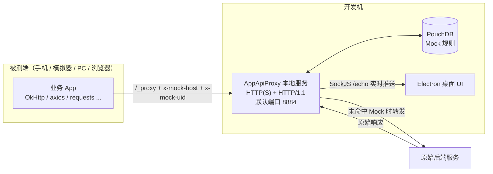
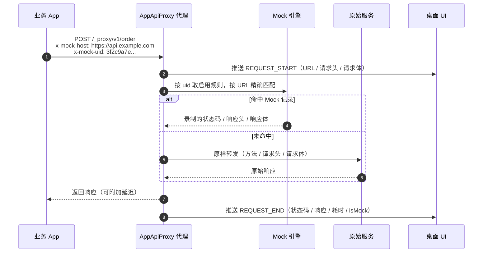

# AppApiProxy 使用说明

<p align="center">
  
</p>

AppApiProxy 是一款面向前后端并行开发的本地调试代理工具。它在开发机上启动一个本地 HTTP(S) 服务，被测应用只需把请求地址指向该服务并添加两个请求头，就可以实时查看请求/响应、把线上数据录制成 Mock 用例、模拟接口延迟，并在后端接口尚未就绪时继续开发。

> 适用版本：1.0.x（当前 main 分支）。示例截图来自历史版本，界面细节请以实际安装版本为准。

## 目录

- [1. 应用简介](#1-应用简介)
- [2. 基本原理](#2-基本原理)
- [3. 安装与启动](#3-安装与启动)
- [4. 快速开始](#4-快速开始)
- [5. 接入说明](#5-接入说明)
- [6. 功能介绍](#6-功能介绍)
- [7. 典型使用场景](#7-典型使用场景)
- [8. 常见问题](#8-常见问题)
- [9. 配置与数据存储](#9-配置与数据存储)
- [10. 已知限制](#10-已知限制)

---

## 1. 应用简介

AppApiProxy 要解决的核心问题是：**让前端在没有后端、没有测试环境、或者不方便抓包的情况下，依然能独立推进开发。**

它提供四类能力：

| 能力 | 说明 |
| --- | --- |
| 请求抓取 | 实时展示经过代理的请求头、请求体、响应头、响应数据、状态码和耗时 |
| 数据 Mock | 把任意一次请求/响应录制成规则，之后由本地直接返回录制的数据，不再请求后端 |
| 延迟模拟 | 为指定客户端设置响应延迟，验证 Loading、超时、竞态等弱网场景 |
| 数据预览 | 在响应 JSON 中点击 URL，直接预览图片、音频、视频和 HLS 直播流 |

适合的角色：

- 移动端（Android / iOS / 鸿蒙）、PC 客户端、Web 前端开发同学
- 需要构造异常响应、边界数据的测试同学
- 需要联调多端、对比不同设备请求的研发同学

所有数据默认只保存在本机，不会上传到任何服务。

---

## 2. 基本原理

### 2.1 整体架构



应用启动后，Electron 主进程会在本机拉起一个 Express 服务（默认端口 `8884`，默认协议 `https`，支持 HTTP/2 并兼容 HTTP/1.1）。被测应用的请求不再直接发往后端，而是先到本地代理：

1. 业务请求的 URL 加上 `/_proxy` 前缀，指向代理机；
2. 通过 `x-mock-host` 告诉代理「原始服务地址是什么」；
3. 通过 `x-mock-uid` 告诉代理「这条流量属于哪个客户端」；
4. 代理读取原始请求字节，查询该客户端是否启用了 Mock 规则；
5. 命中 Mock 就直接返回录制的响应，未命中就把请求原样转发给原始服务；
6. 无论 Mock 还是转发，代理都会把请求开始、请求结束两条记录通过 SockJS 推送给桌面 UI。

### 2.2 一次请求的完整链路



### 2.3 地址转换规则

原始请求：

```text
POST https://api.example.com/v1/order?from=app
```

接入代理后：

```text
POST https://192.168.1.10:8884/_proxy/v1/order?from=app

x-mock-host: https://api.example.com
x-mock-uid: 3f2c9a7e-...
```

也就是说：

```text
代理地址 = {协议}://{代理机 IP}:{端口}/_proxy{原始 Path}{原始 Query}
```

`x-mock-host` 可以带协议，也可以只写域名：

- `https://api.example.com`：按 HTTPS 访问原始服务；
- `api.example.com`：默认按 HTTP 访问；
- `https://api.example.com/api/v1`：支持带基础路径，最终目标为「基础路径 + 请求 Path」。

代理会自动移除 `x-mock-host`、`x-mock-uid` 以及 `Host` 等头，再按原始 Host 转发，业务请求里的 `Authorization`、`Cookie`、`Content-Type` 等头会保留。

---

## 3. 安装与启动

### 3.1 安装包

| 平台 | 产物 | 说明 |
| --- | --- | --- |
| Windows x64 | `AppApiProxy-Setup-<version>.exe` | NSIS 安装包，可创建桌面快捷方式 |
| macOS | `.dmg` | universal 架构 |
| Linux | `.AppImage` | 直接运行 |

Windows 首次启动时会尝试自动添加名为 `AppApiProxy` 的防火墙入站/出站放行规则，便于手机等局域网设备访问。如果系统弹出了防火墙授权提示，请选择允许。

### 3.2 源码运行

```bash
# 安装依赖
yarn

# 开发模式（热更新）
yarn dev

# 构建生产版本
yarn build
```

### 3.3 首次启动

1. 启动 AppApiProxy，主窗口会打开并自动启动本地代理服务；
2. 点击主界面右上角的设置图标；
3. 确认「服务 IP 地址」「代理 Http 服务端口」「Http 协议」：
   - 被测设备需要能访问该 IP，不能填 `127.0.0.1`；
   - 默认端口 `8884`；
   - 默认协议为 `https`（自签名证书），也可以切换为 `http`；
4. 修改端口或协议后点击「保存」，服务会自动重启。

> 手机和开发机需要处于同一局域网。部分公司 Wi-Fi 开启了 AP 隔离，设备之间无法互访，此时可以改用手机热点。

---

## 4. 快速开始

下面用 5 分钟完成一次「抓包 → Mock」的闭环。

### 第一步：确认代理地址

在「设置」中记下：

```text
代理 IP：192.168.1.10
端口：8884
协议：https
```

则代理基地址为 `https://192.168.1.10:8884`。

### 第二步：获取客户端 ID（`x-mock-uid`）

1. 打开主界面；
2. 点击顶部延迟输入框左侧的客户端选择器；
3. 列表中的每个客户端都会显示 UID，当前桌面端会标记「(本机)」；
4. 也可以在「设置 → 在线 Client」中点击客户端查看完整 UID。

> 只有 `x-mock-uid` 与某个在线客户端一致时，请求记录才会实时显示在这个客户端对应的桌面上，Mock 和延迟也才会生效。最简单的做法是直接使用「(本机)」的 UID。

### 第三步：发一条测试请求

```bash
curl -k -i \
  'https://192.168.1.10:8884/_proxy/v1/user/10086?detail=1' \
  -H 'x-mock-host: https://api.example.com' \
  -H 'x-mock-uid: 3f2c9a7e-...' \
  -H 'Content-Type: application/json' \
  -d '{"name":"test"}'
```

如果主界面左侧出现了这条请求，右侧能看到请求头、响应头和响应数据，说明接入成功。

### 第四步：设置延迟

1. 在主界面左上角选择目标客户端；
2. 在「延迟(ms)」输入框填入 `2000`；
3. 点击右侧保存按钮；
4. 再次发请求，响应会在 2 秒后才返回。

### 第五步：录制并启用 Mock

1. 在左侧列表选中刚才的请求；
2. 点击右侧详情顶部的「书签」按钮，打开 Mock 规则管理；
3. 新建规则，填写规则名和描述，保存；
4. 在规则编辑区修改响应数据，点击中间的「→」把这条记录写入规则；
5. 打开规则右上角的开关；
6. 停止后端服务或断网后再次请求，接口仍然返回录制数据，并且记录上会出现 Mock 标记。

---

## 5. 接入说明

### 5.1 接入参数

| 参数 | 必填 | 示例 | 说明 |
| --- | --- | --- | --- |
| 代理地址 | 是 | `https://192.168.1.10:8884` | 协议 + 代理机 IP + 端口 |
| 路径前缀 | 是 | `/_proxy` | 所有代理请求都必须带此前缀 |
| `x-mock-host` | 是 | `https://api.example.com` | 原始服务的协议 + 域名（可带基础路径） |
| `x-mock-uid` | 建议 | `3f2c9a7e-...` | 在线客户端 UID；不带则只有纯转发，没有记录/Mock/延迟 |
| 证书 | 视协议 | 自签名 | 使用 `https` 时客户端需信任证书或忽略校验 |

请求头名称大小写不敏感，`X-Mock-Host`、`X-Mock-Uid` 同样有效。

### 5.2 客户端改造清单

对现有网络框架做最小改造即可：

- [ ] 把请求的 Scheme/Host/Port 替换为代理地址；
- [ ] 在 Path 前拼接 `/_proxy`；
- [ ] 保留原始 Path 和 Query（包括编码形式）；
- [ ] 添加 `x-mock-host`，值为原始 `scheme://host[:port]`；
- [ ] 添加 `x-mock-uid`，值为在线客户端 UID；
- [ ] 如果用 HTTPS 代理，调试包忽略证书校验或导入自签名证书；
- [ ] 重定向、Cookie 等场景按需处理（见[已知限制](#10-已知限制)）。

建议把这段逻辑封装成一个「调试开关」：只在 Debug 包或开发环境启用，Release 包保持直连。

### 5.3 代码示例

#### curl

```bash
# 原始请求：POST https://api.example.com/v1/user/10086?detail=1
curl -k -i \
  'https://192.168.1.10:8884/_proxy/v1/user/10086?detail=1' \
  -H 'x-mock-host: https://api.example.com' \
  -H 'x-mock-uid: 3f2c9a7e-...' \
  -H 'Content-Type: application/json' \
  -d '{"name":"test"}'
```

`-k` 用于跳过 HTTPS 自签名证书校验。如果代理协议改成了 `http`，则去掉 `-k` 并把地址改为 `http://`。

#### Android / OkHttp

```kotlin
class ApiProxyInterceptor(
    private val proxyBase: String, // 例如 "https://192.168.1.10:8884"
    private val mockUid: String,   // 例如 "3f2c9a7e-..."
) : Interceptor {

    override fun intercept(chain: Interceptor.Chain): Response {
        val original = chain.request()
        val src = original.url

        // 原始站点：scheme://host[:port]
        val origin = buildString {
            append(src.scheme).append("://").append(src.host)
            if (src.port != 80 && src.port != 443) append(':').append(src.port)
        }

        val target = (
            proxyBase + "/_proxy" + src.encodedPath +
                (src.encodedQuery?.let { "?$it" } ?: "")
            ).toHttpUrl()

        val request = original.newBuilder()
            .url(target)
            .header("x-mock-host", origin)
            .header("x-mock-uid", mockUid)
            .build()

        return chain.proceed(request)
    }
}
```

注册到 OkHttpClient（仅调试环境）：

```kotlin
val client = OkHttpClient.Builder()
    .addInterceptor(ApiProxyInterceptor(proxyBase = BuildConfig.API_PROXY_BASE, mockUid = BuildConfig.MOCK_UID))
    .build()
```

如果代理地址是 `https`，需要为 OkHttpClient 配置信任自签名证书的 `SSLSocketFactory`/`HostnameVerifier`，**仅限调试包使用**。

#### Web / axios

```js
import axios from 'axios'

const PROXY = 'http://192.168.1.10:8884'
const MOCK_UID = '3f2c9a7e-...'

const http = axios.create({ baseURL: 'https://api.example.com' })

http.interceptors.request.use((config) => {
  const origin = new URL(config.baseURL)
  const target = new URL(config.url ?? '', origin)

  config.headers['x-mock-host'] = origin.origin
  config.headers['x-mock-uid'] = MOCK_UID
  config.baseURL = ''
  config.url = `${PROXY}/_proxy${target.pathname}${target.search}`
  return config
})
```

上面的写法覆盖 `config.url` 中已带的 Query。如果使用 axios 的 `params` 选项，请先把参数序列化到 URL，或自行在拦截器里拼接 `URLSearchParams`。

浏览器端也可以直接跨域访问代理：代理响应默认携带 `Access-Control-Allow-Origin: *`。

#### Python / requests

```python
import requests

PROXY = "http://192.168.1.10:8884"
MOCK_UID = "3f2c9a7e-..."

resp = requests.post(
    f"{PROXY}/_proxy/v1/order",
    params={"from": "app"},
    headers={
        "x-mock-host": "https://api.example.com",
        "x-mock-uid": MOCK_UID,
    },
    json={"sku": "A-1", "count": 2},
    verify=False,  # 代理为 https 自签名证书时使用；http 代理可去掉
    timeout=20,
)
print(resp.status_code, resp.text)
```

### 5.4 关于客户端 UID

- 每个桌面端实例会自动生成一个 UID，保存在本地 `localStorage` 中，重启后保持不变；
- 一个 UID 只对应一个在线推送连接，后注册的会顶掉前一个；
- 被测 App 本身不需要建立 SockJS 连接，只需要在请求头里携带 UID；
- 但只有当某个在线 UI 使用同一个 UID 时，代理才知道把记录推给谁；
- Mock 开关也按 UID 生效：在哪个 UI 上打开规则，就作用于该 UI 的 UID。

因此推荐的用法是：**被测 App 的 `x-mock-uid` 直接填当前桌面端的「(本机)」UID。**

如果要同时调试两台设备，可以让两台设备使用不同的 UID，并分别打开两个桌面端实例（各自使用自己的 UID），这样记录和 Mock 状态互不干扰。

### 5.5 HTTPS 与证书

代理默认使用 `https`，服务端证书来自项目内置的自签名证书。不同客户端需要分别处理：

| 客户端 | 处理方式 |
| --- | --- |
| curl | 加 `-k` |
| Python requests | `verify=False`（控制台会有告警） |
| OkHttp / Retrofit | 调试包配置信任全部证书的 `SSLSocketFactory` 与 `HostnameVerifier` |
| iOS | 在 `Info.plist` 中为调试环境放宽 ATS，或安装并信任证书 |
| 浏览器 | 首次访问时手动信任证书，或改用 `http` |

如果不想处理证书，最省事的方式是在「设置」中把协议切换为 `http`。切换后保存，代理服务会自动重启。

### 5.6 请求/响应限制

| 项目 | 限制 | 表现 |
| --- | --- | --- |
| 请求体大小 | 50 MB | 超出返回 `413`，`{"code":9000,"msg":"request body too large"}` |
| 上游无响应 | 15 秒 | 返回 `502`，`proxy error: proxy timeout` |
| 单条响应记录 | 1 MB | 详情中显示截断标记，完整响应仍正常返回给客户端 |
| UI 记录条数 | 最近 40 条 | 超出后自动淘汰最旧的记录（当前选中项不淘汰） |
| 响应解压 | gzip / deflate / br / zstd | 仅用于 UI 展示，转发给客户端的是原始压缩字节 |

代理支持任意 HTTP 方法、二进制请求体、`multipart/form-data`、`chunked` 传输以及 Range 请求。

---

## 6. 功能介绍

> 以下截图为历史版本，当前版本在布局和字段上可能略有差异。

### 6.1 主界面：实时请求列表


左侧是实时请求列表，按时间倒序排列：

- 顶部图标用于筛选 **API 请求 / 打点数据 / WebSocket** 类型（当前版本主要使用 API 请求）；
- 延迟输入框 + 客户端选择器：为指定 UID 设置响应延迟；
- 搜索框：按 URL 关键字过滤，清空关键字即可恢复；
- 垃圾桶按钮：清空当前所有记录（不可恢复）。

每条记录展示：

- `[HTTP]` 状态码：`200` 为绿色，其他为红色；
- `[BIZ]` 业务码：响应 JSON 中 `code` 为 `8000` 时显示绿色，否则为黄色；
- 请求方法：`GET` / `POST` / `PUT` / `DELETE` 等；
- 耗时：小于 500ms 为绿色，超过 500ms 为红色；
- 进行中的请求显示 Loading，完成后显示箭头；
- 命中 Mock 的请求会显示 Mock 图标。

### 6.2 请求详情

点击任意记录，右侧展示完整详情：

| 区块 | 内容 |
| --- | --- |
| 顶部 | 请求 URL，可复制；书签按钮可把当前记录带入 Mock 规则管理 |
| 请求头 | 原始请求头，JSON 格式展示，支持折叠 |
| 请求参数 | GET Query 参数 |
| 请求体 | 按 `Content-Type` 自动切换 `Form` / `JSON` / `XML` / `Text` / `Binary` 视图 |
| 响应头 | 上游返回的响应头 |
| 响应数据 | 响应体，自动格式化 JSON/XML，支持折叠和搜索 |

编辑器支持语法高亮、行号、折叠和鼠标拖选复制。

### 6.3 数据预览：图片 / 音频 / 视频 / HLS


在任意 JSON/文本编辑区中，鼠标悬停在 `http(s)://` 链接上会出现下划线，单击即可预览：

- 图片：`png` / `jpg` / `gif` / `webp` / `bmp` / `svg` / `avif` / `ico`；
- 音频：`mp3` / `wav` / `ogg` / `m4a` / `aac` / `flac` / `opus`；
- 视频：`mp4` / `m4v` / `mov` / `webm` / `mkv` / `flv`；
- 直播流：`.m3u8`，使用 hls.js 播放。

预览请求会经过代理的 `/corsMediaProxy`，因此不受目标站 CORS 限制；音视频支持 Range，可以边下边播和拖动进度。点击遮罩或关闭按钮即可结束预览。

> 预览会由你的开发机主动请求该 URL，请只预览可信地址。

### 6.4 Mock 规则管理


打开方式：

- 主界面右上角的规则图标；
- 请求详情顶部的书签按钮（会带上当前请求）；
- 托盘菜单「用例管理」。

一个 Mock 规则包含：

- **规则名 / 描述**：用于检索和说明；
- **请求列表**：以 URL 为 Key 的请求/响应快照；
- **Mock 开关**：控制当前 UID 是否启用该规则。

典型流程：

1. **新建规则**：点击搜索框右侧的 `+`，填写名称和描述；
2. **采集记录**：在请求详情点书签，或者在规则编辑器中直接粘贴一条请求 JSON，点击「→」写入；
3. **编辑响应**：点击左侧记录，右侧编辑器会显示完整 JSON，可以修改 `statusCode`、`responseHeaders`、`responseData`；
4. **保存**：云同步按钮保存整份规则；修改名称/描述或切换开关时只保存元数据，不会覆盖已采集的请求；
5. **启用**：打开右上角开关，之后该 UID 的匹配请求直接返回 Mock 数据。

匹配规则：

- 按 **Path + Query 精确匹配**，不区分 Host；
- 不匹配时自动回退到真实代理，不会报错；
- Query 参数顺序、大小写、动态签名都会影响匹配，建议 Mock 前先把会变化的参数固定下来；
- 响应状态码非法时回退为 `200`；
- Mock 响应的响应头会过滤 `content-length`、`content-encoding` 和逐跳头。

Mock 规则保存在本机 PouchDB 中，重启应用不会丢失。

### 6.5 延迟模拟

在主界面左上角选择目标客户端，输入延迟毫秒数并保存：

- 延迟同时作用于 Mock 响应和真实代理响应；
- 只延迟「响应返回」，不会延迟请求发出；
- 每个 UID 独立配置，`0` 表示关闭；
- 适合验证 Loading、骨架屏、超时重试、竞态和防抖逻辑。

### 6.6 二维码与在线客户端


点击主界面右上角的二维码图标，会显示当前 UID 的注册地址。用手机或另一台设备打开该地址：

- 如果桌面端提示「设备[xxx]注册成功」，说明两台设备网络可达；
- 如果没有反应，优先检查 IP 是否是局域网地址、防火墙是否放行、两台设备是否在同一网段；
- 地址中包含代理 IP、端口和 UID，可直接复制。

「设置 → 在线 Client」会列出所有通过 SockJS 注册的客户端（UID、IP、端口、连接 ID），并支持：

- 向单个客户端发送文本消息；
- 向所有客户端广播消息。

消息只用于联调提示，不做持久化。

### 6.7 设置


| 设置项 | 作用 |
| --- | --- |
| Http 协议 | 在 `https[2]` 和 `http` 之间切换，保存后服务重启 |
| 服务 IP 地址 | 选择供其他设备访问的局域网 IP |
| 服务域名 | 预留配置，保存到本地配置文件 |
| 代理 Http 服务端口 | 默认 `8884`；被占用时界面会提示更换 |
| 应用更新服务地址 | 版本检查的基地址，留空时默认请求 `http://127.0.0.1:4000` |
| API 定义服务地址 | 预留配置，保存到本地配置文件 |
| 埋点规则服务地址 | 预留配置，保存到本地配置文件 |
| 代理数据服务地址 | 预留配置；当前版本转发目标仍由 `x-mock-host` 决定 |

下方还有：

- **主题**：浅色 / 深色；
- **字体大小**：7–10 px；
- **语言**：简体中文 / English；
- **版本**：点击版本号手动检查更新。

Web 版本中端口、更新地址等字段为只读，保存按钮不显示，配置由宿主提供。

### 6.8 版本更新

点击「设置 → 版本」可以手动检查更新：

1. 请求 `{更新服务地址}/version-{platform}-{arch}.json`；
2. 若返回的 `version` 与当前应用版本不一致，显示更新按钮；
3. 点击后下载更新包并显示进度；
4. 增量更新下载 `.gz` 并校验 `sha512`，替换 `app.asar` 后重启；
5. 全量更新下载安装包并启动安装程序。

本地调试更新服务：

```bash
# 将 build/ 目录以 4000 端口提供出去
yarn updateServer
```

发布时请确保 `build/version.json` 与 `build/version-<platform>-<arch>.json` 同步更新，否则不同客户端会读到不一致的版本信息。

### 6.9 托盘与快捷键

- **托盘菜单**：用例管理、设置、开发者面板、退出；
- **单击托盘图标**：显示并聚焦主窗口；
- **Ctrl/Cmd + Q**：退出应用；
- **Ctrl/Cmd + R**：刷新窗口；
- 应用为单实例模式，重复启动会聚焦已有窗口；
- Windows 下关闭窗口后应用仍驻留托盘，需要从托盘菜单「退出」才能完全结束进程；macOS / Linux 关闭窗口即退出。

### 6.10 开发者面板（实验）

主界面左下角的火焰按钮可以打开开发者面板，包含：

- 版本检查快捷入口；
- 打开 Chromium DevTools；
- SSE 广播测试；
- HLS 地址播放与带宽估算；
- 摄像头预览（OpenCV 画面处理示例）。

该面板主要用于工具自身的调试，日常联调可以忽略。

---

## 7. 典型使用场景

### 7.1 前后端并行开发

后端接口还没好，但接口文档已经确定：

1. 按接口文档手写一条 Mock 记录（URL、状态码、响应 JSON）；
2. 启用规则；
3. 前端按真实协议请求代理，开发不再被后端阻塞；
4. 后端联调时关闭 Mock，自动切回真实接口。

### 7.2 真机抓包

不想安装额外的抓包工具或配置系统代理时：

1. 手机与开发机连同一 Wi-Fi；
2. App 内把请求指向代理并加上两个头；
3. 主界面实时查看请求，不需要 root、不需要证书抓包；
4. 遇到 HTTPS 时，改代理协议为 `http` 或让调试包信任自签名证书。

### 7.3 异常与边界测试

录一次正常响应，然后复制成多条记录，分别修改：

- `statusCode`：`400` / `401` / `403` / `500` / `502`；
- 业务码：`4000`、`9000`；
- `responseData`：空数组、`null`、超长文本、缺字段、错误类型；
- 延迟：`3000ms` 以上。

快速验证前端的空态、错误态、重试和兜底逻辑。

### 7.4 回归数据沉淀

把线上或测试环境的真实响应录制成规则，作为一个本地的「接口样本库」。后续改动前端时，用固定数据回归，避免依赖不稳定的测试环境。

---

## 8. 常见问题

### Q1：主界面收不到任何请求记录

按顺序排查：

1. URL 是否带了 `/_proxy` 前缀；
2. `x-mock-host` 是否填写，且代理机能够访问该地址；
3. `x-mock-uid` 是否与当前在线客户端的 UID 一致；
4. 请求是否真的到达代理：在代理机浏览器打开 `https://{代理IP}:{端口}` 是否能访问；
5. 手机与开发机是否在同一局域网，防火墙是否放行；
6. 如果代理是 HTTPS，客户端是否因证书校验失败而根本没发出请求。

### Q2：返回 502 / `proxy error`

- `missing x-mock-host header`：没有传 `x-mock-host`；
- `proxy timeout`：上游 15 秒无响应；
- `getaddrinfo ENOTFOUND`：代理机无法解析原始域名；
- 上游证书错误：原始服务证书必须能被 Node 校验通过；
- 注意：请求是从**代理机**发出的，不是从手机发出的。手机能访问的地址，代理机不一定能访问。

### Q3：Mock 规则不生效

1. 规则右上角开关是否打开；
2. 被测请求的 `x-mock-uid` 是否与打开规则的桌面端 UID 一致；
3. 请求的 Path + Query 是否与录制记录**完全一致**（包括参数顺序和编码）；
4. 记录中的 `responseData` 是否是合法 JSON；
5. 修改后是否保存（切换开关只保存元数据，不会覆盖请求列表）；
6. 用「搜索」确认当前启用的规则就是你修改的那一条。

### Q4：二维码/注册地址打不开

- 确认地址中的 IP 是局域网 IP，不是 `127.0.0.1`；
- 确认手机和开发机在同一网段，防火墙已放行；
- 个别版本界面生成的注册路径可能是 `/appmock/...`，服务端实际路由为 `/_appmock/...`，如果访问 404，请把地址改为：

  ```text
  http://{代理IP}:{端口}/_appmock/register/{uid}
  ```

### Q5：端口被占用

设置页会提示「端口已被占用，请更换」。换一个可用端口并保存，服务会自动重启。也可以先结束占用 `8884` 的进程再启动。

### Q6：HTTPS 客户端报证书错误

使用自签名证书时属于预期行为：

- 调试包忽略证书校验；
- 或把 `cert/server.crt` 安装到设备信任列表；
- 或直接在设置中把协议改成 `http`。

### Q7：响应数据看不全

UI 中单条响应最多记录 1MB，超出部分会显示截断标记。客户端收到的响应本身是完整的，只是详情面板不展示全量。大文件建议用日志或专门的抓包工具查看。

### Q8：检查更新总是提示有新版本

`version-<platform>-<arch>.json` 中的 `version` 必须与当前应用版本**完全一致**。发布后请确认平台文件和 `version.json` 都已更新，并检查更新服务地址是否指向正确的目录。

### Q9：关闭窗口后进程还在

Windows 下关闭窗口只是隐藏到托盘，这是预期行为。右键托盘图标选择「退出」，或按 `Ctrl/Cmd + Q`。

---

## 9. 配置与数据存储

数据默认保存在 Electron 的 `userData` 目录：

| 平台 | 默认路径 |
| --- | --- |
| Windows | `%APPDATA%\AppApiProxy\` |
| macOS | `~/Library/Application Support/AppApiProxy/` |
| Linux | `~/.config/AppApiProxy/` |

主要文件：

| 路径 | 内容 |
| --- | --- |
| `local.config.json` | 协议、IP、端口、更新服务地址等本地配置 |
| `biz_storage/Mock.Rules` | PouchDB 数据库，保存所有 Mock 规则 |
| `static/` | 静态资源目录，通过 `/_res/` 对外提供 |
| `update/` | 下载的更新包 |
| `crashDumps/` | 崩溃转储 |

UI 侧还会在浏览器 `localStorage` 中保存：

- `uid`：当前客户端的 UID；
- `theme`：主题；
- `lang`：语言；
- `fontSize`：字体大小。

> 备份 Mock 规则时，请完整备份 `biz_storage/Mock.Rules` 目录。删除该目录会清空所有规则。

---

## 10. 已知限制

- **记录只在内存中**：应用重启后请求列表清空，Mock 规则不受影响。
- **UI 最多保留 40 条记录**：长时间挂机时旧记录会被淘汰。
- **单条响应展示上限 1MB**：超出部分截断展示。
- **Mock 只支持精确匹配**：不支持通配符、正则或按 Host 匹配；动态 Query 需要先固定。
- **不重写 3xx Location**：客户端自动跟随重定向时会绕过代理，重定向后的请求不会出现在列表中。
- **Cookie 域可能不匹配**：原始站点的 `Set-Cookie` 域与代理地址不同，浏览器/客户端可能拒收，登录态相关场景需要单独处理。
- **上游证书必须有效**：代理使用 Node 原生 HTTPS 请求原始服务，自签名上游会失败。
- **不解析 WebSocket 帧**：主界面保留了 WebSocket 类型筛选，但当前版本不抓取 WS 帧；HTTP Upgrade 请求也不在代理能力范围内。
- **打点数据通道未启用**：统计类型（5020）的展示组件保留，但当前版本没有对外上报入口。
- **静态资源管理为占位功能**：设置中的上传控件尚未接入后端上传接口。
- **无账号与云同步**：所有配置和数据都在本机。

---

## 附：内部接口速查

以下接口由本地服务提供，主要用于 UI 自身和二次开发，不保证跨版本兼容。

| 路径 | 说明 |
| --- | --- |
| `/_proxy/*` | 代理入口 |
| `/corsMediaProxy?target=<url>` | 媒体预览代理，支持 Range |
| `/_appmock/getServerConfig` | 获取服务配置 |
| `/_appmock/saveProxyConfig?uid=<uid>` | 保存指定客户端的延迟等代理配置 |
| `/_appmock/getProxyConfig?uid=<uid>` | 获取指定客户端的代理配置 |
| `/_appmock/searchMockRules?keyword=<kw>` | 搜索 Mock 规则 |
| `/_appmock/getMockRuleDetail?ruleId=<id>` | 获取规则详情 |
| `/_appmock/getActiveMockRule` | 获取当前 UID 启用的规则 |
| `/_appmock/saveMockRule?onlySnap=<bool>` | 保存规则 |
| `/_appmock/deleteMockRule?ruleId=<id>` | 删除规则 |
| `/_appmock/getAllPushClients` | 获取在线客户端 |
| `/_appmock/register/<uid>` | 注册/唤醒指定客户端 |
| `/_appmock/broadcast/<uid>` | 广播测试消息 |
| `/echo`（SockJS） | 实时推送通道 |
