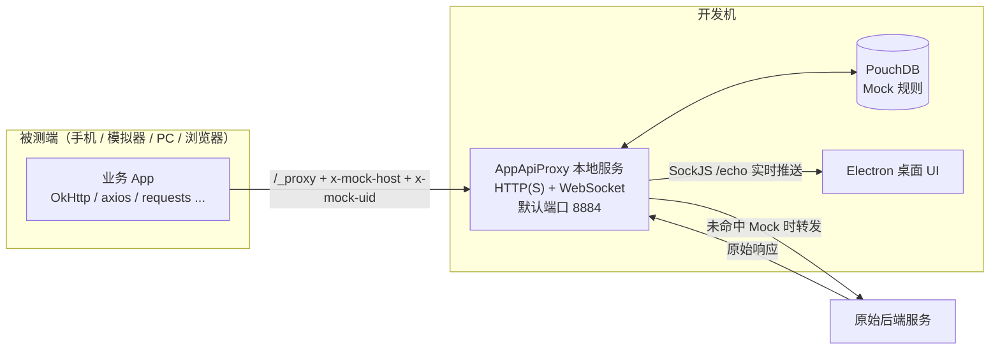
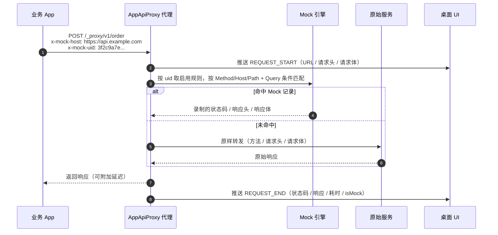
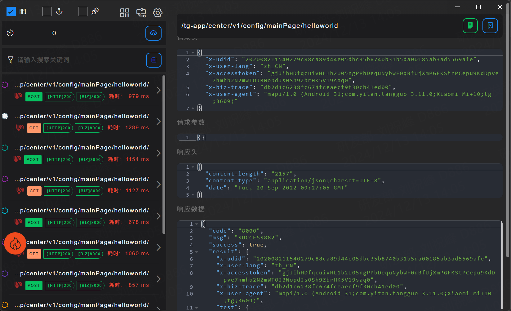
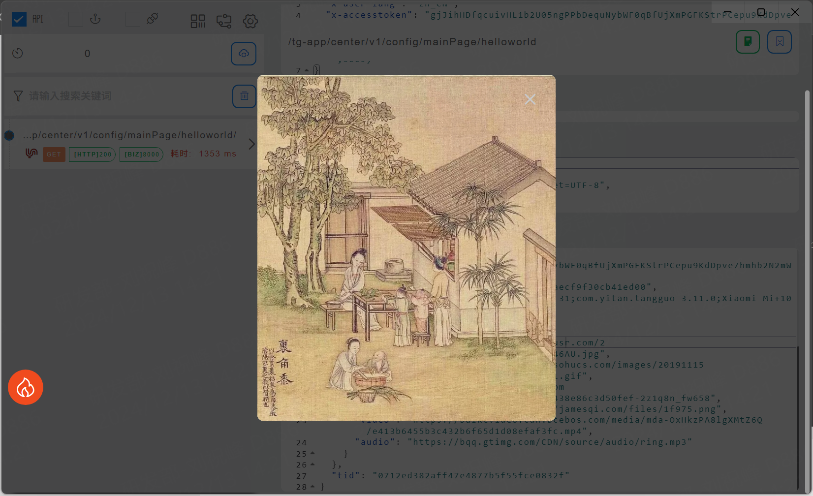
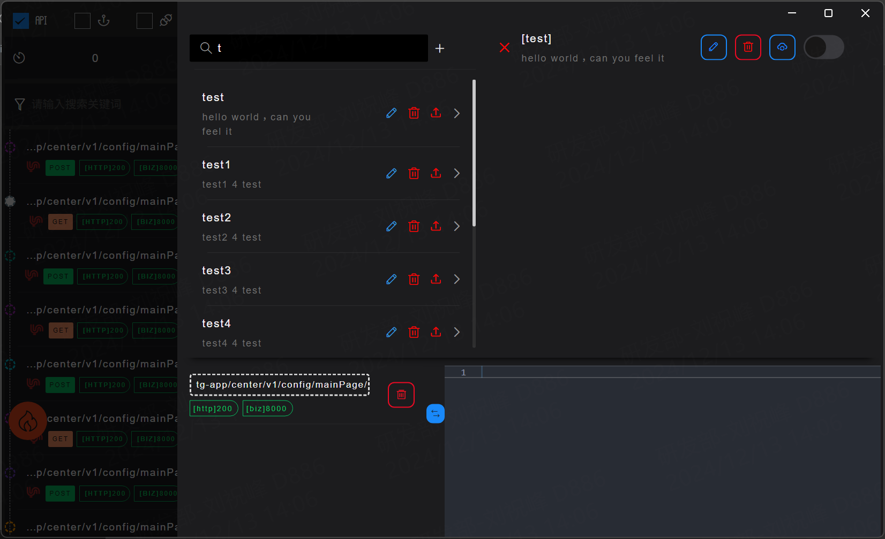
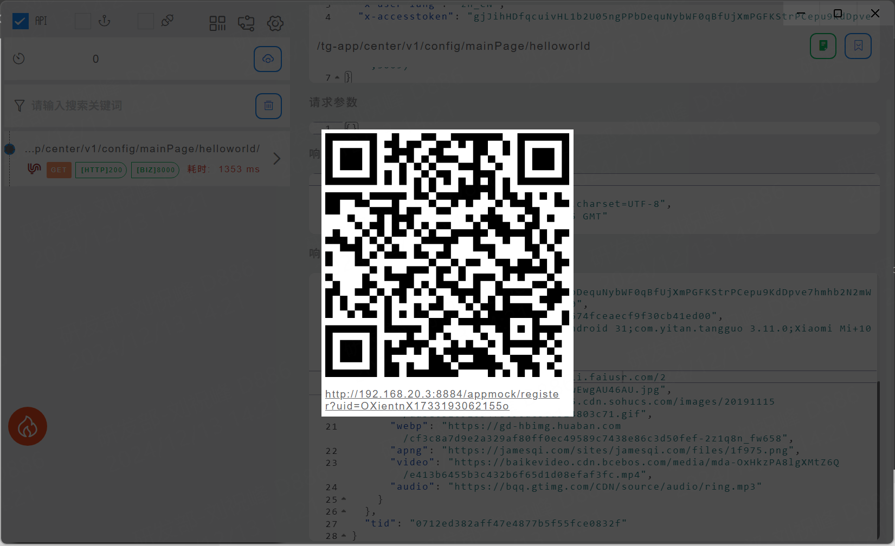
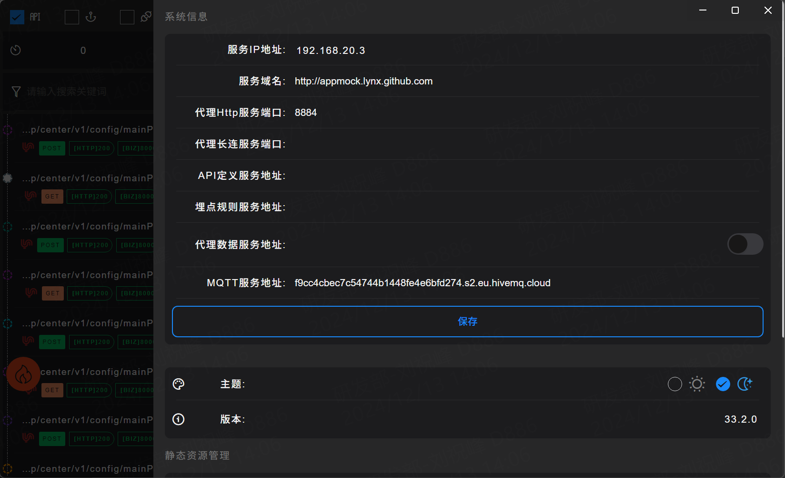

# AppApiProxy 使用说明

<p align="center">
  
</p>

AppApiProxy 是一款面向前后端并行开发的本地调试代理工具。它在开发机上启动一个本地 HTTP(S) 服务，被测应用只需把请求地址指向该服务并添加两个请求头，就可以实时查看请求/响应、把线上数据录制成 Mock 用例、模拟接口延迟，并在后端接口尚未就绪时继续开发。当前版本同时支持 WebSocket 长连接代理，以及首次接入向导与诊断中心。

> 适用版本：当前 main 分支（应用版本 1.0.5+，包含 v1.1 预览能力）。示例截图来自历史版本，界面细节请以实际安装版本为准。

## 目录

- [1. 应用简介](#1-应用简介)
- [2. 基本原理](#2-基本原理)
- [3. 安装与启动](#3-安装与启动)
- [4. 快速开始](#4-快速开始)
- [5. 接入说明](#5-接入说明)
- [6. 功能介绍](#6-功能介绍)
- [7. 典型使用场景](#7-典型使用场景)
- [8. 常见问题](#8-常见问题)
- [9. 配置与数据存储](#9-配置与数据存储)
- [10. 已知限制](#10-已知限制)
- [11. v1.1 发布说明：Mock 匹配行为变化](#11-v11-发布说明mock-匹配行为变化)

---

## 1. 应用简介

AppApiProxy 要解决的核心问题是：**让前端在没有后端、没有测试环境、或者不方便抓包的情况下，依然能独立推进开发。**

它提供以下能力：

| 能力 | 说明 |
| --- | --- |
| 请求抓取 | 实时展示经过代理的请求头、请求体、响应头、响应数据、状态码和耗时 |
| 数据 Mock | 把任意一次请求/响应录制成规则，之后由本地直接返回录制的数据，不再请求后端；支持多响应变体与结构化编辑 |
| 延迟模拟 | 为指定客户端或单条 Mock 响应设置延迟，验证 Loading、超时、竞态等弱网场景 |
| 数据预览 | 在响应 JSON 中点击 URL，直接预览图片、音频、视频和 HLS 直播流 |
| WebSocket 代理 | 代理长连接握手与双向消息，记录帧、关闭码、子协议和异常，并支持消息过滤与搜索 |
| 接入与诊断 | 首次启动引导完成代理接入；诊断中心汇总服务状态、最近请求/错误，并可对目标地址做链路探测 |

适合的角色：

- 移动端（Android / iOS / 鸿蒙）、PC 客户端、Web 前端开发同学
- 需要构造异常响应、边界数据的测试同学
- 需要联调多端、对比不同设备请求的研发同学

所有数据默认只保存在本机，不会上传到任何服务。

---

## 2. 基本原理

### 2.1 整体架构



应用启动后，Electron 主进程会在本机拉起一个 Express 服务（默认端口 `8884`，默认协议 `http`；切换到 `https` 时使用 HTTP/2 并兼容 HTTP/1.1）。被测应用的请求不再直接发往后端，而是先到本地代理：

1. 业务请求的 URL 加上 `/_proxy` 前缀，指向代理机；
2. 通过 `x-mock-host` 告诉代理「原始服务地址是什么」；
3. 通过 `x-mock-uid` 告诉代理「这条流量属于哪个客户端」；
4. 代理读取原始请求字节，查询该客户端是否启用了 Mock 规则；
5. 命中 Mock 就直接返回录制的响应，未命中就把请求原样转发给原始服务；
6. 无论 Mock 还是转发，代理都会把请求开始、请求结束两条记录通过 SockJS 推送给桌面 UI。

WebSocket 长连接复用同一个端口和 `/_proxy` 前缀：代理先与上游完成握手，再把双向帧转发给客户端，并按批把连接状态与帧记录推送到 UI（见 [6.11 WebSocket 代理](#611-websocket-代理)）。

### 2.2 一次请求的完整链路



### 2.3 地址转换规则

原始请求：

```text
POST https://api.example.com/v1/order?from=app
```

接入代理后：

```text
POST https://192.168.1.10:8884/_proxy/v1/order?from=app

x-mock-host: https://api.example.com
x-mock-uid: 3f2c9a7e-...
```

也就是说：

```text
代理地址 = {协议}://{代理机 IP}:{端口}/_proxy{原始 Path}{原始 Query}
```

`x-mock-host` 可以带协议，也可以只写域名：

- `https://api.example.com`：按 HTTPS 访问原始服务；
- `api.example.com`：默认按 HTTP 访问；
- `https://api.example.com/api/v1`：支持带基础路径，最终目标为「基础路径 + 请求 Path」。

代理会自动移除 `x-mock-host`、`x-mock-uid` 以及 `Host` 等头，再按原始 Host 转发，业务请求里的 `Authorization`、`Cookie`、`Content-Type` 等头会保留。

WebSocket 使用同一套转换规则：`wss://{代理IP}:{端口}/_proxy{原始Path}{原始Query}`，同样通过 `x-mock-host` 指定目标；`http` / `https` 会分别映射为 `ws` / `wss`。

---

## 3. 安装与启动

### 3.1 安装包

| 平台 | 产物 | 说明 |
| --- | --- | --- |
| Windows x64 | `AppApiProxy-Setup-<version>.exe` | NSIS 安装包，可创建桌面快捷方式 |
| macOS | `.dmg` | universal 架构 |
| Linux | `.AppImage` | 直接运行 |

Windows 首次启动时会尝试自动添加名为 `AppApiProxy` 的防火墙入站/出站放行规则，便于手机等局域网设备访问。如果系统弹出了防火墙授权提示，请选择允许。

### 3.2 源码运行

```bash
# 安装依赖
yarn

# 开发模式（热更新）
yarn dev

# 构建生产版本
yarn build
```

### 3.3 首次启动与接入向导

首次启动（`local.config.json` 中还没有 `onboarded` 标记）时，应用会直接打开「接入向导」，按四步完成第一次接入：

1. **服务就绪**：显示代理协议、服务地址、端口、运行时长和代理基地址，可直接复制地址；端口不可用时会提示去设置中更换；
2. **接入客户端**：左侧展示注册二维码，右侧可按 `cURL` / `JavaScript` / `Python` / `Android` 生成带 `x-mock-host`、`x-mock-uid` 的代码片段，修改「真实服务地址」后片段会同步更新；
3. **连接验证**：每 2 秒刷新一次健康状态，发起请求后会显示最近一条请求、UID 是否已注册；UID 不在线时会给出对齐提示；
4. **第一条 Mock**：填写规则名、请求路径和响应 JSON，点击「创建并启用」即可生成规则与记录，随后用页面给出的 cURL 验证是否命中。

点击「开始使用」会记录已完成状态并进入主界面；点击「跳过向导」同样会记录状态。之后可以通过以下入口重新打开：

- **设置 → 接入与诊断 → 接入向导**；
- 托盘菜单「接入向导」。

如果跳过了向导，也可以手动完成基础配置：

1. 点击主界面右上角的设置图标；
2. 确认「服务 IP 地址」「代理 Http 服务端口」「Http 协议」：
   - 被测设备需要能访问该 IP，不能填 `127.0.0.1`；
   - 默认端口 `8884`；
   - 默认协议为 `http`，也可以切换为 `https`（自签名证书）；
3. 修改端口或协议后点击「保存」，服务会自动重启。

> 手机和开发机需要处于同一局域网。部分公司 Wi-Fi 开启了 AP 隔离，设备之间无法互访，此时可以改用手机热点。

---

## 4. 快速开始

下面用 5 分钟完成一次「抓包 → Mock」的闭环。

### 第一步：确认代理地址

在「设置」中记下：

```text
代理 IP：192.168.1.10
端口：8884
协议：https
```

则代理基地址为 `https://192.168.1.10:8884`。

### 第二步：获取客户端 ID（`x-mock-uid`）

1. 打开主界面；
2. 点击顶部延迟输入框左侧的客户端选择器；
3. 列表中的每个客户端都会显示 UID，当前桌面端会标记「(本机)」；
4. 也可以在「设置 → 在线 Client」中点击客户端查看完整 UID。

> 只有 `x-mock-uid` 与某个在线客户端一致时，请求记录才会实时显示在这个客户端对应的桌面上，Mock 和延迟也才会生效。最简单的做法是直接使用「(本机)」的 UID。

### 第三步：发一条测试请求

```bash
curl -k -i \
  'https://192.168.1.10:8884/_proxy/v1/user/10086?detail=1' \
  -H 'x-mock-host: https://api.example.com' \
  -H 'x-mock-uid: 3f2c9a7e-...' \
  -H 'Content-Type: application/json' \
  -d '{"name":"test"}'
```

如果主界面左侧出现了这条请求，右侧能看到请求头、响应头和响应数据，说明接入成功。

### 第四步：设置延迟

1. 在主界面左上角选择目标客户端；
2. 在「延迟(ms)」输入框填入 `2000`；
3. 点击右侧保存按钮；
4. 再次发请求，响应会在 2 秒后才返回。

### 第五步：录制并启用 Mock

1. 在左侧列表选中刚才的请求；
2. 点击详情右上角的书签按钮，打开「录制到 Mock」面板；
3. 在面板里确认目标规则：
   - 默认选中当前启用的规则；
   - 没有规则或想换一条时，可直接搜索，或输入名称「新建规则」；
   - 该接口已录制过时会提示「将更新已有记录」，并显示已有变体数量。
4. 点击「录制并启用」（只想先存下来就点「仅录制」，之后在规则开关处启用）；
5. 面板底部会保留最近 3 次录制记录，可对最近一次点击「撤销」；
6. 通知里点击「查看」可打开规则管理，直接编辑这条记录；编辑器里改完后点顶部保存按钮或按 `Ctrl/Cmd + S`；
7. 停止后端服务或断网后再次请求，接口仍然返回录制数据，并且记录上会出现 Mock 标记。

> 录制成功后会自动关闭面板并弹出通知；同一接口再次录制默认更新已有记录，不会产生重复数据。

---

## 5. 接入说明

### 5.1 接入参数

| 参数 | 必填 | 示例 | 说明 |
| --- | --- | --- | --- |
| 代理地址 | 是 | `https://192.168.1.10:8884` | 协议 + 代理机 IP + 端口 |
| 路径前缀 | 是 | `/_proxy` | 所有代理请求都必须带此前缀 |
| `x-mock-host` | 是 | `https://api.example.com` | 原始服务的协议 + 域名（可带基础路径） |
| `x-mock-uid` | 建议 | `3f2c9a7e-...` | 在线客户端 UID；不带则只有纯转发，没有记录/Mock/延迟 |
| 证书 | 视协议 | 自签名 | 使用 `https` 时客户端需信任证书或忽略校验 |

请求头名称大小写不敏感，`X-Mock-Host`、`X-Mock-Uid` 同样有效。

### 5.2 客户端改造清单

对现有网络框架做最小改造即可：

- [ ] 把请求的 Scheme/Host/Port 替换为代理地址；
- [ ] 在 Path 前拼接 `/_proxy`；
- [ ] 保留原始 Path 和 Query（包括编码形式）；
- [ ] 添加 `x-mock-host`，值为原始 `scheme://host[:port]`；
- [ ] 添加 `x-mock-uid`，值为在线客户端 UID；
- [ ] 如果用 HTTPS 代理，调试包忽略证书校验或导入自签名证书；
- [ ] 重定向、Cookie 等场景按需处理（见[已知限制](#10-已知限制)）。

建议把这段逻辑封装成一个「调试开关」：只在 Debug 包或开发环境启用，Release 包保持直连。

### 5.3 代码示例

#### curl

```bash
# 原始请求：POST https://api.example.com/v1/user/10086?detail=1
curl -k -i \
  'https://192.168.1.10:8884/_proxy/v1/user/10086?detail=1' \
  -H 'x-mock-host: https://api.example.com' \
  -H 'x-mock-uid: 3f2c9a7e-...' \
  -H 'Content-Type: application/json' \
  -d '{"name":"test"}'
```

`-k` 用于跳过 HTTPS 自签名证书校验。如果代理协议改成了 `http`，则去掉 `-k` 并把地址改为 `http://`。

#### Android / OkHttp

```kotlin
class ApiProxyInterceptor(
    private val proxyBase: String, // 例如 "https://192.168.1.10:8884"
    private val mockUid: String,   // 例如 "3f2c9a7e-..."
) : Interceptor {

    override fun intercept(chain: Interceptor.Chain): Response {
        val original = chain.request()
        val src = original.url

        // 原始站点：scheme://host[:port]
        val origin = buildString {
            append(src.scheme).append("://").append(src.host)
            if (src.port != 80 && src.port != 443) append(':').append(src.port)
        }

        val target = (
            proxyBase + "/_proxy" + src.encodedPath +
                (src.encodedQuery?.let { "?$it" } ?: "")
            ).toHttpUrl()

        val request = original.newBuilder()
            .url(target)
            .header("x-mock-host", origin)
            .header("x-mock-uid", mockUid)
            .build()

        return chain.proceed(request)
    }
}
```

注册到 OkHttpClient（仅调试环境）：

```kotlin
val client = OkHttpClient.Builder()
    .addInterceptor(ApiProxyInterceptor(proxyBase = BuildConfig.API_PROXY_BASE, mockUid = BuildConfig.MOCK_UID))
    .build()
```

如果代理地址是 `https`，需要为 OkHttpClient 配置信任自签名证书的 `SSLSocketFactory`/`HostnameVerifier`，**仅限调试包使用**。

#### Web / axios

```js
import axios from 'axios'

const PROXY = 'http://192.168.1.10:8884'
const MOCK_UID = '3f2c9a7e-...'

const http = axios.create({ baseURL: 'https://api.example.com' })

http.interceptors.request.use((config) => {
  const origin = new URL(config.baseURL)
  const target = new URL(config.url ?? '', origin)

  config.headers['x-mock-host'] = origin.origin
  config.headers['x-mock-uid'] = MOCK_UID
  config.baseURL = ''
  config.url = `${PROXY}/_proxy${target.pathname}${target.search}`
  return config
})
```

上面的写法覆盖 `config.url` 中已带的 Query。如果使用 axios 的 `params` 选项，请先把参数序列化到 URL，或自行在拦截器里拼接 `URLSearchParams`。

浏览器端也可以直接跨域访问代理：代理响应默认携带 `Access-Control-Allow-Origin: *`。

#### Python / requests

```python
import requests

PROXY = "http://192.168.1.10:8884"
MOCK_UID = "3f2c9a7e-..."

resp = requests.post(
    f"{PROXY}/_proxy/v1/order",
    params={"from": "app"},
    headers={
        "x-mock-host": "https://api.example.com",
        "x-mock-uid": MOCK_UID,
    },
    json={"sku": "A-1", "count": 2},
    verify=False,  # 代理为 https 自签名证书时使用；http 代理可去掉
    timeout=20,
)
print(resp.status_code, resp.text)
```

### 5.4 关于客户端 UID

- UID 由代理服务在注册成功时分配，**每次注册（应用启动、推送连接重建）都会生成新的 UID**，不再复用历史值；
- 一个 UID 只对应一个在线连接，因此多个窗口/设备同时注册不会互相顶掉；
- 被测 App 本身不需要建立 SockJS 连接，只需要在请求头里携带 UID；
- 但只有当某个在线 UI 使用同一个 UID 时，代理才知道把记录推给谁；
- Mock 开关按 UID 生效：在哪个 UI 上打开规则，就作用于该 UI 的 UID。

推荐的用法是：**用桌面端二维码注册被测设备。** 每台设备注册后都会拿到独立的新 UID，并归属到扫码的桌面端：

- 设备的代理请求记录会实时展示在扫码的那台桌面上；
- 设备之间、设备与桌面端之间的延迟配置和请求记录互不影响；
- 设备的 Mock 请求沿用其归属桌面端已启用的规则。

> 桌面端每次启动/重连都会换新 UID，旧二维码和旧 UID 会失效，需要重新扫码注册。

### 5.5 HTTPS 与证书

代理可在「设置」中切换 `http` 和 `https`（默认 `http`）；选择 `https` 时服务端证书来自项目内置的自签名证书。不同客户端需要分别处理：

| 客户端 | 处理方式 |
| --- | --- |
| curl | 加 `-k` |
| Python requests | `verify=False`（控制台会有告警） |
| OkHttp / Retrofit | 调试包配置信任全部证书的 `SSLSocketFactory` 与 `HostnameVerifier` |
| iOS | 在 `Info.plist` 中为调试环境放宽 ATS，或安装并信任证书 |
| 浏览器 | 不会忽略证书错误：把 `cert/server.crt` 装入「受信任的根证书」并重启浏览器；内置证书 SAN 仅覆盖 `localhost` / `127.0.0.1`，用局域网 IP 访问需另签证书或改用 `http` |

如果不想处理证书，最省事的方式是在「设置」中把协议切换为 `http`。切换后保存，代理服务会自动重启。

### 5.6 请求/响应限制

| 项目 | 限制 | 表现 |
| --- | --- | --- |
| 请求体大小 | 50 MB | 超出返回 `413`，`{"code":9000,"msg":"request body too large"}` |
| 上游无响应 | 15 秒 | 返回 `502`，`proxy error: proxy timeout` |
| 单条响应记录 | 1 MB | 详情中显示截断标记，完整响应仍正常返回给客户端 |
| UI 记录条数 | 最近 40 条 | 超出后自动淘汰最旧的记录（当前选中项不淘汰） |
| 响应解压 | gzip / deflate / br / zstd | 仅用于 UI 展示，转发给客户端的是原始压缩字节 |

代理支持任意 HTTP 方法、二进制请求体、`multipart/form-data`、`chunked` 传输以及 Range 请求。

---

## 6. 功能介绍

> 以下截图为历史版本，当前版本在布局和字段上可能略有差异。

### 6.1 主界面：实时请求列表



左侧是实时请求列表，按时间倒序排列：

- 顶部图标用于筛选 **API 请求（5010）/ 打点数据（5020）/ WebSocket（5030）** 类型；勾选 WebSocket 后列表只显示长连接，图标上的徽标是当前活跃连接数，有活跃连接时图标会高亮；
- **全局 Mock 开关**：显示当前生效的规则名，点击可在「不启用」和「上次使用的规则」之间切换；没有历史规则时会打开规则管理器让你选择；
- 延迟输入框 + 客户端选择器：为指定 UID 设置响应延迟；
- 搜索框：按 URL 关键字过滤，清空关键字即可恢复；只勾选 WebSocket 且没有匹配结果时会显示连接方式提示；
- 垃圾桶按钮：清空当前所有记录（不可恢复）。

每条记录展示：

- `[HTTP]` 状态码：`200` 为绿色，其他为红色；
- `[BIZ]` 业务码：响应 JSON 中 `code` 为 `2000` 时显示绿色，否则为黄色；
- 请求方法：`GET` / `POST` / `PUT` / `DELETE` 等；
- 耗时：小于 500ms 为绿色，超过 500ms 为红色；
- 进行中的请求显示 Loading，完成后显示箭头；
- 命中 Mock 的请求会显示 Mock 图标；未命中但接近命中时会显示匹配度徽标；
- WebSocket 连接展示 `[WS]` 状态、上下行字节数、持续时长、子协议、关闭原因/关闭码和丢弃帧数。

### 6.2 请求详情

点击任意记录，右侧展示完整详情：

| 区块 | 内容 |
| --- | --- |
| 顶部 | 请求 URL，可复制；书签按钮打开「录制到 Mock」面板 |
| Mock 命中 | 命中记录、匹配档位、生效变体、忽略参数、排序依据、匹配耗时；可直接打开记录或收紧条件 |
| Mock 未命中 | 失败维度（Method / Host / Path / Query / Header）与修正建议，可一键忽略动态参数或切换宽松匹配 |
| 请求头 | 原始请求头，按 key-value 折叠展示 |
| 请求参数 | GET Query 参数 |
| 请求体 | 按 `Content-Type` 自动切换 `Form` / `JSON` / `XML` / `Text` / `Binary` 视图 |
| 响应头 | 上游返回的响应头 |
| 响应数据 | 响应体，自动格式化 JSON/XML，支持折叠和搜索 |

编辑器支持语法高亮、行号、折叠、内容搜索和鼠标拖选复制；顶部 URL 区域滚动时保持吸顶。

「录制到 Mock」面板支持：

- 搜索并选择目标规则，或输入新名称直接创建；
- 显示录制后将替换的当前启用规则；
- 「仅录制」/「录制并启用」两种保存方式；
- 底部展示最近 3 次录制记录，可撤销最近一次（新建会删除记录，更新会恢复录制前内容）。

### 6.3 数据预览：图片 / 音频 / 视频 / HLS



在任意 JSON/文本编辑区中，鼠标悬停在 `http(s)://` 链接上会出现下划线，单击即可预览：

- 图片：`png` / `jpg` / `gif` / `webp` / `bmp` / `svg` / `avif` / `ico`；
- 音频：`mp3` / `wav` / `ogg` / `m4a` / `aac` / `flac` / `opus`；
- 视频：`mp4` / `m4v` / `mov` / `webm` / `mkv` / `flv`；
- 直播流：`.m3u8`，使用 hls.js 播放。

预览请求会经过代理的 `/corsMediaProxy`，因此不受目标站 CORS 限制；音视频支持 Range，可以边下边播和拖动进度。点击遮罩或关闭按钮即可结束预览。

> 预览会由你的开发机主动请求该 URL，请只预览可信地址。

### 6.4 Mock 规则管理



打开方式：

- 主界面右上角的规则图标；
- 请求详情顶部的书签按钮（会带上当前请求）；
- 托盘菜单「用例管理」。

一个 Mock 规则包含：

- **规则名 / 描述**：用于检索和说明；
- **Mock 开关**：控制当前 UID 是否启用该规则；同一桌面端同一时间只启用一条规则，首页的全局开关与规则页开关状态一致；
- **记录列表**：请求/响应快照，按创建时间分页加载（每页 100 条，底部「加载更多」）；
  - 列表支持按名称、URL、Method、Host、Path 或忽略参数搜索，并按「更新时间 / 创建时间 / 优先级」排序；筛选和排序只作用于已加载的页；
  - 每条记录展示 Method、匹配档位、Host + Path、状态码、忽略参数、变体数量/当前变体，以及重复匹配、被遮蔽、不可达、条件无效等告警。

典型流程：

1. **新建规则**：点击搜索框右侧的 `+`，填写名称和描述；
2. **采集记录**：在请求详情点书签录制，或点击记录列表头部的 `+` 新建空记录后填写；
3. **编辑记录**：点击左侧记录进入编辑器，按「响应 / 匹配 / 变体 / 原始」四个 Tab 修改；
4. **保存**：点编辑器顶部保存按钮或按 `Ctrl/Cmd + S`；有未保存修改时标题旁会显示「未保存」；
5. **保存元信息**：顶部的云同步按钮只保存名称/描述等元数据，不会覆盖已采集的请求；
6. **启用**：打开右上角开关（或首页全局开关），之后该 UID 的匹配请求直接返回 Mock 数据。

#### 记录编辑器

| Tab | 能力 |
| --- | --- |
| 响应 | 状态码（100–599，非法值保存后按 `200` 返回）、响应延迟（0–60000ms）、响应头（支持同名多值）、响应体（`JSON` / `XML` / `TEXT` / `BINARY`）；JSON 支持格式化和压缩；响应体上限 2MB；二进制响应以 Base64 只读展示 |
| 匹配 | 匹配档位（宽松 / 标准 / 严格 / 自定义）、Method、Host、Path 类型、Query 忽略键与条件、Header 条件、手动优先级；可用当前请求测试是否命中 |
| 变体 | 最多 20 个响应变体；每个变体有独立名称、状态码、延迟和响应体，可复制、删除、设为当前；`当前` 变体优先生效，未设置时回退基础响应；变体延迟大于 `0` 时覆盖设备级延迟 |
| 原始 | 直接编辑整条记录的 JSON，点击「应用」后再保存；适合批量粘贴或排查字段 |

保存语义：

- 保存的是整条记录，会同时提交 `expectedUpdatedAt` 做乐观锁校验；
- 同一规则内按匹配条件（匹配指纹）判重；与已有记录的匹配条件重复时会提示「路径已存在」，可打开已有记录或继续编辑；
- 多窗口同时修改同一条记录时，后保存方会收到「保存冲突」提示，可选择**取消**、**加载最新版本**或**覆盖保存**（覆盖时保留本地内容）；
- 没有实际修改时重复保存不会推进 `updatedAt`；规则名称、描述等元信息用顶部云同步按钮保存。

匹配规则：

- **身份维度**：Method + Host + Path。Method 默认取录制时的方法（不再匹配任意方法），可改为 `ANY`；Host 默认任意，录制时带上 `x-mock-host` 则按该 Host 匹配；
- **Path**：支持 exact（精确）、prefix（前缀）、glob（通配，如 `/v1/users/*`）和 regex（正则，长度 ≤ 200 字符）；默认忽略结尾斜杠；
- **Query**：顺序不敏感，`%E4%B8%AD` 与中文原文、`+` 与 `%20` 视为同一个值；默认 `allowExtra=true`，录制之外新增的参数不影响命中；支持 `equals` / `regex` / `exists` / `notExists` 条件；
- **Header 条件**：默认不匹配 Header；需要区分租户、版本等场景时再添加；
- **动态键**：`ts`、`sign`、`nonce`、`token` 等每次请求都会变化的键自动忽略，可在记录的「匹配」Tab 查看或撤销；`version`、`role`、`page`、`status` 等业务语义键始终保留为条件；
- **多值参数**：`?id=1&id=2` 默认 `any`（命中任一值），可切换为 `all`（全部匹配）；
- **匹配档位**：宽松只匹配 Method + Host + Path；标准忽略动态参数并允许额外参数；严格要求 Query 与录制时完全一致；手动调整后显示为自定义；
- **排序**：手动优先级最高；未设置优先级时，Path 更具体、条件更多、最近更新的记录优先；
- **未命中**：自动回退到真实代理，不报错；请求详情会给出失败维度与修正建议，可直接忽略参数或切换宽松匹配；
- **规模上限**：单规则超过 5,000 条会提示拆分但仍全部参与匹配，超过 10,000 条拒绝启用；
- **暂不支持**：按请求 Body 匹配，导入含 Body 条件的规则会被拒绝；
- 响应状态码非法时回退为 `200`；Mock 响应的响应头会过滤 `content-length`、`content-encoding` 和逐跳头。

#### 存储与迁移

Mock 规则保存在本机 PouchDB 中，重启应用不会丢失。规则元信息、记录和迁移状态分开存储：

- 规则文档保存名称、描述、启用状态，以及当前启用的场景标记；
- 每条记录使用 `rec_<uuid>` 独立文档，保存响应、变体与匹配条件；修改单条记录只读写对应文档，记录再多也不会触发整规则重写；
- 版本、迁移状态与迁移报告单独存为元信息文档，不随记录读写；
- 唯一性由 `matchFingerprint`（匹配条件生成的指纹）决定；`url` 用于展示和按 URL 查找，旧记录没有匹配条件时才退回用 URL 判重；
- 当前 schema 版本为 v4（记录结构 v3、匹配结构 v1），大库迁移在后台分批完成，不阻塞启动。

升级到 v1.1 后，历史记录会在首次启动时迁移为新的匹配结构。迁移前会自动把整个数据库备份到 `biz_storage/Mock.Rules.v4.bak`（每个数据库只在首次迁移前备份一次）；自动忽略的动态键、Path 参数化与重复指纹处理都会记录在迁移报告中。迁移不删除任何记录，旧 `record` 快照与响应体都会保留。

### 6.5 延迟模拟

在主界面左上角选择目标客户端，输入延迟毫秒数并保存：

- 延迟同时作用于 Mock 响应和真实代理响应；
- 只延迟「响应返回」，不会延迟请求发出；
- 每个 UID 独立配置，`0` 表示关闭；
- Mock 记录（含变体）可以单独设置响应延迟，优先级高于设备级延迟；记录延迟为 `0` 时继续使用设备级延迟；
- 适合验证 Loading、骨架屏、超时重试、竞态和防抖逻辑。

### 6.6 二维码与在线客户端



点击主界面右上角的二维码图标，会显示当前 UID 的注册地址。用手机或另一台设备打开该地址：

- 服务端会为该设备分配一个**新的 UID**，并绑定到扫码的桌面端；
- 同一地址被多台设备打开时，每次都会得到不同的 UID，请求与配置互不干扰；
- 设备把响应中的 `uid` 配置到 `x-mock-uid`，其请求记录就会展示在扫码的桌面上；
- 桌面端提示「设备[新 UID]注册成功」说明注册成功；
- 如果没有反应，检查桌面端是否已完成注册、IP 是否是局域网地址、防火墙是否放行、两台设备是否在同一网段。

注册接口返回：

```json
{ "code": 8000, "data": { "uid": "设备UID", "ownerUid": "桌面端UID", "message": "注册成功" } }
```

「设置 → 在线 Client」会列出所有在线客户端（桌面端与已注册设备），展示 UID、所属桌面端、IP/端口等信息，并支持：

- 向单个客户端发送文本消息；
- 向所有客户端广播消息。

消息只用于联调提示，不做持久化。

### 6.7 设置



| 设置项 | 作用 |
| --- | --- |
| Http 协议 | 在 `https[2]` 和 `http` 之间切换，保存后服务重启 |
| 服务 IP 地址 | 选择供其他设备访问的局域网 IP |
| 服务域名 | 预留配置，保存到本地配置文件 |
| 代理 Http 服务端口 | 默认 `8884`；被占用时界面会提示更换 |
| 应用更新服务地址 | 版本检查的基地址，留空时默认请求 `http://127.0.0.1:4000` |
| API 定义服务地址 | 预留配置，保存到本地配置文件 |
| 埋点规则服务地址 | 预留配置，保存到本地配置文件 |
| 代理数据服务地址 | 预留配置（右侧开关同样预留）；正常使用时转发目标仍由 `x-mock-host` 决定 |

「接入与诊断」分组提供两个入口：

- **接入向导**：重新打开四步接入流程；
- **诊断中心**：查看服务健康状态、最近请求与错误，并对目标地址做链路探测（见 [6.12](#612-接入向导与诊断中心)）。

下方还有：

- **主题**：浅色 / 深色；
- **字体大小**：7–10 px；
- **语言**：简体中文 / English；
- **版本**：点击版本号手动检查更新。

Web 版本中端口、更新地址等字段为只读，保存按钮不显示，配置由宿主提供。

### 6.8 版本更新

点击「设置 → 版本」可以手动检查更新：

1. 请求 `{更新服务地址}/version-{platform}-{arch}.json`；
2. 若返回的 `version` 与当前应用版本不一致，显示更新按钮；
3. 点击后下载更新包并显示进度；
4. 增量更新下载 `.gz` 并校验 `sha512`，替换 `app.asar` 后重启；
5. 全量更新下载安装包并启动安装程序。

> 增量更新会先把新包解压到用户数据目录，点击「重启」后由独立 helper 替换 `app.asar` 并拉起应用，不会弹出控制台窗口。若应用安装在 `Program Files` 等受保护目录，重启时会弹出 UAC 提权完成替换（取消则保持旧版本并重新启动）；过程记录在应用数据目录的 `logs/update.log`。

本地调试更新服务：

```bash
# 将 build/ 目录以 4000 端口提供出去
yarn updateServer

# 端口被其他程序占用时改用其他端口（设置里的「应用更新服务地址」需同步修改）
yarn updateServer --port 4001
```

启动时会先检查端口占用：若占用者是上次遗留的更新服务，会自动结束旧实例后重新启动；若是其他程序，则直接报错退出并给出占用进程 PID，不会误杀。启动日志会打印本机与局域网可访问地址。

发布新版本（会先打包，再按构建产物自动生成各平台更新文件）：

```bash
yarn pub      # 增量：app.asar 压缩为 build/res/app-<platform>-<arch>-<version>.gz
yarn pub:full # 全量：使用安装包（Windows .exe / macOS .zip）
```

脚本会写入 `build/version-<platform>-<arch>.json`，并把当前平台同步到 `build/version.json`；macOS universal 包会同时生成 `darwin-x64` 与 `darwin-arm64` 两份。可用 `--update-url https://your-update-server` 指定更新地址，`--no-force` 关闭强制更新。

### 6.9 托盘与快捷键

- **托盘菜单**：用例管理、设置、接入向导、开发者面板、退出；
- **单击托盘图标**：显示并聚焦主窗口；
- **Ctrl/Cmd + Q**：退出应用；
- **Ctrl/Cmd + R**：刷新窗口；
- **Ctrl/Cmd + S**：在 Mock 记录编辑器中保存当前记录；
- 应用为单实例模式，重复启动会聚焦已有窗口；
- Windows 下关闭窗口后应用仍驻留托盘，需要从托盘菜单「退出」才能完全结束进程；macOS / Linux 关闭窗口即退出。

### 6.10 开发者面板（实验）

主界面左下角的火焰按钮可以打开开发者面板，包含：

- 版本检查快捷入口；
- 打开 Chromium DevTools；
- SSE 广播测试；
- HLS 地址播放与带宽估算；
- 摄像头预览（OpenCV 画面处理示例）。

该面板主要用于工具自身的调试，日常联调可以忽略。

### 6.11 WebSocket 代理

WebSocket 与 HTTP 共用同一个端口和 `/_proxy` 前缀，把长连接地址指向代理即可：

```text
原始： wss://api.example.com/ws/chat?room=1
代理： wss://192.168.1.10:8884/_proxy/ws/chat?room=1

x-mock-host: https://api.example.com
x-mock-uid: 3f2c9a7e-...
```

- 目标协议按 `x-mock-host` 自动映射：`http` → `ws`、`https` → `wss`，也可以直接写 `ws://` / `wss://`；
- 客户端连代理用 `ws://` 还是 `wss://` 取决于「设置 → Http 协议」：代理为 `https` 时必须用 `wss://`。浏览器不会忽略证书错误，需要先把 `cert/server.crt` 装入受信任根证书并重启浏览器；内置证书 SAN 只覆盖 `localhost` / `127.0.0.1` / `::1`，用局域网 IP 访问时需另签证书或改用 `http`；
- 浏览器的 `WebSocket` 构造函数不能自定义请求头，可改用查询参数兜底：`?__mock_host=...&__mock_uid=...`，代理在转发前会剥离这两个参数；
- 勾选左上角 **5030（WebSocket）** 后列表只显示长连接，图标徽标显示当前活跃连接数；未勾选时连接仍会建立，只是不在列表中展示；
- 点击连接可查看握手请求/响应头，按方向（上行/下行）和类型（文本/二进制/控制帧）过滤消息、搜索内容、跟随最新消息，并复制单条消息；
- 连接状态为 `已连接` → `已关闭`（关闭码 / 原因 / 关闭方）或 `失败`（错误码 + 说明）；
- 代理不会代替客户端处理心跳，也不会协商 `permessage-deflate` 压缩；二进制帧在界面中以 Base64 展示。

已知边界：

- 并发连接上限 128，超出时握手直接返回 503 并标记 `WS-E10`；
- 单条消息上限 50MB；单帧文本最多保留 256KB、二进制 128KB，超出会截断并标记；
- 每个连接最多保留 1000 帧；推送队列积压超过 1000 帧或 4MB 时丢弃最旧帧并显示「丢弃 N」；
- 上游证书仍需有效，自签名 WSS 会返回 `WS-E05`。

想实际跑一遍建链、推送、关闭码和异常场景，可配合仓库内的 `tools/ws-lab`，
按 [ws-lab 验证清单](../tools/ws-lab/README.md) 逐项操作。

### 6.12 接入向导与诊断中心

**接入向导**的入口和四步流程见 [3.3 首次启动与接入向导](#33-首次启动与接入向导)。向导完成或跳过都会写入 `onboarded` 标记，之后不会自动弹出；需要重新查看时可从「设置 → 接入与诊断 → 接入向导」或托盘菜单打开。

**诊断中心**用于快速判断「请求为什么没到代理」或「代理为什么访问不了上游」，入口为「设置 → 接入与诊断 → 诊断中心」。

健康概览（每 3 秒自动刷新，也可手动刷新）：

| 卡片 | 内容 |
| --- | --- |
| 服务状态 | 代理服务是否运行 |
| 服务地址 | 当前协议、IP、端口 |
| 在线客户端 | 桌面端数量 / 设备数量 |
| 活跃 Mock 规则 | 当前启用规则的客户端数量 |
| 运行时长 | 本次服务启动后的运行时间 |

下方三个列表各保留最近 20 条、按时间倒序：

- **未注册 UID 的请求**：`x-mock-uid` 不在线的请求，通常是 UID 填错或桌面端重连后 UID 已更换；
- **最近错误**：代理转发失败、请求体解析失败等错误，带 UID、URL 和时间；
- **最近请求**：最近经过代理的请求，并标记「已注册 / 未注册」与「Mock 命中」。

**链路诊断**：输入目标地址（可省略协议，默认按 `http`），点击「开始诊断」后依次执行：

1. DNS 解析；
2. TCP 连接；
3. TLS 握手（仅 `https` 目标）；
4. HTTP `HEAD` 请求。

每一步都会显示耗时和结果，任一步失败即停止，便于定位卡在哪一层；整体预算 5 秒，超时会返回失败步骤。诊断请求由**代理机**发起，结果不代表手机等被测设备的网络状况。

**复制诊断报告**会生成一段 JSON，包含版本、服务地址、运行时长、客户端数量、活跃规则数、异常/最近请求、错误和诊断结果；其中的 UID 已做脱敏，可直接粘贴给同事排查。

---

## 7. 典型使用场景

### 7.1 前后端并行开发

后端接口还没好，但接口文档已经确定：

1. 按接口文档手写一条 Mock 记录（URL、状态码、响应 JSON）；
2. 启用规则；
3. 前端按真实协议请求代理，开发不再被后端阻塞；
4. 后端联调时关闭 Mock，自动切回真实接口。

### 7.2 真机抓包

不想安装额外的抓包工具或配置系统代理时：

1. 手机与开发机连同一 Wi-Fi；
2. App 内把请求指向代理并加上两个头；
3. 主界面实时查看请求，不需要 root、不需要证书抓包；
4. 遇到 HTTPS 时，改代理协议为 `http` 或让调试包信任自签名证书。

### 7.3 异常与边界测试

录一次正常响应，然后复制成多条记录，分别修改：

- `statusCode`：`400` / `401` / `403` / `500` / `502`；
- 业务码：`4000`、`9000`；
- `responseData`：空数组、`null`、超长文本、缺字段、错误类型；
- 延迟：`3000ms` 以上。

快速验证前端的空态、错误态、重试和兜底逻辑。

### 7.4 回归数据沉淀

把线上或测试环境的真实响应录制成规则，作为一个本地的「接口样本库」。后续改动前端时，用固定数据回归，避免依赖不稳定的测试环境。

### 7.5 长连接联调

后端推送服务尚未就绪，或需要验证断线重连、心跳、关闭码处理时：

1. 把 WebSocket 地址改为 `wss://{代理IP}:{端口}/_proxy{原始Path}`，并带上 `x-mock-host`、`x-mock-uid`；
2. 勾选左上角 **5030**，实时查看连接状态、上下行帧和字节数；
3. 用 `tools/ws-lab` 或业务服务模拟推送、关闭、子协议和异常场景；
4. 需要定位问题时，在详情中按方向/类型过滤帧，或复制单条消息内容。

### 7.6 多响应变体

同一个接口需要覆盖成功、空数据、错误码等多种返回时，不必创建多条路径相同的记录：

1. 在记录编辑器的「变体」Tab 新增变体，分别设置状态码、响应体和延迟；
2. 将需要生效的变体设为「当前」；
3. 验证完一种场景后切换当前变体，请求会立即返回对应数据；
4. 需要回到基础响应时，取消当前变体即可。

---

## 8. 常见问题

### Q1：主界面收不到任何请求记录

按顺序排查：

1. URL 是否带了 `/_proxy` 前缀；
2. `x-mock-host` 是否填写，且代理机能够访问该地址；
3. `x-mock-uid` 是否与当前在线客户端的 UID 一致；
4. 请求是否真的到达代理：在代理机浏览器打开 `https://{代理IP}:{端口}` 是否能访问；
5. 手机与开发机是否在同一局域网，防火墙是否放行；
6. 如果代理是 HTTPS，客户端是否因证书校验失败而根本没发出请求。

### Q2：返回 502 / `proxy error`

- `missing x-mock-host header`：没有传 `x-mock-host`；
- `proxy timeout`：上游 15 秒无响应；
- `getaddrinfo ENOTFOUND`：代理机无法解析原始域名；
- 上游证书错误：原始服务证书必须能被 Node 校验通过；
- 注意：请求是从**代理机**发出的，不是从手机发出的。手机能访问的地址，代理机不一定能访问。

### Q3：Mock 规则不生效

1. 规则右上角开关是否打开；
2. 被测请求的 `x-mock-uid` 是否与打开规则的桌面端 UID 一致；
3. 请求的 Method / Path / Query 是否满足记录「匹配」Tab 中的条件：注意 Method 需一致（`ANY` 除外）、Path 类型是精确还是通配、Query 是否有必填条件；
4. 如果记录是迁移来的，打开记录「匹配」Tab 确认自动放宽后的条件是否符合预期；
5. 记录中的 `responseData` 是否是合法 JSON；
6. 修改后是否保存（切换开关只保存元数据，不会覆盖请求列表）；
7. 用「搜索」确认当前启用的规则就是你修改的那一条；请求详情会展示未命中的失败维度与建议记录。

### Q4：二维码/注册地址打不开

- 确认地址中的 IP 是局域网 IP，不是 `127.0.0.1`；
- 确认手机和开发机在同一网段，防火墙已放行；
- 注册地址格式为 `http://{代理IP}:{端口}/_appmock/register/{uid}`，同时也兼容历史格式 `/_appmock/register?uid={uid}`；
- 如果提示 `client [...] is not online`，说明桌面端尚未完成注册或已断开，等界面出现「注册成功」后再扫码。

### Q5：端口被占用

设置页会提示「端口已被占用，请更换」。换一个可用端口并保存，服务会自动重启。也可以先结束占用 `8884` 的进程再启动。

### Q6：HTTPS 客户端报证书错误

使用自签名证书时属于预期行为：

- 调试包忽略证书校验；
- 或把 `cert/server.crt` 安装到设备信任列表；
- 或直接在设置中把协议改成 `http`。

### Q7：响应数据看不全

UI 中单条响应最多记录 1MB，超出部分会显示截断标记。客户端收到的响应本身是完整的，只是详情面板不展示全量。大文件建议用日志或专门的抓包工具查看。

### Q8：检查更新总是提示有新版本

`version-<platform>-<arch>.json` 中的 `version` 必须与当前应用版本**完全一致**。发布后请确认平台文件和 `version.json` 都已更新，并检查更新服务地址是否指向正确的目录。

### Q9：关闭窗口后进程还在

Windows 下关闭窗口只是隐藏到托盘，这是预期行为。右键托盘图标选择「退出」，或按 `Ctrl/Cmd + Q`。

### Q10：WebSocket 连接失败 / 列表里没有消息

- 连接没有出现在列表：确认已勾选左上角 **5030**，且客户端请求的是 `/_proxy` 前缀；
- 握手返回 400 且响应头带 `x-mock-ws-error: WS-E01`：`x-mock-host` 或 `__mock_host` 缺失、无法解析；
- `WS-E04` / `WS-E05` / `WS-E07`：分别是上游连接被拒、TLS 证书失败、上游 15 秒内未完成握手；
- `WS-E06`：上游返回了非 101 状态码，通常是路径、鉴权或子协议（`WS-E08`）不匹配；
- 连接已建立但没有帧：确认业务端确实在收发消息；ping/pong 控制帧只记录不转发，代理本身不主动回心跳；
- 列表显示「丢弃 N」：推送队列积压导致旧帧被淘汰，可降低消息频率或体积。

### Q11：保存 Mock 时提示「保存冲突」或「路径已存在」

- **保存冲突**：同一条记录已在其他窗口被修改。选择「加载最新版本」会丢弃本地修改，选择「覆盖保存」会以本地内容重写服务端记录；
- **路径已存在**：目标规则中已有相同匹配条件的记录。可以打开已有记录继续修改，或留在当前编辑页调整匹配条件后再次保存；
- 保存前会先做本地校验，状态码、延迟、响应头、变体数量等不合法时会直接定位到对应字段。

### Q12：接入向导不再自动弹出

向导只在首次启动（没有 `onboarded` 标记）时自动打开，完成或跳过后都不会再弹出。可从「设置 → 接入与诊断 → 接入向导」或托盘菜单「接入向导」重新打开。

### Q13：Mock 变体没有生效

1. 确认目标变体已设为「当前」（列表上会显示「当前」标记）；
2. 未设置当前变体时返回的是基础响应，不是变体的内容；
3. 变体延迟为 `0` 时会继续使用设备级延迟，而不是变成无延迟；
4. 修改变体后同样需要保存记录，其他窗口才能读到新内容。

---

## 9. 配置与数据存储

数据默认保存在 Electron 的 `userData` 目录：

| 平台 | 默认路径 |
| --- | --- |
| Windows | `%APPDATA%\AppApiProxy\` |
| macOS | `~/Library/Application Support/AppApiProxy/` |
| Linux | `~/.config/AppApiProxy/` |

主要文件：

| 路径 | 内容 |
| --- | --- |
| `local.config.json` | 协议、IP、端口、更新服务地址、代理数据服务地址，以及接入向导 `onboarded` 标记等本地配置 |
| `biz_storage/Mock.Rules` | PouchDB 数据库，保存规则元信息、`rec_<uuid>` 记录文档、匹配指纹索引和迁移报告 |
| `biz_storage/Mock.Rules.v4.bak` | schema v4 迁移前的自动备份（只生成一次） |
| `static/` | 静态资源目录，通过 `/_res/` 对外提供 |
| `update/` | 下载的更新包 |
| `crashDumps/` | 崩溃转储 |

`local.config.json` 读取失败时会先备份为 `local.config.json.bad`，再回退默认配置，避免损坏文件导致应用无法启动。

UI 侧还会在浏览器 `localStorage` 中保存：

- `theme`：主题；
- `lang`：语言；
- `fontSize`：字体大小；
- `mock.lastRuleId`：最近使用的 Mock 规则，供首页全局开关恢复；
- `mock.migration.notifiedAt`：迁移提示只展示一次；
- `onboarded`：Web 版本的接入向导完成状态（桌面端保存在 `local.config.json`）。

> 备份 Mock 规则时，请完整备份 `biz_storage/Mock.Rules` 目录。删除该目录会清空所有规则。需要回退迁移结果时，同时保留 `Mock.Rules.v4.bak`。

---

## 10. 已知限制

- **记录只在内存中**：应用重启后请求列表和 WebSocket 连接列表清空，Mock 规则不受影响。
- **UI 最多保留 40 条记录**：长时间挂机时旧记录会被淘汰。
- **单条响应展示上限 1MB**：超出部分截断展示。
- **Mock 不支持按请求 Body 匹配**：Body 条件会在导入/保存时被拒绝，响应仍可正常编辑。
- **Mock 结构化编辑限制**：单条响应体上限 2MB，变体最多 20 个，延迟范围 0–60000ms，状态码范围 100–599；二进制响应体以 Base64 只读展示，不支持在结构化编辑器中直接改文本。
- **Mock 规模上限**：单规则超过 5,000 条会提示拆分但仍全部参与匹配，超过 10,000 条拒绝启用。
- **记录列表分页**：每页 100 条，搜索和排序只作用于已加载的页；需要检索更早记录时先「加载更多」。
- **迁移期间写入受限**：大型数据库在后台迁移时，尚未完成迁移的规则会暂时拒绝保存记录，待该规则迁移完成后恢复。
- **正则 Path 有长度与安全限制**：pattern 最长 200 字符，嵌套量词等高风险写法会被拒绝。
- **不重写 3xx Location**：客户端自动跟随重定向时会绕过代理，重定向后的请求不会出现在列表中。
- **Cookie 域可能不匹配**：原始站点的 `Set-Cookie` 域与代理地址不同，浏览器/客户端可能拒收，登录态相关场景需要单独处理。
- **上游证书必须有效**：代理使用 Node 原生 HTTPS 请求原始服务，自签名上游会失败。
- **WebSocket 帧有保留上限**：单连接最多记录 1000 帧，文本帧超过 256KB、二进制帧超过 128KB 会截断；并发连接上限 128 条；代理不转发 ping/pong，也不支持 `permessage-deflate` 压缩协商。
- **WebSocket 连接不持久化**：连接状态只保存在主进程内存中，应用或服务重启后列表清空，客户端需要重新建链。
- **诊断缓冲固定**：最近请求、最近错误、未注册 UID 请求各保留 20 条；链路诊断总预算 5 秒，超时按失败处理。
- **接入向导只自动弹一次**：完成或跳过后不再自动出现，需要时从设置或托盘手动打开。
- **打点数据通道未启用**：统计类型（5020）的展示组件保留，但当前版本没有对外上报入口。
- **静态资源管理为占位功能**：设置中的上传控件尚未接入后端上传接口。
- **无账号与云同步**：所有配置和数据都在本机。

---

## 11. v1.1 发布说明：Mock 匹配行为变化

v1.1 把 Mock 匹配从「URL 字符串精确相等」升级为「Method + Host + Path 身份匹配 + Query/Header 条件」。升级后旧规则仍可命中，但以下行为变化属于有意调整，请先阅读再升级：

| 变化 | 说明 |
| --- | --- |
| Query 顺序不敏感 | `?a=1&b=2` 与 `?b=2&a=1` 现在视为同一请求 |
| 默认允许额外参数 | 新录制/迁移记录 `allowExtra=true`，请求多带参数不再导致未命中；需要严格相等时在「匹配」Tab 切换严格档 |
| 动态键自动忽略 | `ts`、`sign`、`nonce`、`token` 等高频变化键自动忽略；`version`、`role`、`page`、`status` 等语义键不会被自动忽略 |
| Method 变精确 | 旧版本不区分 Method；新版本按录制方法匹配，跨方法复用同一记录时请改为 `ANY` |
| 排序规则变化 | 手动优先级仍最高；其余情况改为「Path 更具体 → 条件更多 → 最近更新优先」，可能改变原来同时命中多条记录时的选择 |
| 规模上限 | 5,000 条提示拆分但全部参与；10,000 条拒绝启用（主进程强制，绕过 UI 同样生效） |
| Body 暂不支持 | 含请求 Body 条件的规则会被拒绝导入/保存 |
| 首次启动迁移 | 历史记录首次启动时迁移，大库在后台分批完成；迁移前自动备份 |

### 11.1 回滚方式

1. 退出应用（Windows 需从托盘选择「退出」，不要只关闭窗口）；
2. 进入 `userData/biz_storage/`，把当前 `Mock.Rules` 目录改名保留；
3. 将迁移自动生成的 `Mock.Rules.v4.bak` 复制为 `Mock.Rules`；
4. 重新启动应用，旧版本会通过保留的 `record` 快照读取历史记录。

> 回滚边界：迁移后新录制的记录使用新的文档 ID，旧版本可能无法识别；需要完整回退时请同时回退到升级前的应用版本，并以 `Mock.Rules.v4.bak` 为准。

### 11.2 同期新增能力

除匹配引擎外，当前版本还完成了以下能力，详细用法见对应章节：

| 能力 | 说明 | 章节 |
| --- | --- | --- |
| Mock 结构化编辑器 | 响应 / 匹配 / 变体 / 原始四个 Tab，多值响应头、二进制响应、2MB 校验 | [6.4](#64-mock-规则管理) |
| 响应变体 | 单条记录最多 20 个变体，独立状态码/延迟/响应体，一键切换 | [6.4](#64-mock-规则管理) |
| 保存乐观锁 | `expectedUpdatedAt` 校验，冲突时加载最新版本或覆盖保存 | [6.4](#64-mock-规则管理) |
| 记录级延迟 | 记录/变体延迟优先于设备级延迟 | [6.5](#65-延迟模拟) |
| 接入向导 | 首次启动四步接入、二维码、代码片段、连接验证、第一条 Mock | [3.3](#33-首次启动与接入向导) |
| 诊断中心 | 健康概览、异常请求/错误列表、DNS→TCP→TLS→HTTP 链路诊断、脱敏报告 | [6.12](#612-接入向导与诊断中心) |
| WebSocket 代理 | 握手转发、帧记录、子协议、关闭码、错误码与 5030 列表 | [6.11](#611-websocket-代理) |

---

## 附：内部接口速查

以下接口由本地服务提供，主要用于 UI 自身和二次开发，不保证跨版本兼容。

| 路径 | 说明 |
| --- | --- |
| `/_proxy/*` | HTTP/WebSocket 代理入口（WebSocket 走 Upgrade） |
| `/corsMediaProxy?target=<url>` | 媒体预览代理，支持 Range |
| `/_appmock/getServerConfig` | 获取服务配置 |
| `/_appmock/saveProxyConfig?uid=<uid>` | 保存指定客户端的延迟等代理配置（表单体） |
| `/_appmock/getProxyConfig?uid=<uid>` | 获取指定客户端的代理配置 |
| `/_appmock/getSocketConnections` | 获取当前活跃的 WebSocket 连接快照 |
| `/_appmock/health` | 获取健康状态、在线客户端、最近请求/错误 |
| `/_appmock/diagnose?target=<url>` | 对目标地址执行 DNS/TCP/TLS/HTTP 链路诊断（POST） |
| `/_appmock/searchMockRules?keyword=<kw>` | 搜索 Mock 规则 |
| `/_appmock/getMockRuleDetail?ruleId=<id>` | 获取规则详情 |
| `/_appmock/getActiveMockRule` | 获取当前 UID 启用的规则 |
| `/_appmock/saveMockRule` | 保存规则元信息（名称、描述、启用状态；表单体 `rule`） |
| `/_appmock/deleteMockRule?ruleId=<id>` | 删除规则 |
| `/_appmock/getMockRecords?ruleId=<id>&offset=<n>&limit=<n>` | 分页获取规则下的请求记录（返回 `items` 与 `hasMore`，默认 100 条/页） |
| `/_appmock/getMockRecord?recordId=<id>` | 获取单条记录 |
| `/_appmock/getMockRecordByUrl?ruleId=<id>&url=<url>` | 按 URL 查找记录 |
| `/_appmock/saveMockRecord?expectedUpdatedAt=<ts>` | 新增或更新单条记录（表单体为完整 `record`；传 `expectedUpdatedAt` 启用乐观锁） |
| `/_appmock/deleteMockRecord?recordId=<id>` | 删除单条记录（POST） |
| `/_appmock/matchMockRecord` | 用给定请求测试当前规则是否命中（表单体 `request`） |
| `/_appmock/analyzeMockMatch` | 分析记录的匹配条件稳定性（表单体 `request`） |
| `/_appmock/getMockMigrationReport` | 获取 v4 迁移报告（无报告时为空） |
| `/_appmock/revertMockMatch` | 撤销迁移生成的条件（表单体 `{ scope, recordId?, ruleId? }`） |
| `/_appmock/getMockMatchWarnings?ruleId=<id>` | 获取重复/遮蔽/不可达等匹配告警 |
| `/_appmock/getAllPushClients` | 获取在线客户端 |
| `/_appmock/register/<uid>` | 为设备分配新 uid，并归属到指定桌面端（兼容 `?uid=<uid>`） |
| `/_appmock/sse/broadcast/<uid>` | 广播测试消息（GET） |
| `/echo`（SockJS） | 桌面端实时推送通道 |
